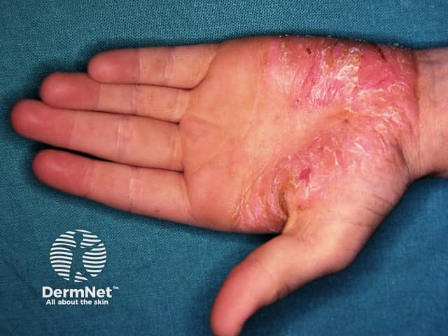
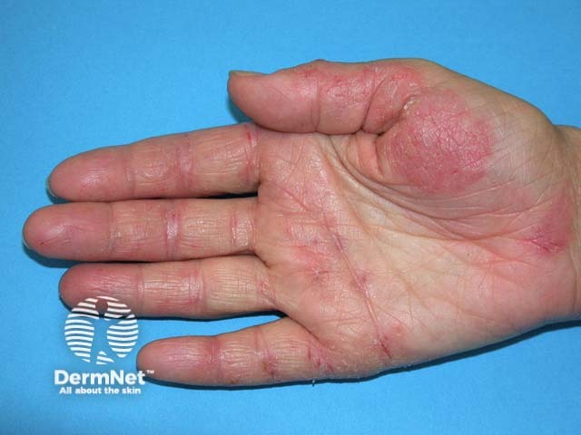
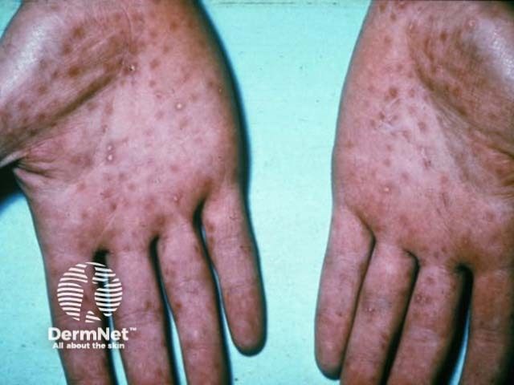
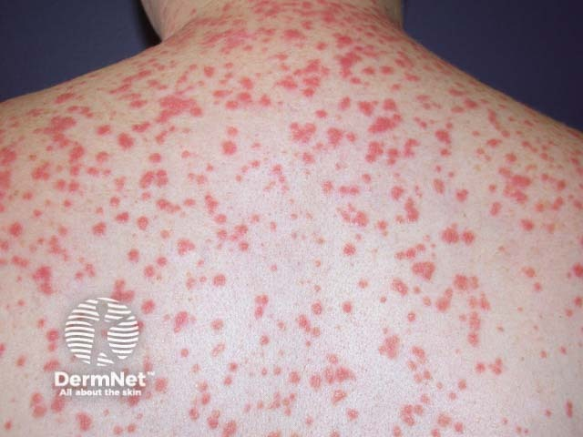
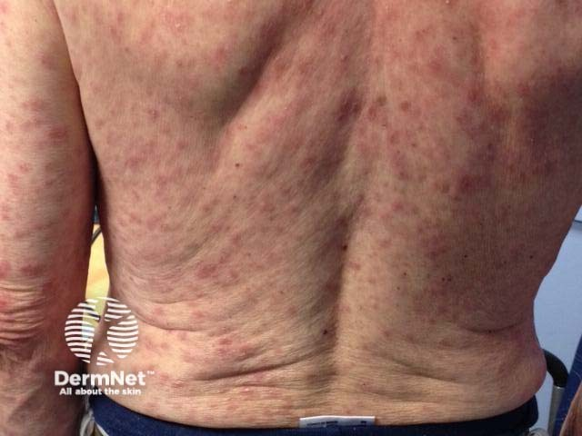

# Литературная виньетка 1. «Цитадель» А. Кронина: сыпь на ладонях

[← Крещение поворотом](https://julianekrasova.github.io/kreschenie-povorotom/#zhurnalnyy-klub)

Арчибальд Кронин (1896–1981) получил медицинское образование в Университете Глазго и работал врачом в шахтёрских посёлках Уэльса и в Лондоне, прежде чем оставить практику ради литературы. Роман «Цитадель» (1937) описывает путь врача Эндрью Мэнсона от земской практики к прибыльной лондонской. Приведённый эпизод относится к началу лондонской практики героя: благодарная пациентка в дальнейшем приводит к нему состоятельных клиентов.

## Фрагмент

> Было уже около девяти, и он собирался закрывать амбулаторию, когда вошла молодая женщина. Она неуверенно посмотрела на него:
>
> — Я не знала, куда идти — сюда или с парадного хода.
>
> — Это все равно, — кисло усмехнулся Эндрью. — Только те, кто приходят сюда, платят половину. Присядьте. В чем дело?
>
> — Я ничего не имею против того, чтобы уплатить полностью. — Она подошла с забавной серьезностью и села на стул. Это была женщина лет двадцати восьми (как мысленно определил Эндрью), в темнозеленом платье, топорная, с кривыми ногами и широким, некрасивым, серьезным лицом. При взгляде на нее являлась инстинктивная мысль: за этой никаких глупостей не водится!
>
> Эндрью сказал, смягчившись:
>
> — Не будем говорить о плате. Расскажите мне, на что вы жалуетесь.
>
> — Видите ли, доктор, — она, видимо, хотела все же сначала отрекомендоваться. — Мне посоветовала к вам обратиться миссис Смис — знаете, у которой закусочная. Мы с ней старые знакомые. Я служу у Лорье, совсем близко отсюда. Моя фамилия Крэмб. Должна вам сказать, что я побывала уже у очень многих докторов. — Она сняла перчатки. — Это из-за моих рук.
>
> Он посмотрел на ее руки, ладони которых были покрыты красноватой сыпью, похожей на псориаз. Но это был не псориаз, — края были не извилистые, а ровные. Неожиданно заинтересованный, Эндрью взял увеличительное стекло и стал внимательнее рассматривать ее ладонь. А женщина продолжала говорить серьезным, убеждающим тоном:
>
> — И сказать вам не могу, как это мне мешает в моей работе. Я бы Бог знает что дала, чтобы от этого избавиться. Каких только мазей я уже не перепробовала! Но ни одна ничуть мне не помогла.
>
> — Нет, и не могла помочь. — Он отложил лупу, испытывая удовольствие врача, который ставит трудный, но несомненный для него диагноз. — Это несколько необычное состояние кожи, мисс Крэмб. И бесполезно лечить его мазями. Причина тут — в вашей крови, и единственное средство от этого избавиться — соблюдать диету.
>
> — И никаких лекарств не надо? — Ее серьезное лицо выразило сомнение. — Ни один врач мне еще этого не говорил.
>
> — А я вам это говорю. — Он засмеялся и, вырвав листок из блокнота, записал ей подробно, какую диету ей следует соблюдать, какие блюда ей абсолютно запрещены.
>
> Она приняла бумажку как-то нерешительно.
>
> — Что ж... я, конечно, попробую, доктор. Я все, что угодно, готова испробовать.
>
> Она добросовестно расплатилась с ним, постояла, словно все еще мучимая сомнением, потом вышла. И Эндрью немедленно забыл о ней.
>
> Десять дней спустя она пришла снова, на этот раз с парадного хода, и вошла в кабинет с таким выражением плохо скрытого восторга, что Эндрью едва удержался от улыбки.
>
> — Хотите посмотреть мои руки, доктор?
>
> — Да. — Теперь он-таки улыбнулся. — Надеюсь, вы не жалеете, что соблюдали диету?
>
> — Жалею! — Она протянула к нему руки в страстном порыве благодарности. — Взгляните! Я совсем вылечилась. Ни единого пятнышка. Вы не знаете, как это для меня важно... я и выразить вам этого не могу... Какой вы ученый!
>
> — Полноте, полноте, — возразил Эндрью легким тоном. — Человеку моей профессии полагается знать эти вещи. Идите себе домой и не беспокойтесь больше. Только не ешьте той пищи, которую я вам запретил, и никогда у вас на руках больше не будет сыпи.
>
> Она поднялась.
>
> — А теперь позвольте вам уплатить, доктор.
>
> — Вы мне уже уплатили, — возразил он, испытывая легкое эстетическое удовольствие от созерцания собственного благородства. Он очень охотно принял бы от нее еще три с половиной или даже семь шиллингов, но искушение завершить это торжество своего искусства красивым жестом было непобедимо.

*Кронин А. Цитадель / пер. с англ. М. Абкиной. — СПб.: Азбука, 2017. Фрагмент приводится в учебных целях в объёме, необходимом для разбора (ст. 1274 ГК РФ).*

## Вопросы

1. Какие заболевания совместимы с картиной, описанной во фрагменте, и какие из них исключает признак, по которому герой отверг псориаз?
2. Какое заболевание из этого ряда имеет наибольшее значение для практики и на каком основании?
3. Чем может объясняться исчезновение сыпи через десять дней после назначения диеты?

Ответ на вопрос 1

Во фрагменте заболевание не названо: состояние обозначено как «несколько необычное состояние кожи», причина которого находится «в крови». Перечень запрещённых продуктов также не приводится: указано лишь, что диета была записана подробно. Разбор поэтому строится на признаках, которые текст сообщает.

#### Сведения, содержащиеся во фрагменте

| Параметр | Описание во фрагменте | Дифференциально-диагностическое значение |
|---|---|---|
| Пациентка | Женщина около 28 лет, служащая модного магазина | Возможен профессиональный контакт с тканями и красителями |
| Локализация | Ладони, по-видимому, обеих рук | Двустороннее поражение снижает вероятность дерматофитии кистей, при которой чаще поражается одна кисть |
| Морфология | Красноватая сыпь, сходная с псориазом | Псориазиформная морфология: псориаз, экзема кистей, сифилиды, дерматофития |
| Граница очагов | «Не извилистые, а ровные» края | Рассмотрено ниже |
| Течение | Многократные обращения, безуспешное местное лечение | Хроническое или рецидивирующее течение |
| Результат | Полное разрешение через 10 дней после назначения диеты | Совместимо с элиминацией пищевого фактора и с естественным течением ряда заболеваний |
| Не документированы | Зуд, шелушение, пузырьки, трещины, состояние тыла кистей, ногтей и стоп, высыпания на других участках, анамнез | Ограничивают ретроспективную интерпретацию |

#### Дифференциальный ряд

| Заболевание | Признаки, совместимые с описанием | Признаки, ослабляющие предположение | Значение диеты |
|---|---|---|---|
| Ладонный псориаз | Сходство отмечено самим героем; очаги эритемы с резкой границей | Неровный, полициклический контур сливающихся бляшек; разрешение за 10 дней нетипично | Эффект аглютеновой диеты описан у больных с серологическими признаками целиакии [6] |
| Экзема (дерматит) кистей, в том числе системный контактный дерматит | Хроническое течение, резистентность к местным средствам того времени, поражение ладоней; при нуммулярной форме — округлые очаги с ровным контуром | Отсутствие указаний на зуд и пузырьки | Пищевые аллергены и гаптены (в том числе никель) рассматриваются как фактор поддержания; элиминация может приводить к улучшению [2] |
| Вторичный сифилис (ладонные сифилиды) | Красновато-медные чётко очерченные псориазиформные очаги на обеих ладонях; «причина в крови» | Отсутствие сведений о других проявлениях вторичного периода | Отсутствует; высыпания вторичного периода разрешаются без лечения в течение нескольких недель [3] |
| Дерматофития кистей | Псориазиформное шелушение ладоней | Ровные края; вероятное двустороннее поражение | Отсутствует |
| Контактный дерматит от профессионального раздражителя | Работа в магазине тканей и одежды | Отсутствие сведений о смене условий труда | Отсутствует; разрешение следует за прекращением контакта |

Признак, по которому герой отверг псориаз, относится к контуру очага, а не к резкости его границы, и эти характеристики различаются. Псориатическая бляшка отграничена от здоровой кожи резко, однако контур сливающихся бляшек неровный, полициклический [1] (рисунок 1). Очаг нуммулярной экземы имеет округлую форму и ровный контур [2] (рисунок 2), тогда как граница обычной экземы кистей размыта. Извилистый (серпигинозный) контур характерен для дерматофитии и кольцевидных сифилидов. Ровный контур тем самым ослабляет предположение о дерматофитии, кольцевидных сифилидах и псориазе и совместим с нуммулярной экземой: признак, использованный героем, согласуется с описанием и сужает дифференциальный ряд в сторону экземы.

::: {.ryad}

:::

Ответ на вопрос 2

Из перечисленных заболеваний вторичный сифилис имеет наибольшее значение для практики: ладонные и подошвенные высыпания относятся к его классическим проявлениям, а самопроизвольное разрешение маскирует продолжающуюся инфекцию [3].

Сходство сифилидов с псориазом определяется не размером элементов, а их строением. Вторичный сифилис относится к папулосквамозным дерматозам, как и псориаз: элемент сыпи представляет собой воспалительную папулу, покрытую чешуйками, и на ладонях, где толстый роговой слой препятствует возвышению папулы, сифилид выглядит как плоское красно-медное шелушащееся пятно (рисунок 3). Мелкие изолированные сифилиды сходны с каплевидным псориазом, а при слиянии папул на ладонях образуются шелушащиеся бляшки, сходные с ладонным псориазом и экземой. В дерматологической литературе конца XIX века сифилис входил в обязательный дифференциальный ряд ладонных дерматозов наряду с экземой и псориазом; описаны медный оттенок сифилитического поражения ладоней и ненадёжность пробного лечения как диагностического теста [8].

Разграничение каплевидного псориаза и вторичного сифилиса проводится по нескольким признакам (рисунки 4 и 5). Элементы каплевидного псориаза имеют розово-красный цвет и серебристое шелушение по всей поверхности, располагаются преимущественно на туловище и проксимальных отделах конечностей и, как правило, не поражают ладони и подошвы; высыпанию нередко предшествует стрептококковая инфекция глотки [1]. Сифилиды имеют медно-красный оттенок, шелушение располагается венчиком по периферии элемента (воротничок Биетта), поражение ладоней и подошв типично и сочетается с другими проявлениями вторичного периода — поражением слизистых оболочек, генерализованной лимфаденопатией [3]. Сочетание высыпаний на туловище с поражением ладоней говорит в пользу сифилиса; псориазиформная сыпь на ладонях составляет показание к серологическому исследованию на сифилис независимо от предполагаемого диагноза.

Применённые к описанному случаю эти признаки сужают дифференциальный ряд до нуммулярной экземы. Высыпания ограничивались ладонями, тогда как каплевидный псориаз и вторичный сифилис, как правило, сопровождаются распространённой сыпью на туловище. Ровный, не извилистый контур очагов соответствует нуммулярной экземе и не соответствует полициклическому контуру псориатических бляшек. Исчезновение сыпи через десять дней после исключения продуктов совместимо с элиминацией пищевого фактора, поддерживающего экзему, и нетипично для псориаза. Остаточное значение сохраняет вторичный сифилис, высыпания которого разрешаются самостоятельно: без серологического исследования он остаётся не исключённым.

::: {.ryad}

:::

Ответ на вопрос 3

Действие романа относится к периоду, когда в практику входила элиминационная диета. А. Роу (Окленд, США) предложил её для диагностики и лечения пищевой аллергии в 1928 г. [4] и в 1931 г. описал стандартизированные варианты диет [5]. По его наблюдениям, субъективное улучшение через 5–10 дней указывает на правильно подобранную диету [5]; срок, указанный в романе, с этим совпадает. Метод Роу, однако, не заканчивался улучшением: после него продукты возвращались в рацион по одному-два каждые 4–5 дней с наблюдением за реакцией [5]. Только повторное появление симптомов после возврата продукта указывает на связь с ним. Во фрагменте этот этап отсутствует, и пациентке предписано пожизненно исключать продукты, связь которых с сыпью не проверена.

Исчезновение сыпи после назначения диеты допускает три объяснения: (1) элиминация пищевого фактора; (2) естественное течение заболевания, разрешающегося самостоятельно, — в первую очередь вторичного сифилиса [3]; (3) совпадение по времени с прекращением действия иного фактора, например контакта на работе. Различить их по единичному наблюдению без повторного введения продукта и без катамнеза невозможно. Заключение о действии диеты на основании одной лишь последовательности событий представляет собой ошибку *post hoc ergo propter hoc*.

Диагностическая уверенность во фрагменте

Диагноз сопровождается у героя «удовольствием врача, который ставит трудный, но несомненный для него диагноз», а прогноз сформулирован без оговорок: сыпи «никогда больше не будет». Ни одно из этих утверждений во фрагменте не проверено: исследования не выполнялись, повторное введение продуктов не проводилось, отдалённое наблюдение не предусмотрено. Пациентка после повторного визита из наблюдения выбывает. Эпизод тем самым воспроизводит устройство обратной связи в амбулаторной и выездной практике: благоприятный исход единичного случая воспринимается как подтверждение диагноза, тогда как сведения, способные его опровергнуть, к врачу не поступают.

## Источники

1. Engin B., Aşkın Ö., Tüzün Y. Palmoplantar psoriasis // Clinics in Dermatology. 2017. Vol. 35, № 1. P. 19–27.
2. Thyssen J.P., Schuttelaar M.L.A., Alfonso J.H. et al. Guidelines for diagnosis, prevention, and treatment of hand eczema // Contact Dermatitis. 2022. Vol. 86, № 5. P. 357–378.
3. Ghanem K.G., Ram S., Rice P.A. The modern epidemic of syphilis // New England Journal of Medicine. 2020. Vol. 382, № 9. P. 845–854.
4. Rowe A.H. Food allergy: its manifestations, diagnosis and treatment // JAMA. 1928. Vol. 91, № 21. P. 1623.
5. Rowe A.H. Elimination diets for diagnosis and treatment of food allergy // Journal of Allergy. 1931. doi:10.1016/S0021-8707(31)90024-5.
6. Bhatia B.K., Millsop J.W., Debbaneh M. et al. Diet and psoriasis, part II: celiac disease and role of a gluten-free diet // Journal of the American Academy of Dermatology. 2014. Vol. 71, № 2. P. 350–358.
7. Кронин А. Цитадель / пер. с англ. М. Абкиной. СПб.: Азбука, 2017.
8. Jamieson W.A. Eczema palmare and plantare // Transactions of the Medico-Chirurgical Society of Edinburgh. 1898. Vol. 17. P. 39–51.

## Источники иллюстраций

| Рисунок | Что изображено | Источник и лицензия |
|---|---|---|
| 1 | Ладонный псориаз | DermNet, [Palmoplantar psoriasis images](https://dermnetnz.org/topics/palmoplantar-psoriasis-images), CC BY-NC-ND 4.0 |
| 2 | Экзема (дерматит) кистей | DermNet, [Hand dermatitis images](https://dermnetnz.org/topics/hand-dermatitis-images), CC BY-NC-ND 4.0 |
| 3 | Вторичный сифилис, ладони | DermNet, [Syphilis images](https://dermnetnz.org/topics/syphilis-images), CC BY-NC-ND 4.0 |
| 4 | Каплевидный псориаз, спина | DermNet, [Guttate psoriasis images](https://dermnetnz.org/topics/guttate-psoriasis-images), CC BY-NC-ND 4.0 |
| 5 | Вторичный сифилис, спина | DermNet, [Syphilis images](https://dermnetnz.org/topics/syphilis-images), CC BY-NC-ND 4.0 |

---

Серия «Крещение поворотом» · Журнальный клуб · литературная виньетка 1 · версия 1.0 · 20 ноября 2026 · CC BY-NC-SA 4.0 (за исключением цитируемого фрагмента и иллюстраций, распространяемых на условиях лицензий их правообладателей)
