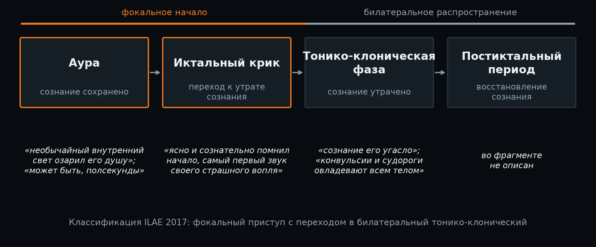

# Литературная виньетка 2. «Идиот» Ф.М. Достоевского: приступ на лестнице

[← Крещение поворотом](https://julianekrasova.github.io/kreschenie-povorotom/#zhurnalnyy-klub)

Ф.М. Достоевский (1821–1881) страдал эпилепсией; приступы документированы начиная с периода сибирской ссылки и описаны в его письмах и в воспоминаниях современников. Эпилепсией наделены несколько его персонажей — Кириллов («Бесы»), Смердяков («Братья Карамазовы») и князь Мышкин, герой романа «Идиот» (1868–1869). Описание приступа в приведённом фрагменте основано, таким образом, на самонаблюдении и с середины XX века рассматривается в неврологической литературе как клиническое свидетельство [2–4]. Во фрагменте Рогожин, подозревающий в князе соперника, поджидает его на лестнице гостиницы с ножом.

## Фрагмент

> Глаза Рогожина засверкали, и бешеная улыбка исказила его лицо. Правая рука его поднялась, и что-то блеснуло в ней; князь не думал ее останавливать. Он помнил только, что, кажется, крикнул:
>
> — Парфен, не верю!..
>
> Затем вдруг как бы что-то разверзлось пред ним: необычайный внутренний свет озарил его душу. Это мгновение продолжалось, может быть, полсекунды; но он, однако же, ясно и сознательно помнил начало, самый первый звук своего страшного вопля, который вырвался из груди его сам собой и который никакою силой он не мог бы остановить. Затем сознание его угасло мгновенно, и наступил полный мрак.
>
> С ним случился припадок эпилепсии, уже очень давно оставившей его. Известно, что припадки эпилепсии, собственно самая падучая, приходят мгновенно. В это мгновение вдруг чрезвычайно искажается лицо, особенно взгляд. Конвульсии и судороги овладевают всем телом и всеми чертами лица. Страшный, невообразимый и ни на что не похожий вопль вырывается из груди; в этом вопле вдруг исчезает как бы всё человеческое, и никак невозможно, по крайней мере очень трудно, наблюдателю вообразить и допустить, что это кричит этот же самый человек. Представляется даже, что кричит как бы кто-то другой, находящийся внутри этого человека. Многие, по крайней мере, изъясняли так свое впечатление, на многих же вид человека в падучей производит решительный и невыносимый ужас, имеющий в себе даже нечто мистическое. Надо предположить, что такое впечатление внезапного ужаса, сопряженного со всеми другими страшными впечатлениями той минуты, — вдруг оцепенили Рогожина на месте и тем спасли князя от неизбежного удара ножом, на него уже падавшего. Затем, еще не успев догадаться о припадке и увидев, что князь отшатнулся от него и вдруг упал навзничь, прямо вниз по лестнице, с размаху ударившись затылком о каменную ступень, Рогожин стремглав бросился вниз, обежал лежавшего и почти без памяти выбежал из гостиницы.
>
> От конвульсий, биения и судорог тело больного спустилось по ступенькам, которых было не более пятнадцати, до самого конца лестницы. Очень скоро, не более как минут через пять, заметили лежавшего, и собралась толпа. Целая лужица крови около головы вселяла недоумение: сам ли человек расшибся, или «был какой грех». Скоро, однако же, некоторые различили падучую; один из номерных признал в князе давешнего постояльца.

*Достоевский Ф.М. Идиот. Ч. 2, гл. 5 // Полное собрание сочинений: в 30 т. Л.: Наука, 1973. Т. 8. Произведение находится в общественном достоянии.*

## Вопросы

1. К какому типу относится описанный приступ по современной классификации и какие элементы текста определяют его начало?
2. Чем является «необычайный внутренний свет» и почему о нём известно только со слов больного?
3. Каков механизм вопля, который «вырвался из груди его сам собой» и который наблюдатель воспринимает как крик «кого-то другого»?
4. Какие задачи стоят перед бригадой скорой медицинской помощи, прибывшей к лежащему у подножия лестницы человеку с кровотечением из раны головы, если о предшествующих событиях известно только то, что знает толпа?

Ответ на вопрос 1

Описанный приступ соответствует фокальному приступу с переходом в билатеральный тонико-клонический (*focal to bilateral tonic-clonic seizure*) по классификации Международной противоэпилептической лиги (ILAE) 2017 г. [1]. Классификация ILAE определяет тип приступа по его началу: генерализованным считается приступ, который с первого момента вовлекает обе гемисферы, фокальным — приступ, начинающийся в сетях одной гемисферы. Распространение фокального приступа на обе гемисферы не делает его генерализованным.

Фокальное начало устанавливается по двум элементам текста. Первый — ощущение, предшествующее утрате сознания («необычайный внутренний свет озарил его душу»): субъективное ощущение при сохранном сознании представляет собой фокальный приступ с сохранённым сознанием, в традиционной терминологии — ауру. Второй — сохранная память о начале приступа: князь «ясно и сознательно помнил начало, самый первый звук своего страшного вопля». При генерализованном приступе сознание утрачивается с первого мгновения, и воспоминаний о начале не остаётся. Последовательность фаз и соответствующие им фрагменты текста приведены на рисунке 1 и в таблице.

| Фаза | Текст | Клинический термин |
|---|---|---|
| Фокальное начало | «Необычайный внутренний свет озарил его душу»; «может быть, полсекунды» | Фокальный приступ с сохранённым сознанием (аура) |
| Иктальный крик | «Самый первый звук своего страшного вопля, который вырвался из груди его сам собой» | Начало тонической фазы |
| Утрата сознания | «Сознание его угасло мгновенно, и наступил полный мрак» | Распространение на обе гемисферы |
| Тоническая фаза и падение | «Отшатнулся от него и вдруг упал навзничь» | Тоническое напряжение мышц туловища, падение без защитных реакций |
| Клоническая фаза | «Конвульсии и судороги овладевают всем телом и всеми чертами лица»; «от конвульсий, биения и судорог тело больного спустилось по ступенькам» | Билатеральные клонические судороги |
| Постиктальный период | Во фрагменте не описан | — |

Наблюдатель при таком приступе видит генерализованный тонико-клонический приступ: фокальное начало длится доли секунды и внешних проявлений может не иметь. Различие между фокальным и первично генерализованным приступом устанавливается поэтому со слов больного, а не со слов свидетеля, и составляет основание для разного выбора противоэпилептической терапии и для поиска структурного очага при нейровизуализации [1].

Во фрагменте указан и провоцирующий фактор: приступ возник у человека, эпилепсия которого «уже очень давно оставила его», в момент нападения с ножом. Эмоциональный стресс и предшествующее ему лишение сна относятся к наиболее частым провоцирующим факторам, которые называют сами больные эпилепсией.

Ответ на вопрос 2

«Необычайный внутренний свет» соответствует экстатической ауре — фокальному приступу, проявляющемуся ощущением блаженства, ясности сознания, единения с миром и уверенности в истинности переживаемого. В литературе такие приступы называют «эпилепсией Достоевского» [2, 5]. Сам писатель описывал это состояние современникам и наделил им Мышкина и Кириллова; в главе, из которой взят фрагмент, Мышкин рассуждает о том, что за такое мгновение можно отдать всю жизнь.

Т. Алажуанин, анализируя свидетельства о приступах писателя, отнёс экстатическую ауру к височной эпилепсии [2]. Последующие наблюдения, включая регистрацию приступов при стереоэлектроэнцефалографии и электрическую стимуляцию мозга, связывают экстатическую ауру с передним отделом островковой доли [5, 6]. Островковая кора интегрирует интероцептивные сигналы, то есть сведения о внутреннем состоянии организма, и, по гипотезе Ф. Пикар и А. Крэйга, участвует в формировании осознания собственного состояния; нарушение её работы во время приступа предложено в качестве объяснения переживания абсолютной ясности и уверенности [5, 6].

О субъективном содержании фокального приступа с сохранённым сознанием известно только со слов больного: внешних проявлений оно может не иметь, а электроэнцефалограмма с поверхности головы фокальный приступ, ограниченный глубинными структурами (в том числе островковой долей), часто не регистрирует. Поэтому сведения об ощущениях, предшествовавших утрате сознания, составляют обязательную часть анамнеза после приступа, если больной в состоянии их сообщить.

Ответ на вопрос 3

Иктальный крик возникает в начале тонической фазы. Тоническое сокращение диафрагмы и мышц грудной клетки и брюшной стенки происходит одновременно с сокращением мышц гортани, сужающих голосовую щель; воздух выталкивается из лёгких через суженную голосовую щель, что и производит звук. Крик не является выражением боли или страха и сознанием не управляется: слова «вырвался из груди его сам собой» и «никакою силой он не мог бы остановить» соответствуют этому механизму.

Звук, вызванный одновременным сокращением всех мышц выдоха и гортани без участия речевых зон коры, лишён интонации и артикуляции, свойственных голосу человека. Этим объясняется восприятие, описанное во фрагменте: наблюдателю «представляется даже, что кричит как бы кто-то другой». Продолжающееся тоническое сокращение дыхательных мышц прекращает вентиляцию на время тонической фазы, с чем связан цианоз в начале приступа.

Ответ на вопрос 4

Бригада, прибывшая к лежащему у подножия лестницы человеку, располагает сведениями толпы, а не читателя. Последовательность событий ей неизвестна, и её задача состоит в том, чтобы не принять первое объяснение за установленное. Во фрагменте толпа рассматривает два объяснения — падение («сам ли человек расшибся») и насилие («был какой грех»); признание «падучей» некоторыми из присутствующих добавляет третье. Для бригады они не исключают друг друга: приступ мог стать причиной падения, черепно-мозговая травма при падении или ударе — причиной приступа, а насилие — причиной травмы.

#### Оценка приступа

Ко времени, когда лежащего заметили, прошло около пяти минут. Генерализованный тонико-клонический приступ, продолжающийся 5 мин и более, а также повторные приступы без восстановления сознания между ними рассматриваются как эпилептический статус [7]: порог в 5 мин выбран потому, что спонтанное прекращение приступа после этого срока маловероятно. Длительность приступа до прибытия бригады определяется со слов свидетелей и, как правило, неизвестна точно. Определение глюкозы крови выполняется у любого больного с приступом и нарушенным сознанием.

Прикус языка поддерживает эпилептическую природу утраты сознания: латеральный прикус обладает высокой специфичностью и низкой чувствительностью [8], поэтому его отсутствие эпилептический приступ не исключает. Падение навзничь и тонико-клоническое сокращение мышц плечевого пояса составляют типичный механизм заднего вывиха плеча, который при осмотре после приступа пропускается часто.

#### Травма головы и шеи

Постиктальное нарушение сознания маскирует черепно-мозговую травму: снижение уровня сознания и спутанность нельзя отнести к приступу, пока не исключена травма. Наибольшее значение имеет динамика: постиктальная спутанность уменьшается в течение минут и часов, тогда как ухудшение уровня сознания по шкале комы Глазго, появление очаговой неврологической симптоматики или анизокории указывают на внутричерепное повреждение. Оценка по шкале Глазго повторяется в ходе всей транспортировки.

Механизм травмы во фрагменте относится к опасным: падение навзничь с удара затылком о каменную ступень и спуск по лестнице в 15 ступеней. Клинические правила отбора на компьютерную томографию при лёгкой травме головы и шейного отдела позвоночника относят к опасным механизмам падение с высоты более 1 м или с 5 ступеней [9, 10]. Сами правила к больному после приступа неприменимы: они разработаны для больных в ясном сознании, а больные, перенёсшие приступ до осмотра, исключались из исследования правила для травмы головы [9]. Отказ от компьютерной томографии на их основании у такого больного необоснован. Удар затылком создаёт условия для контузионных очагов в лобных и височных долях по механизму противоудара. Объём кровопотери из раны волосистой части головы, богато снабжённой сосудами, может быть значительным, однако о тяжести повреждения мозга по нему судить нельзя.

#### Подозрение на насилие

Предположение толпы о «грехе» составляет для бригады самостоятельный вопрос. Медицинская организация обязана информировать органы внутренних дел о пациентах, вред здоровью которых, по имеющимся основаниям, причинён противоправными действиями [11]; к этим основаниям относятся, в частности, повреждения, механизм которых не соответствует предполагаемому обстоятельству. Во фрагменте такие основания были: нападавший с ножом скрылся с места происшествия, о чём не знал никто из присутствующих.

#### Тактика

Сочетание приступа с травмой головы при опасном механизме падения составляет показание к госпитализации в стационар с возможностью компьютерной томографии и нейрохирургической помощи независимо от того, восстановилось ли сознание к моменту осмотра. Медикаментозная тактика при эпилептическом статусе в виньетке не рассматривается и определяется действующими Алгоритмами.

Достоверность описания

Описание приступа во фрагменте точно в том, что может знать больной (аура, память о начале крика, внезапная утрата сознания), и в том, что видит свидетель (крик, падение, судороги). Обе точки зрения совмещены в одном тексте, и это отличает его от большинства описаний приступов, составленных врачами, которым доступна только вторая.

Принадлежность приступов самого Достоевского к фокальной эпилепсии оспаривалась. А. Гасто в 1978 г. отнёс их к первично генерализованной эпилепсии, а экстатическую ауру считал литературным вымыслом [3]; позднее он пересмотрел эту оценку в пользу височной эпилепсии с экстатической аурой [12]. Экстатические приступы, впоследствии зарегистрированные при видеоэлектроэнцефалографическом мониторинге [5, 6], подтвердили существование феномена, описанного во фрагменте, но не диагноз писателя: ретроспективный диагноз по литературному тексту остаётся гипотезой.

## Источники

1. Fisher R.S., Cross J.H., French J.A. et al. Operational classification of seizure types by the International League Against Epilepsy: Position Paper of the ILAE Commission for Classification and Terminology // Epilepsia. 2017. Vol. 58, № 4. P. 522–530.
2. Alajouanine T. Dostoiewski's epilepsy // Brain. 1963. Vol. 86, № 2. P. 209–218.
3. Gastaut H. Fyodor Mikhailovitch Dostoevsky's involuntary contribution to the symptomatology and prognosis of epilepsy // Epilepsia. 1978. Vol. 19, № 2. P. 186–201.
4. Достоевский Ф.М. Идиот // Полное собрание сочинений: в 30 т. Л.: Наука, 1973. Т. 8.
5. Picard F., Craig A.D. Ecstatic epileptic seizures: a potential window on the neural basis for human self-awareness // Epilepsy & Behavior. 2009. Vol. 16, № 3. P. 539–546.
6. Gschwind M., Picard F. Ecstatic epileptic seizures: a glimpse into the multiple roles of the insula // Frontiers in Behavioral Neuroscience. 2016. Vol. 10. Art. 21.
7. Trinka E., Cock H., Hesdorffer D. et al. A definition and classification of status epilepticus — Report of the ILAE Task Force on Classification of Status Epilepticus // Epilepsia. 2015. Vol. 56, № 10. P. 1515–1523.
8. Benbadis S.R., Wolgamuth B.R., Goren H. et al. Value of tongue biting in the diagnosis of seizures // Archives of Internal Medicine. 1995. Vol. 155, № 21. P. 2346–2349.
9. Stiell I.G., Wells G.A., Vandemheen K. et al. The Canadian CT Head Rule for patients with minor head injury // Lancet. 2001. Vol. 357, № 9266. P. 1391–1396.
10. Stiell I.G., Wells G.A., Vandemheen K.L. et al. The Canadian C-spine rule for radiography in alert and stable trauma patients // JAMA. 2001. Vol. 286, № 15. P. 1841–1848.
11. Приказ Минздравсоцразвития России от 17.05.2012 № 565н «Об утверждении Порядка информирования медицинскими организациями органов внутренних дел о поступлении пациентов, в отношении которых имеются достаточные основания полагать, что вред их здоровью причинён в результате противоправных действий».
12. Gastaut H. New comments on the epilepsy of Fyodor Dostoevsky // Epilepsia. 1984. Vol. 25, № 4. P. 408–411.

---

Серия «Крещение поворотом» · Журнальный клуб · литературная виньетка 2 · версия 1.0 · 20 ноября 2026 · CC BY-NC-SA 4.0
