

  
Манипуляции

  
Периферический венозный доступ

  
Выбор вены и устройства, техника постановки катетера и иглы-бабочки, механизмы неудач и последовательность действий при трудном венозном доступе на догоспитальном этапе

  

  
Учебный материал для фельдшеров и врачей скорой медицинской помощи. Анатомия поверхностных вен, устройство и пропускная способность периферических катетеров, этапы введения, хват иглы и натяжение кожи, причины сквозного прокола и «ускользания» вены, предикторы трудного доступа, способы улучшить наполнение вен, ограничение числа попыток и альтернативы по приказу ДЗМ Москвы № 535.

  
Серия «Крещение поворотом» · версия 1.0 · 11 октября 2026 · CC BY-NC-SA 4.0

Катетеризация периферической вены — самая частая инвазивная манипуляция скорой медицинской помощи и одна из наиболее зависимых от навыка. В проспективном исследовании 762 догоспитальных венепункций первая попытка оказалась неудачной в 22 % случаев, а в 13 % установка катетера заняла более двух минут (Prottengeier et al., *European Journal of Emergency Medicine*, 2016). Неудача стоит времени, боли и вен, которые понадобятся пациенту позже. Материал построен вокруг того, что повышает долю успешных первых попыток: выбора места, подготовки вены, правильного хвата и последовательности движений иглой.

# Анатомия поверхностных вен верхней конечности

Поверхностные вены верхней конечности лежат в подкожной клетчатке над собственной фасцией и формируют два основных ствола (рис. 1).

| Вена | Ход | Особенности для пункции |
|---|---|---|
| Тыльная венозная сеть кисти, пястные вены | Тыл кисти | Видны у большинства пациентов; тонкие, подвижные, болезненны при пункции; удобны при истощении и у пожилых |
| Латеральная подкожная вена руки (v. cephalica) | От лучевого края тыла кисти по латеральному краю предплечья и плеча | Крупная и прямая на предплечье; на запястье рядом проходит поверхностная ветвь лучевого нерва |
| Медиальная подкожная вена руки (v. basilica) | По медиальному краю предплечья, в нижней трети плеча уходит под фасцию | Часто видна, но подвижна; рядом в локтевой ямке — плечевая артерия и срединный нерв |
| Промежуточная вена локтя (v. mediana cubiti) | Косо соединяет латеральную и медиальную вены в локтевой ямке | Крупная и хорошо фиксированная; катетер в сгибе перегибается при сгибании руки |
| Промежуточная вена предплечья (v. mediana antebrachii) | По передней поверхности предплечья | Непостоянна; при наличии — удобное место для катетера |

<figure>
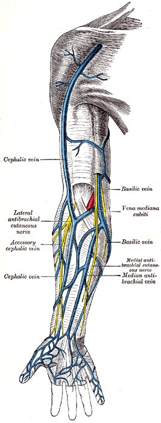
<figcaption>Рис. 1. Поверхностные вены передней поверхности предплечья и локтевой ямки: латеральная (cephalic) и медиальная (basilic) подкожные вены, промежуточная вена локтя и промежуточная вена предплечья; показаны также кожные нервы, проходящие рядом с венами. Иллюстрация H. V. Carter из «Анатомии» Грея (1918), рис. 574; общественное достояние.</figcaption>
</figure>

Выбор места определяется задачей и состоянием вен. Стандарты Infusion Nurses Society (INS) рекомендуют для периферического катетера вены предплечья, поскольку там катетер не перегибается при движениях и реже смещается; сгибательные поверхности суставов используются при отсутствии альтернативы или при необходимости быстрого крупного доступа (Gorski et al., *Journal of Infusion Nursing*, 2021). Избегают латеральной поверхности запястья на протяжении 10–12 см и его ладонной поверхности из-за риска повреждения поверхностной ветви лучевого нерва и боли, конечности на стороне мастэктомии с удалением подмышечных лимфоузлов, сосудистого доступа для гемодиализа, области воспаления, ран и предшествующих неудачных пункций, а также вен нижних конечностей у взрослых, где выше риск тромбофлебита и тромбоза. Каждая следующая попытка выполняется проксимальнее предыдущей: дистальнее места прокола введённый раствор выходит через отверстие в стенке вены.

# Устройства для венозного доступа

## Периферический венозный катетер

Периферический катетер — тонкостенная пластиковая трубка, надетая на металлическую иглу-проводник (рис. 2). Кончик катетера отстоит от кончика иглы на 1–2 мм; этим определяется ключевой приём техники введения, рассмотренный ниже. Камера на павильоне иглы заполняется кровью при попадании кончика иглы в просвет вены. Порт для инъекций позволяет вводить препараты болюсно без отсоединения инфузионной системы.

<figure class="fragment">
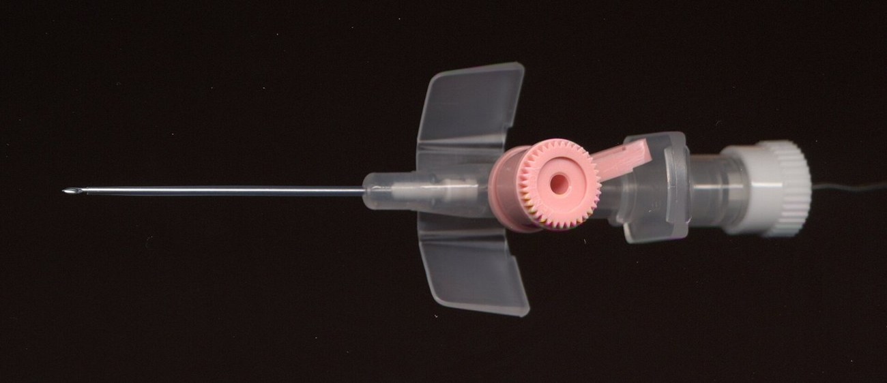
<figcaption>Рис. 2. Периферический венозный катетер 20G (1,0 × 32 мм) в разобранном виде: игла-проводник с прозрачной камерой обратного тока, катетер с крыльями для фиксации и портом для инъекций, защитный колпачок и заглушка. Фото: Fifo, Wikimedia Commons, CC BY-SA 2.5.</figcaption>
</figure>

Калибр обозначается в единицах Gauge (G): чем больше число, тем тоньше катетер. Цвет павильона стандартизован и одинаков у разных производителей (рис. 3).

<figure class="fragment">
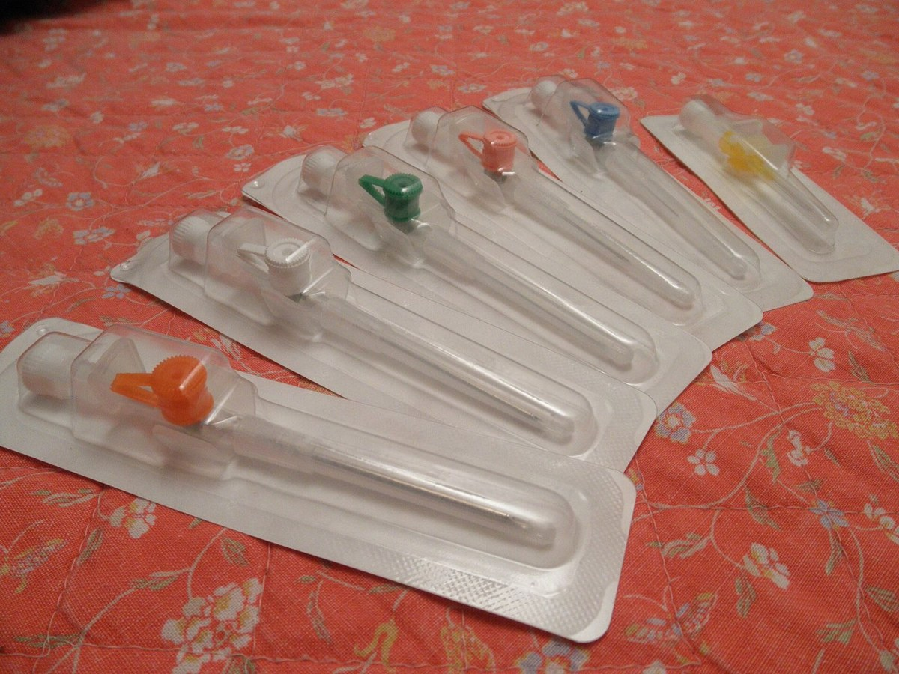
<figcaption>Рис. 3. Цветовая маркировка периферических катетеров, слева направо: 14G — оранжевый, 16G — серый, 18G — зелёный, 20G — розовый, 22G — синий, 24G — жёлтый. Фото: MERRF, Wikimedia Commons, CC0.</figcaption>
</figure>

Пропускная способность катетера по закону Пуазейля пропорциональна четвёртой степени радиуса и обратно пропорциональна длине. Уменьшение внутреннего диаметра вдвое снижает поток в 16 раз; поэтому при необходимости быстрой инфузии значение имеет каждый шаг калибра, а короткий катетер при равном диаметре пропускает больше длинного (рис. 4).

<figure>
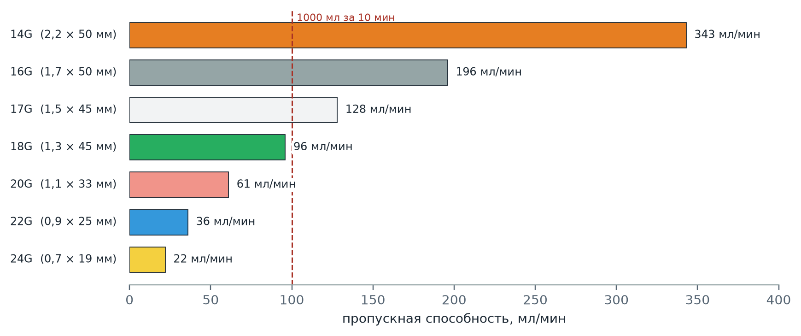
<figcaption>Рис. 4. Пропускная способность периферических катетеров по данным изготовителя (B. Braun, Vasofix Safety). Пунктир — скорость, необходимая для введения 1000 мл за 10 минут: при гравитационной инфузии через катетеры 20G и тоньше она недостижима, через 18G — близка к предельной, через 16–14G — достижима.</figcaption>
</figure>

Выбор калибра определяется задачей. Для болюсного введения препаратов и медленных инфузий достаточно 20–22G; для инфузионной терапии гиповолемического шока и при кровопотере — 18G и крупнее; у пожилых с хрупкими венами и при тонких венах кисти катетер 22–24G устанавливается с большей вероятностью успеха, чем крупный. В многофакторном анализе 602 догоспитальных венепункций с успехом первой попытки независимо ассоциировался только калибр катетера: более крупные катетеры чаще ставились с первой попытки (Frisch et al., *Prehospital Emergency Care*, 2013), что, вероятнее всего, отражает выбор крупного катетера для хорошо видимых вен.

## Игла-бабочка

Игла-бабочка (инфузионная игла с крыльями, scalp-vein set) — короткая стальная игла 19–27G с пластиковыми крыльями и гибкой трубкой (рис. 5). Короткая игла и крылья, позволяющие держать её у самой кожи, облегчают пункцию тонких и поверхностных вен, в том числе вен кисти у истощённых и пожилых пациентов.

<figure>
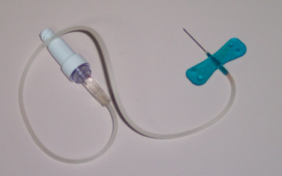
<figcaption>Рис. 5. Игла-бабочка: стальная игла, пластиковые крылья, удлинительная трубка с коннектором. Wikimedia Commons, общественное достояние.</figcaption>
</figure>

Ограничение иглы-бабочки — стальная игла в просвете вены. При движении конечности её кончик прокалывает стенку, и раствор выходит в ткани. Стандарты INS ограничивают применение стальных игл однократным введением препарата и забором крови и не рекомендуют оставлять их для инфузий (Gorski et al., 2021). На догоспитальном этапе игла-бабочка подходит для болюсного введения из шприца, когда катетер установить не удаётся; при транспортировке, длительной инфузии и введении раздражающих растворов — например, амиодарона — предпочтителен катетер.

# Подготовка к пункции

## Наполнение вены

Вена, которая не видна и не пальпируется, — главный предиктор неудачи. В исследовании Prottengeier et al. независимыми предикторами неудачной первой попытки на догоспитальном этапе были невидимость вены без жгута, отсутствие её пальпации со жгутом и недостаточное освещение. Шкала A-DIVA (van Loon et al., *Medicine*, 2016) прогнозирует трудный доступ у взрослых по видимости и пальпируемости вены, указаниям на трудный доступ в анамнезе и малому диаметру вены. Отсюда следуют приёмы подготовки, каждый из которых воздействует на один из этих факторов.

| Приём | Механизм и данные |
|---|---|
| Освещение | Недостаточное освещение — независимый предиктор неудачи на догоспитальном этапе; на лестничной клетке и в машине используется фонарь, направленный сбоку, при котором вена отбрасывает тень и становится заметнее |
| Положение конечности | Рука ниже уровня сердца наполняет вены за счёт гидростатического давления |
| Согревание | Активное согревание кисти и предплечья в течение 10–15 минут повысило долю успешных первых попыток с 72 до 94 % и сократило время катетеризации с 62 до 36 секунд (Lenhardt et al., *BMJ*, 2002); на догоспитальном этапе применяются грелка, тёплая вода, согревающий пакет |
| Жгут | Накладывается на 7–10 см выше места пункции с давлением, перекрывающим венозный, но не артериальный кровоток: пульс на лучевой артерии сохраняется; манжета тонометра, раздутая до 40–60 мм рт. ст., создаёт дозированное давление |
| Работа кулаком | Сжатие кулака улучшает наполнение вен, но при заборе крови вызывает ложное повышение калия на 1–2 ммоль/л (Don et al., *New England Journal of Medicine*, 1990) |
| Похлопывание по вене | Широко применяется; доказательств эффективности нет, вызывает боль и спазм |

У пожилых пациентов с тонкой кожей и хрупкими венами тугой жгут повышает давление в вене, и при проколе её стенка разрывается с образованием гематомы. В этих случаях жгут затягивается слабо или не применяется, а вена фиксируется натяжением кожи.

## Устойчивость рук

Физиологический тремор усиливается при стрессе и выбросе катехоламинов и передаётся на кончик иглы. Его вклад уменьшают устойчивая поза исполнителя (сидя или с упором, рука пациента на уровне рук исполнителя) и опора кисти: мизинец и локтевой край кисти, держащей катетер, опираются на предплечье пациента, так что игла движется за счёт пальцев, а не всей руки. Подготовка всего необходимого до наложения жгута — пластыря, заглушки, шприца с раствором для промывания — снимает спешку после попадания в вену.

# Техника постановки периферического катетера

## Последовательность действий

Ниже приведена последовательность, общая для большинства руководств (Gorski et al., 2021); она соответствует иллюстрации 1963 года, на которой показаны основные элементы венепункции (рис. 6).

<figure class="fragment">
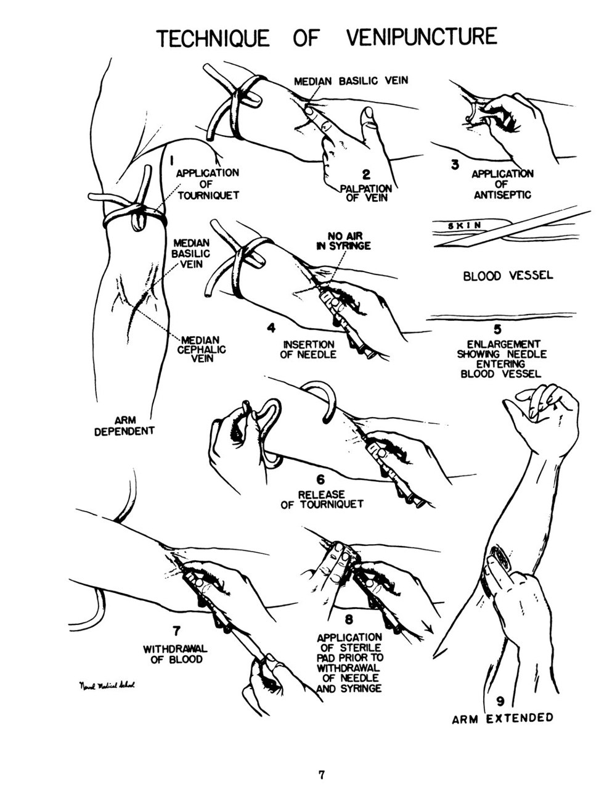
<figcaption>Рис. 6. Техника венепункции в учебном пособии Военно-морской медицинской школы США (1963): наложение жгута, выбор и пальпация вены, фиксация вены натяжением кожи большим пальцем, введение иглы срезом вверх под острым углом, ослабление жгута. Naval Medical School (U.S.), Serology, 1963; общественное достояние.</figcaption>
</figure>

1. **Выбор вены.** Вена выбирается при наложенном жгуте осмотром и пальпацией: пригодная вена упругая, прямая на протяжении длины катетера, не узловатая и не уплотнённая. Пальпация надёжнее осмотра: видимая, но тромбированная вена ощущается как плотный тяж.
2. **Обработка кожи.** Кожа обрабатывается антисептиком и высыхает; после обработки место пункции повторно не пальпируется.
3. **Хват катетера.** Катетер держат большим и средним пальцами за павильон иглы или за крылья, указательный палец лежит на упоре для продвижения катетера; срез иглы обращён вверх.
4. **Натяжение кожи.** Большой палец второй руки натягивает кожу на 3–5 см дистальнее места пункции в направлении от иглы. Натяжение фиксирует вену и не даёт ей сместиться при проколе; без него подвижные вены пожилых «уходят» от иглы.
5. **Прокол.** Кожа прокалывается под углом 15–30° к ней, над веной или сбоку от неё, затем игла направляется в вену (рис. 7, этап 1). Для поверхностных вен кисти угол меньше, для глубже лежащих вен предплечья — больше.
6. **Обратный ток крови.** Появление крови в камере означает, что в вене находится кончик иглы, но ещё не кончик катетера. В этот момент угол уменьшается до 5–10°, и вся система продвигается вдоль вены ещё на 1–2 мм (рис. 7, этап 2).
7. **Продвижение катетера.** Игла удерживается неподвижно, а катетер сдвигается с неё указательным пальцем в вену на всю длину (рис. 7, этап 3; рис. 8).
8. **Снятие жгута и извлечение иглы.** Жгут снимается до извлечения иглы. Вена пережимается пальцем выше кончика катетера, игла извлекается, на катетер надевается заглушка или подсоединяется система (рис. 9).
9. **Проверка и фиксация.** Катетер промывается изотоническим раствором: свободное введение без припухлости и боли подтверждает положение в вене. Катетер фиксируется прозрачной повязкой или пластырем так, чтобы место пункции оставалось видимым (рис. 10).

<figure>
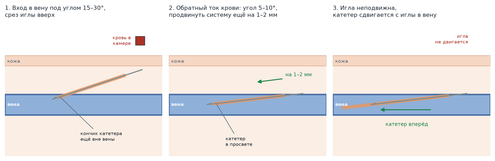
<figcaption>Рис. 7. Этапы введения периферического катетера. 1 — игла входит в вену под углом 15–30°; кровь в камере появляется, когда в просвете находится кончик иглы, но кончик катетера, отстоящий от него на 1–2 мм, ещё вне вены. 2 — угол уменьшается до 5–10°, система продвигается ещё на 1–2 мм, и в просвет входит кончик катетера. 3 — игла удерживается неподвижно, катетер сдвигается с неё в вену. Собственная схема.</figcaption>
</figure>

<figure class="fragment">
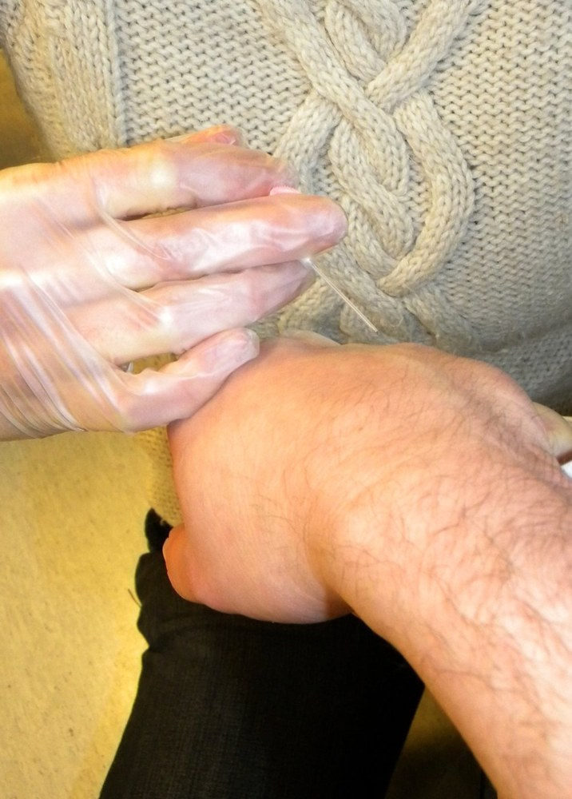
<figcaption>Рис. 8. Введение периферического катетера в вену тыла кисти в учебной ситуации на догоспитальном этапе: катетер удерживается за павильон, угол к коже острый. Фото: Pöllö, Wikimedia Commons, CC BY 3.0.</figcaption>
</figure>

<figure class="fragment">
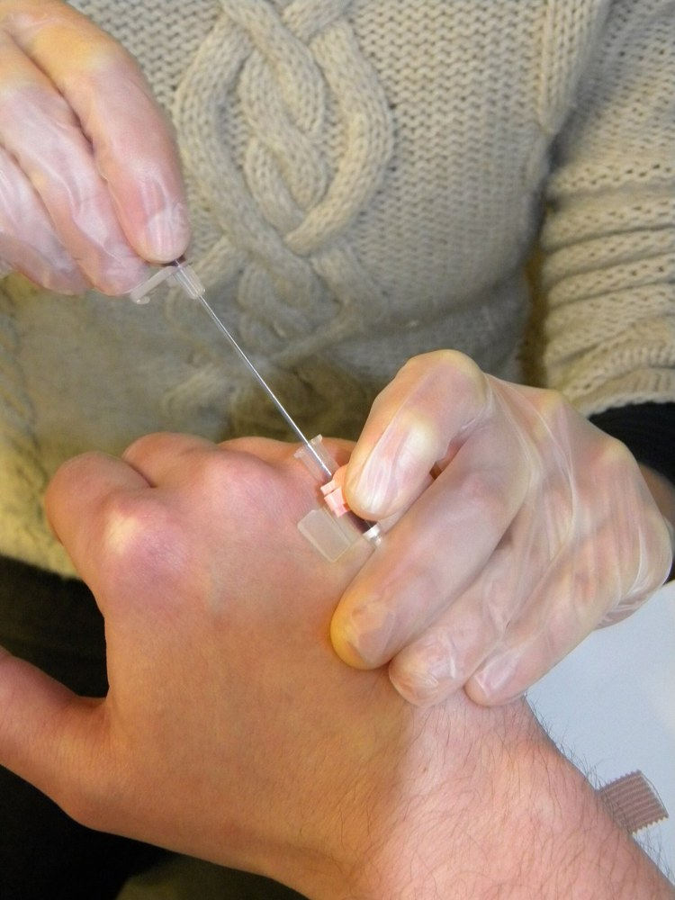
<figcaption>Рис. 9. Извлечение иглы-проводника: один палец фиксирует катетер, другой пережимает вену выше его кончика, чтобы кровь не вытекала через павильон. Фото: Pöllö, Wikimedia Commons, CC BY 3.0.</figcaption>
</figure>

<figure class="fragment">
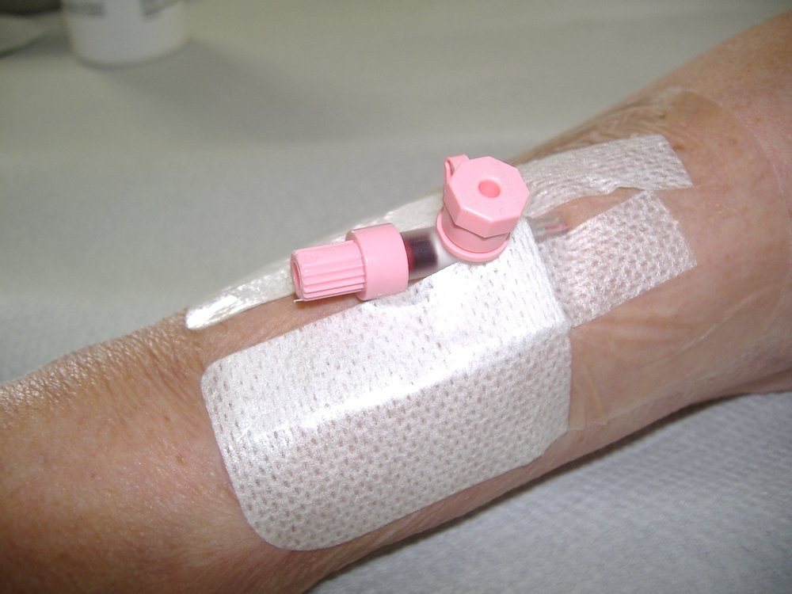
<figcaption>Рис. 10. Периферический катетер, установленный и фиксированный на тыле кисти. Фото: HoRaMi, Wikimedia Commons, CC BY-SA 3.0.</figcaption>
</figure>

## Техника постановки иглы-бабочки

Крылья складываются вверх и зажимаются большим и указательным пальцами; срез иглы обращён вверх. Кожа натягивается так же, как при постановке катетера. Игла вводится под углом 10–15° — меньшим, чем катетер, поскольку игла короткая, а вены, для которых её выбирают, поверхностные (рис. 11). После появления крови в трубке игла продвигается вдоль вены ещё на 2–3 мм почти параллельно коже, крылья опускаются на кожу и фиксируются пластырем. Препарат вводится медленно; появление припухлости или боли в месте пункции означает выход иглы из вены.

<figure>
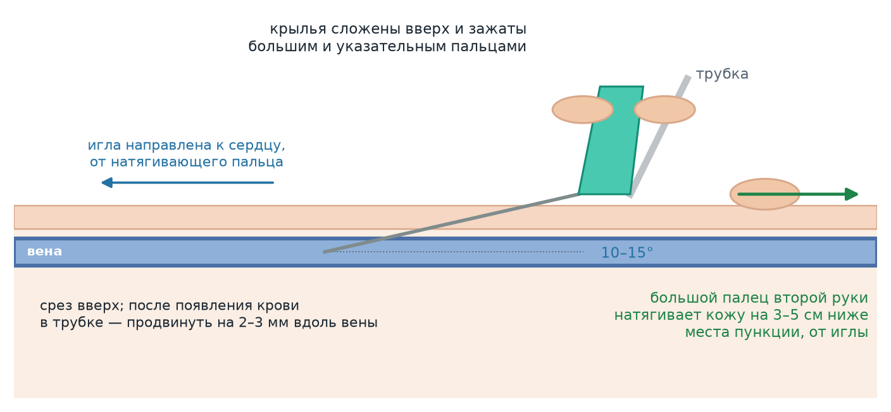
<figcaption>Рис. 11. Введение иглы-бабочки: крылья сложены вверх и зажаты большим и указательным пальцами, игла срезом вверх входит под углом 10–15°, большой палец второй руки натягивает кожу ниже места пункции — со стороны павильона, в направлении от иглы, так что игла смотрит от пальца к сердцу. Собственная схема.</figcaption>
</figure>

# Механизмы неудачи

Большинство неудачных попыток объясняется одним из трёх механизмов (рис. 12).

<figure>
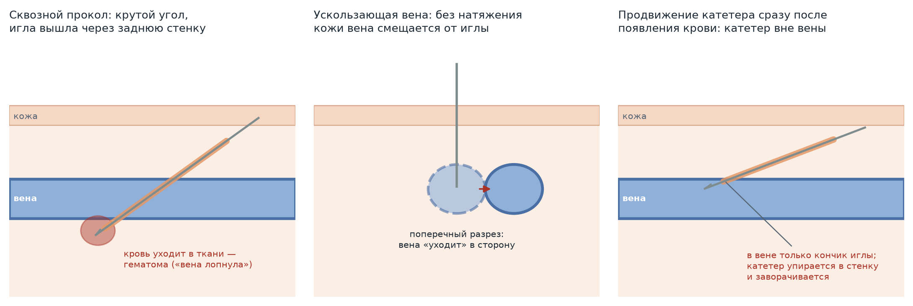
<figcaption>Рис. 12. Механизмы неудачной попытки. Слева — сквозной прокол: при крутом угле игла проходит через переднюю и заднюю стенки вены, кровь выходит в ткани. В центре — смещение вены: без натяжения кожи подвижная вена отклоняется от иглы. Справа — катетер продвигается сразу после появления крови, когда в вене находится только кончик иглы: катетер упирается в стенку и не входит в просвет. Собственная схема.</figcaption>
</figure>

| Признак | Механизм | Как предотвратить |
|---|---|---|
| Кровь в камере появилась и исчезла; быстро нарастает гематома | Сквозной прокол задней стенки при крутом угле или при продвижении иглы после появления крови без уменьшения угла | Угол 15–30° при проколе, после появления крови — уменьшение угла и продвижение не более чем на 1–2 мм |
| Гематома в момент прокола у пожилого пациента («вена лопнула») | Разрыв хрупкой стенки при высоком давлении в вене от тугого жгута | Слабый жгут или его отсутствие, катетер меньшего калибра, малый угол |
| Игла «проскальзывает» мимо видимой вены | Смещение подвижной вены | Натяжение кожи большим пальцем дистальнее места пункции, пункция у места слияния вен, где вена фиксирована |
| Кровь в камере есть, катетер не продвигается | В просвете только кончик иглы; катетер упирается в стенку | Уменьшение угла и продвижение системы на 1–2 мм до сдвигания катетера |
| Кровь в камере есть, при продвижении катетер собирается «гармошкой» | Повреждение кончика катетера или его продвижение против клапана | Новый катетер; пункция выше или ниже клапана, который виден как утолщение по ходу вены |
| При промывании — припухлость и боль | Кончик катетера вне вены | Удаление катетера, прижатие места пункции, новая попытка проксимальнее |

Повторное введение иглы-проводника в уже частично сдвинутый с неё катетер недопустимо: игла может прорезать стенку катетера, и его фрагмент уходит в кровоток.

# Трудный венозный доступ

## Ограничение числа попыток

Стандарты INS ограничивают число попыток установки периферического катетера двумя для одного исполнителя и четырьмя суммарно (Gorski et al., 2021). Каждая следующая попытка выполняется новым катетером. Неудачные попытки причиняют боль, расходуют вены, задерживают лечение и повышают частоту осложнений; после двух неудач попытку передают более опытному члену бригады или переходят к альтернативному пути введения.

## Последовательность действий на догоспитальном этапе

<figure>
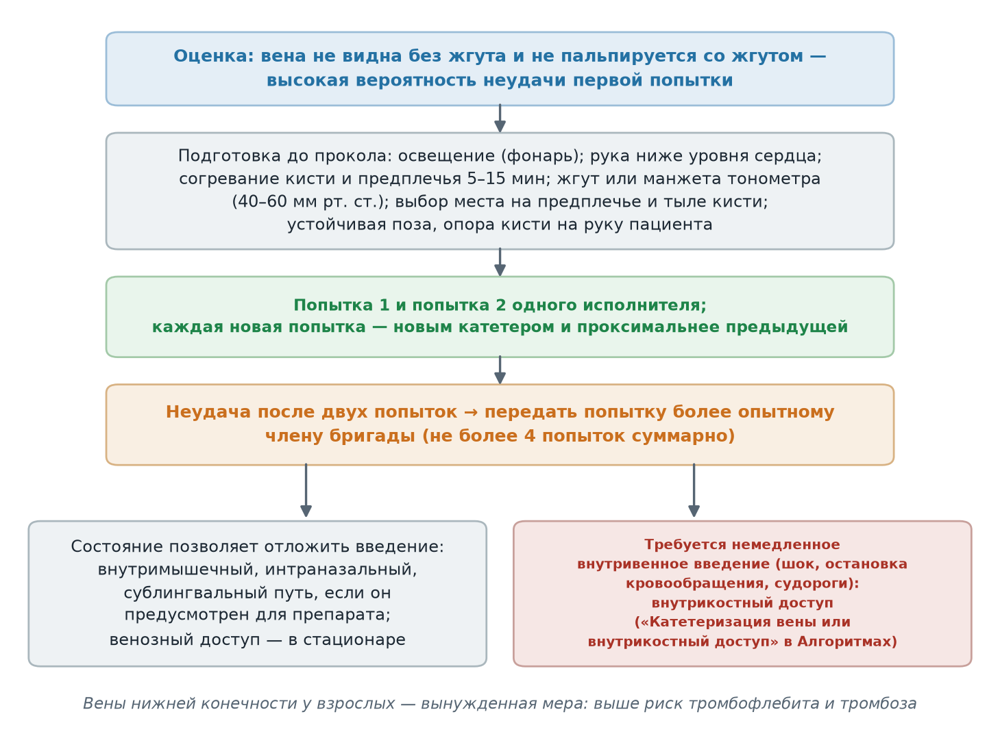
<figcaption>Рис. 13. Последовательность действий при трудном венозном доступе на догоспитальном этапе. Собственная схема по стандартам INS (Gorski et al., 2021) и приказу ДЗМ Москвы № 535.</figcaption>
</figure>

Альтернативы выбираются по срочности введения. Если состояние позволяет, препарат вводится внутримышечно, интраназально или сублингвально, когда такой путь для него предусмотрен, а венозный доступ устанавливается в стационаре. Если требуется немедленное внутривенное введение — при шоке, остановке кровообращения, судорожном статусе, — Алгоритмы ДЗМ в разделах, предусматривающих внутривенное введение при неотложных состояниях, используют формулировку «катетеризация вены или внутрикостный доступ»: внутрикостный доступ является предусмотренной альтернативой, а не отступлением от протокола. Наружная яремная вена — крупная поверхностная вена, пригодная для катетеризации у взрослых; она хорошо видна при положении пациента с опущенным головным концом. Вены нижней конечности у взрослых используются как вынужденная мера.

## Выбор способа введения при плохих венах

Для препаратов, вводимых медленно, способ введения влияет на вероятность успеха не меньше, чем выбор вены. Гравитационная инфузия через тонкую иглу ограничена её сопротивлением и не позволяет выдержать заданное время; введение из шприца или через шприцевой дозатор не зависит от пропускной способности иглы. Расчёт для пропафенона приведён в материале серии «Пропафенон». Раздражающие растворы, такие как амиодарон, вызывают флебит у значительной части пациентов при введении в мелкие периферические вены (материал «Амиодарон»), и при плохих венах их введение через иглу-бабочку сопряжено с дополнительным риском.

# Осложнения

| Осложнение | Проявления | Действия |
|---|---|---|
| Гематома | Припухлость и синюшность в месте пункции | Удаление иглы или катетера, прижатие на 2–3 минуты, конечность приподнята |
| Инфильтрация и экстравазация | Припухлость, бледность, боль, похолодание кожи при инфузии | Прекращение инфузии, удаление катетера; при экстравазации раздражающего препарата — отметка в карте вызова и передача в стационар |
| Флебит | Боль, гиперемия и уплотнение по ходу вены, чаще через часы и дни | Удаление катетера; на догоспитальном этапе значение имеет выбор вены и препарата |
| Пункция артерии | Алая пульсирующая кровь в камере | Удаление иглы, прижатие не менее 5 минут |
| Повреждение нерва | Простреливающая боль или парестезии по ходу нерва в момент пункции | Немедленное удаление иглы; документирование |

Повреждение нервов при венепункции наиболее вероятно на латеральной поверхности запястья (поверхностная ветвь лучевого нерва) и в локтевой ямке (срединный нерв и медиальный кожный нерв предплечья), где нервы проходят рядом с венами (Gorski et al., 2021). Внезапная простреливающая боль в момент прокола — показание к немедленному извлечению иглы, а не к её перенаправлению.

Доля периферических катетеров, удаляемых до окончания лечения из-за осложнений или нарушения функции, по данным обзора Helm et al. (*Journal of Infusion Nursing*, 2015), составляет 35–50 %. Тщательная фиксация катетера перед транспортировкой уменьшает вероятность его смещения при перекладывании пациента.

# Источники

- Gorski L.A., Hadaway L., Hagle M.E. et al. Infusion Therapy Standards of Practice, 8th Edition. *Journal of Infusion Nursing*, 2021; 44(1S): S1–S224 — выбор вены, ограничение числа попыток, применение стальных игл, повреждение нервов.
- Prottengeier J., Albermann M., Heinrich S., Birkholz T., Gall C., Schmidt J. The prehospital intravenous access assessment: a prospective study on intravenous access failure and access delay in prehospital emergency medicine. *European Journal of Emergency Medicine*, 2016; 23(6): 442–447 — 762 венепункции; неудача первой попытки 22 %; предикторы: видимость, пальпируемость, освещение.
- Frisch A., Cammarata S., Mosesso V.N., Martin-Gill C. Multivariate analysis of successful intravenous line placement in the prehospital setting. *Prehospital Emergency Care*, 2013; 17(1): 46–50 — 602 случая; успех первой попытки 77,9 %; связь с калибром катетера.
- van Loon F.H.J., Puijn L.A.P.M., Houterman S., Bouwman A.R.A. Development of the A-DIVA scale: a clinical predictive scale to identify difficult intravenous access in adult patients based on clinical observations. *Medicine (Baltimore)*, 2016; 95(16): e3428.
- Lenhardt R., Seybold T., Kimberger O. et al. Local warming and insertion of peripheral venous cannulas: single blinded prospective randomised controlled trial and single blinded randomised crossover trial. *BMJ*, 2002; 325(7361): 409–412 — успех первой попытки 94 % против 72 %.
- Don B.R., Sebastian A., Cheitlin M. et al. Pseudohyperkalemia caused by fist clenching during phlebotomy. *New England Journal of Medicine*, 1990; 322(18): 1290–1292.
- Helm R.E., Klausner J.D., Klemperer J.D. et al. Accepted but unacceptable: peripheral IV catheter failure. *Journal of Infusion Nursing*, 2015; 38(3): 189–203.
- B. Braun Melsungen AG. Vasofix Safety: product information — размеры и пропускная способность катетеров.
- Приказ Департамента здравоохранения города Москвы № 535 от 18.05.2023 «Об утверждении Алгоритмов оказания скорой и неотложной медицинской помощи» — формулировка «катетеризация вены или внутрикостный доступ».
- Gray H. *Anatomy of the Human Body*, 20th ed. Philadelphia: Lea & Febiger, 1918 — рис. 574.
- Материалы серии «Крещение поворотом»: «Пропафенон», «Амиодарон».

# Источники иллюстраций

| Файл | Что изображено | Источник и лицензия |
|---|---|---|
| `veny_predplechya_gray574.png` | Поверхностные вены предплечья и локтевой ямки | Wikimedia Commons, «Gray574.png», H. V. Carter, «Анатомия» Грея (1918); общественное достояние |
| `katetr_ustroystvo.jpg` | Периферический катетер в разобранном виде | Wikimedia Commons, «Venflon intravenous cannula details.jpeg», автор Fifo, CC BY-SA 2.5 |
| `katetery_razmery.jpg` | Катетеры разных размеров с цветовой маркировкой | Wikimedia Commons, «Different size venous catheters.JPG», автор MERRF, CC0 |
| `propusknaya_sposobnost.png` | Пропускная способность катетеров | Собственная схема по данным изготовителя (B. Braun, Vasofix Safety) |
| `igla_babochka.png` | Игла-бабочка | Wikimedia Commons, «Butterfly needle.png», общественное достояние |
| `tehnika_venepunkcii_1963.jpg` | Техника венепункции | Wikimedia Commons, «Technique of Venupuncture, extracted from Serology (1963).png», Naval Medical School (U.S.); общественное достояние |
| `etapy_vvedeniya.png` | Этапы введения катетера | Собственная схема |
| `vvedenie_katetera.jpg` | Введение катетера в вену тыла кисти | Wikimedia Commons, «IV cannulation.jpg», автор Pöllö, CC BY 3.0 |
| `izvlechenie_igly.jpg` | Извлечение иглы-проводника | Wikimedia Commons, «Taking off the trocar in iv cannulation.jpg», автор Pöllö, CC BY 3.0 |
| `fiksaciya_katetera.jpg` | Фиксированный катетер на тыле кисти | Wikimedia Commons, «Placement of intravenous cannula 3.jpg», автор HoRaMi, CC BY-SA 3.0 |
| `babochka.png` | Введение иглы-бабочки | Собственная схема |
| `oshibki.png` | Механизмы неудачной попытки | Собственная схема |
| `algoritm.png` | Действия при трудном венозном доступе | Собственная схема |

Собственные схемы построены скриптом `images/postroit.py`.

# Выходные данные

**Материал:** «Периферический венозный доступ». Версия 1.0 от 11 октября 2026.

**Серия:** «Крещение поворотом». Раздел «Манипуляции».

**Лицензия:** текст и собственные схемы — Creative Commons «С указанием авторства — Некоммерческая — С сохранением условий» 4.0 (CC BY-NC-SA 4.0). Фотографии распространяются на условиях лицензий, указанных в таблице «Источники иллюстраций».

**Оговорка.** Материал носит учебный характер. Он не заменяет практического обучения под контролем опытного специалиста, действующие протоколы и распоряжения службы. Ответственность за выполнение манипуляции несёт медицинский работник, а не автор материала.

**Нашли ошибку?** Сообщить можно через раздел Issues репозитория проекта; исправление выходит новой версией, а изменение фиксируется в журнале изменений.
