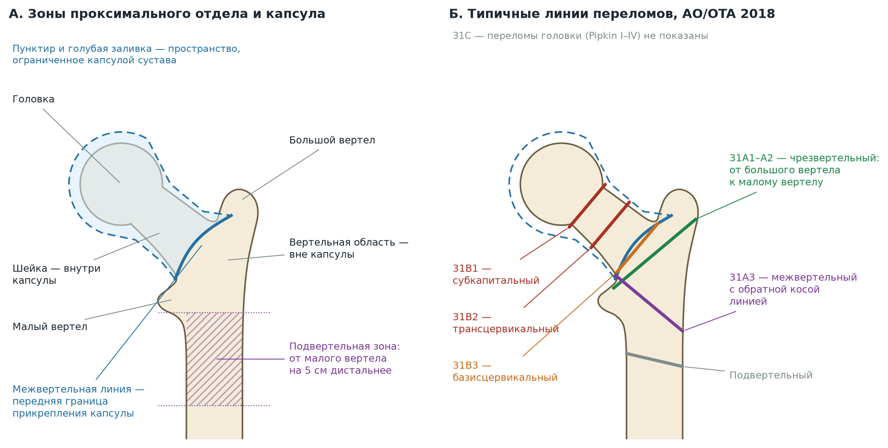
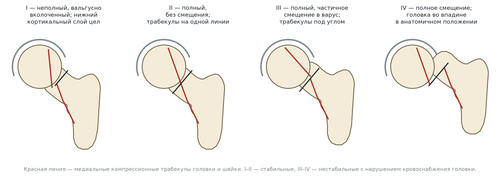
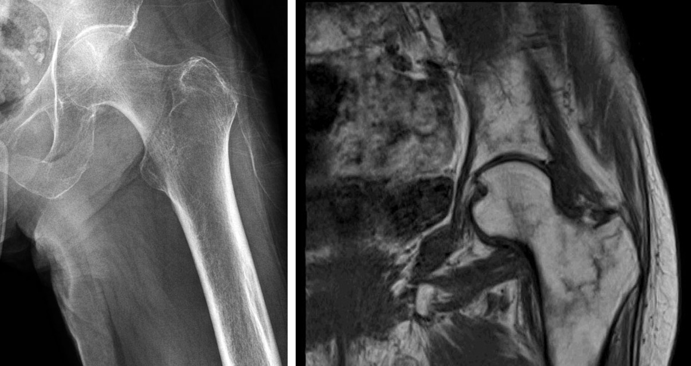

  
Клинический разбор

  
Чрезвертельный перелом

  
Перелом проксимального отдела бедренной кости без классической клинической картины у пациентки 100 лет

  

  
Вызов к женщине 100 лет после падения дома: самостоятельно встать не могла, при осмотре нет укорочения и наружной ротации конечности, симптомы «прилипшей пятки» и осевой нагрузки отрицательные, на фоне декомпенсации хронической сердечной недостаточности. Пациентка оставлена на месте. Через двое суток другая бригада выявила наружную ротацию стопы и положительный симптом «прилипшей пятки»; в стационаре диагностирован закрытый чрезвертельный перелом. Рассмотрены анатомия и классификация переломов проксимального отдела бедренной кости, частота отдельных типов, клиническая картина переломов со смещением и без смещения, рентгенонегативные переломы, падение у пациента старческого возраста как симптом, ограничение ответа кровообращения на кровопотерю при электрокардиостимуляторе и аортальном стенозе, тактика по приказу ДЗМ Москвы № 535 в сопоставлении с клиническими рекомендациями и руководством NICE.

  
Серия «Крещение поворотом» · версия 1.2 · 25 ноября 2026 · CC BY-NC-SA 4.0

# Клинический случай

## Слово бригаде

«Вызов был с поводом "травма таз/бедро". Приехали, бабушка, 100 лет ровно ей, сидит в кресле, тяжело дышит. Дочь рассказыает, что нашла ее на полу. Бабушка жила одна, вполне себя сама обслуживала. Ну вот упала, встать не могла. Бабушка сама сказала, что ударилась бедром. И, может быть, подвернула ногу. Стали бабушку с кресла на кровать перетаскивать, она не хотела, тяжело дышать лежа. В анамнезе ХСН. Уговорили. Взяли под руки. На ногу больную она даже опиралась при перемещении. дальше по симптомам: прилипшей пятки: отрицательный, ногу могла поднять, и одну, и вторую. Осевой нагрузки (поколаяивание по пятке): отрицательный. Стопа наружу не развернута, нога не укорочена. Пассивные движения в голеностопе безболезненны, активные сохранены, болезненность не выражена при них. При пальпации в области вертелов - непонятно, сомнительно, кажется, она сказала, что колено болит, а не бедро. Ну тут я вообще потерялась, похоже стало на вот это вот: "все болит, ничего не помогает". При этом лежа трудно дышать. Посадили обратно и занялись дыханием. Да, ХСН, небольшой гидроторакс справа, но откачивать не будут пока, не много жидкости, 96 сатурация, терпимо. Укололи фуросемид. Сказали родственникам, что перелома нет. Уехали. Через два дня другая бригада видит уже картину во всей красе: развернутую стопу, прилипшую пятку. Вывозит. Чрезвертельный перелом. У меня мысли о собственной профнепригодности... Вот такие коварные вещи бывают. С этих пор - переломы у упавших на бедро пожилых людей без рентгена не исключаю, то клиника поздно проявляется, то смазана, то другими проблемами заслоняется, как у нас с ХСН было.»

## Данные, известные из наблюдения

Женщина 100 лет. До падения проживала одна и самостоятельно себя обслуживала. Рост 160 см, масса тела около 70 кг. Повод к вызову в карте вызова — «травма, таз/бедро».

**Анамнез.** В течение недели до вызова постепенно нарастали одышка при минимальной нагрузке и слабость. Около 20 минут до вызова пациентка упала дома; дочь обнаружила её на полу, самостоятельно встать пациентка не могла. Сознание, со слов пациентки, не теряла. Бригаде пациентка сообщила, что ударилась бедром; в карте вызова со слов пациентки записано: «упала, споткнувшись, травм не получила».

Хроническая сердечная недостаточность с сохранённой фракцией выброса (54 %), II стадия, III функциональный класс; за два с половиной месяца до вызова — острая декомпенсация с гидротораксом, торакоцентез и дренирование правой плевральной полости; гидроперикард; лёгочная гипертензия. Синдром слабости синусового узла, синдром тахикардии-брадикардии, эквиваленты приступов Морганьи — Адамса — Стокса в анамнезе; двухкамерный электрокардиостимулятор имплантирован за четыре года до вызова. Пароксизмальная фибрилляция предсердий. Дегенеративный порок аортального клапана. Гипертоническая болезнь III стадии, хроническая ишемия головного мозга 2-й степени, двусторонняя сенсоневральная тугоухость. Постоянная терапия по карте вызова — апиксабан, торасемид, лозартан; по данным электронной медицинской карты — ривароксабан 20 мг, торасемид 10 мг, периндоприл 4 мг, омепразол 20 мг в сутки.

**Жалобы.** Одышка, усиливающаяся при минимальной нагрузке; слабость.

**Объективный статус.** Состояние средней тяжести. Сознание ясное, 15 баллов по шкале комы Глазго. В положении лёжа нарастала одышка; пациентка переведена в положение сидя. Температура тела 36,6 °C. Отёки голеней и стоп. Частота дыхательных движений 22 в минуту, одышка смешанного характера; дыхание ослаблено в нижних отделах с обеих сторон, там же — мелкопузырчатые влажные хрипы и притупление перкуторного звука. Пульс 64 в минуту, ритмичный; артериальное давление 130/80 мм рт. ст., привычное — 130/80 мм рт. ст. Печень выступает из-под края рёберной дуги на 2 см. SpO₂ 96 %. Уровень глюкозы крови в карте вызова не указан.

**Электрокардиограмма.** «Синусовый ритм 65 в минуту, отклонение электрической оси влево, блокада передней ветви левой ножки пучка Гиса, атриовентрикулярная блокада I степени, рубцовые изменения передней локализации». Запись передана на дистанционную консультацию; заключение — декомпенсация хронической сердечной недостаточности, рекомендована медицинская эвакуация.

**Помощь и динамика.** Фуросемид 40 мг внутривенно. После введения: артериальное давление 130/80 мм рт. ст., пульс 62 в минуту, частота дыхательных движений 16 в минуту, SpO₂ 99 %, температура тела 36,5 °C.

**Диагноз бригады.** I50.9 — ишемическая болезнь сердца, хроническая сердечная недостаточность, III функциональный класс. Травма в диагноз не вынесена.

**Исход вызова.** Пациентка отказалась от медицинской эвакуации; рекомендовано обратиться в поликлинику по месту жительства.

## Медицинская документация

Данные получены ретроспективно из электронной медицинской карты пациентки. Время указано от вызова (сутки 0 — день вызова). Снимки и протокол лучевого исследования недоступны; в протоколах эхокардиографии и ультразвукового исследования вен дата не указана.

::: lomka
| Срок | Источник | Сведения |
|--------|--------|----------------------------|
| Сутки 2 | Сообщение родственницы | По телефону родственница сообщила о боли и выраженных трудностях передвижения после падения в день вызова. Повторного падения, по сведениям родственников, не было. Оформлен вызов |
| Сутки 2 | Повторный вызов | По сведениям бригады — наружная ротация стопы, положительный симптом «прилипшей пятки». Диагноз S72.0; доставлена в многопрофильный стационар с подозрением на перелом шейки бедренной кости |
| Сутки 2 | Лучевое исследование в стационаре | Заключение: чрезвертельный перелом, закрытый |
| Не указан | ЭКГ в стационаре | Ритм электрокардиостимулятора с предсердной стимуляцией, 63 в минуту; PQ 254 мс; QRS 116 мс; электрическая ось −38°. Автоматическое измерение: QT 616 мс, QTc 631 мс |
| Не указан | Эхокардиография | Фракция выброса 64–65 % (Симпсон). Гипертрофия миокарда левого желудочка (межжелудочковая перегородка и задняя стенка 13 мм). Дилатация левого предсердия (площадь 25,3 см²). Кальциноз корня аорты и створок аортального клапана, открытие клапана ограничено, максимальный градиент 65 мм рт. ст.; аортальная регургитация I степени, митральная II–III, трикуспидальная III степени. Систолическое давление в лёгочной артерии 51 мм рт. ст.; TAPSE 22 мм. Нижняя полая вена 10 мм, на вдохе коллабирует более чем на 50 %. Сепарация листков перикарда 9–13 мм. Электроды стимулятора в правых камерах |
| Не указан | Ультразвуковое исследование вен нижних конечностей | Проходимость поверхностных и глубоких вен обеих нижних конечностей сохранена |
:::

Разбор случая приведён в конце материала.

# Вопросы для размышления

Ответы — в конце материала.

1. Какие переломы относят к переломам проксимального отдела бедренной кости, где проходит граница внутрикапсульных и внекапсульных переломов и к какой группе относится межвертельный перелом?
2. Какова частота отдельных типов переломов проксимального отдела бедренной кости и как меняется соотношение переломов шейки и вертельной области с возрастом?
3. Чем обусловлены укорочение конечности, наружная ротация и положительный симптом «прилипшей пятки» и при каких переломах эти признаки отсутствуют?
4. Какая доля переломов проксимального отдела бедренной кости не выявляется на первичных рентгенограммах и какие исследования применяются при несоответствии клинической и рентгенологической картины?
5. Почему падение у пациентки 100 лет рассматривается одновременно как травма и как симптом и какие сведения наблюдения относятся к возможным причинам падения?
6. Какие особенности пациентки ограничивали ответ кровообращения на кровопотерю при вертельном переломе?
7. Какова тактика при подозрении на перелом проксимального отдела бедренной кости по приказу № 535, клиническим рекомендациям и руководству NICE и каковы последствия отсрочки хирургического лечения?

# Анатомия и классификация

## Капсула сустава и кровоснабжение головки

Капсула тазобедренного сустава проксимально прикрепляется по краю вертлужной впадины, дистально спереди — по межвертельной линии, сзади — на границе средней и латеральной трети шейки. Передняя поверхность шейки целиком лежит внутри капсулы, задняя — в медиальных двух третях; вертельная область расположена вне капсулы (рис. 1, А).

Головку и шейку у взрослого кровоснабжают преимущественно ретинакулярные ветви медиальной огибающей артерии бедра, которые идут по поверхности шейки под синовиальной оболочкой; вклад артерии связки головки невелик. Перелом шейки со смещением разрывает или перекручивает ретинакулярные сосуды, поэтому внутрикапсульные переломы осложняются несращением и асептическим некрозом головки. Вертельная область образована губчатой костью с обильным кровоснабжением из окружающих мышц: внекапсульные переломы срастаются надёжно, но кровоточат больше, а кровь не ограничивается капсулой и распространяется в мягкие ткани бедра.

## Классификация

Клинические рекомендации «Переломы проксимального отдела бедренной кости» (Дубров и соавт., 2021) делят переломы на распространяющиеся на суставную поверхность — переломы головки — и не распространяющиеся на неё — переломы шейки и вертельной области. По отношению к линии прикрепления капсулы выделяют внутрикапсульные (головка и шейка) и внекапсульные переломы. К внекапсульным относят чрезвертельные, межвертельные и подвертельные переломы. Внутрисуставным является только перелом головки; межвертельный перелом лежит вне капсулы и вне сустава.

Классификация AO/OTA (Meinberg et al., 2018) обозначает проксимальный отдел бедренной кости кодом 31:

- **31A — вертельная область.** 31A1 — простой чрезвертельный перелом: линия от большого вертела к медиальному кортикальному слою выше или ниже малого вертела, малый вертел и заднемедиальная опора сохранены; к этой группе относятся также изолированные переломы большого и малого вертелов. 31A2 — многооскольчатый чрезвертельный перелом с несостоятельной латеральной стенкой (толщина 20,5 мм и менее). 31A3 — межвертельный перелом: линия проходит между вертелами над малым вертелом, в варианте A3.1 — с обратной косой линией (от проксимального медиального отдела к дистальному латеральному); все переломы A3 нестабильны.
- **31B — шейка.** 31B1 — субкапитальный, 31B2 — трансцервикальный, 31B3 — базисцервикальный перелом.
- **31C — головка.** Переломы головки по Pipkin (I–IV) возникают преимущественно при вывихе бедра в результате высокоэнергетической травмы.

Подвертельным называют перелом в зоне от малого вертела до уровня на 5 см дистальнее его (в AO/OTA — 32A–C(1–3).1). Зоны и типичные линии переломов показаны на рис. 1.

Переломы шейки классифицируют по Garden — по смещению отломков (рис. 2) — и по Pauwels — по углу линии перелома к горизонтали: I тип — до 30°, II — 30–50°, III — более 50°. Garden I–II (Pauwels I) относят к стабильным переломам с минимальным нарушением кровоснабжения головки, Garden III–IV (Pauwels II–III) — к нестабильным. Риск вторичного смещения при Garden I–II составляет около 31 %, поэтому и при этих переломах рекомендован остеосинтез (Дубров и соавт., 2021).

<figure class="shema">
  
  <figcaption>Рис. 1. Проксимальный отдел правой бедренной кости, вид спереди. А — анатомические зоны; голубая заливка и пунктир — пространство, ограниченное капсулой сустава; синяя линия — межвертельная линия, передняя граница прикрепления капсулы; штриховка — подвертельная зона. Б — типичные линии переломов с кодами AO/OTA 2018. Схема с условными пропорциями, построена для настоящего материала.</figcaption>
</figure>

<figure class="shema">
  
  <figcaption>Рис. 2. Классификация переломов шейки бедренной кости Garden. Красная линия — медиальные компрессионные трабекулы головки и шейки: при I типе они изогнуты в вальгус, при II типе продолжают друг друга, при III типе расположены под углом, при IV типе трабекулы головки занимают анатомичное положение относительно впадины, а дистальный отломок смещён проксимально. Схема с условными пропорциями, построена для настоящего материала.</figcaption>
</figure>

## Терминология и коды МКБ-10

Термины «чрезвертельный» и «межвертельный» в отечественной и англоязычной литературе не совпадают. В отечественной классификации чрезвертельные переломы соответствуют 31A1–A2, межвертельные — 31A3. В англоязычной литературе термином *intertrochanteric fracture* нередко обозначают все переломы вертельной области (31A1–A3), а термин *pertrochanteric* используется реже. В МКБ-10 рубрика S72.0 — перелом шейки бедренной кости, S72.1 — чрезвертельный перелом (включая межвертельный и перелом вертела), S72.2 — подвертельный перелом.

# Частота

Соотношение типов переломов в крупных регистрах близко: около половины приходится на переломы шейки, от трети до двух пятых — на переломы вертельной области, около 5 % — на подвертельные.

| Тип перелома | NHFD, 2010–2011, n = 53 443 | AIHW, 2015–2016 | Санкт-Петербург, 2011 |
|------|------|------|------|
| Шейка, всего | 57,7 % | 56 % | 52,0 % |
| в том числе со смещением | 46,3 % | — | — |
| в том числе без смещения | 11,4 % | — | — |
| Вертельная область | 33,8 % | 38 % | 41,9 % |
| Подвертельные | 5,0 % | 5,8 % | 5,3 % |
| Изолированный перелом большого вертела | — | — | 0,8 % |
| Прочие и неуточнённые | 3,5 % | — | — |

*NHFD — национальная база данных переломов проксимального отдела бедренной кости Англии, Уэльса и Северной Ирландии; AIHW — Австралийский институт здравоохранения и социального обеспечения; данные по Санкт-Петербургу — многоцентровое исследование трёх городских стационаров, приведённое в клинических рекомендациях (Дубров и соавт., 2021).*

Доля вертельных переломов растёт с возрастом. По данным AIHW, она увеличивается с 31 % в возрастной группе 45–49 лет до 42 % у пациентов 85 лет и старше. Вертельная область образована преимущественно губчатой костью, а типичный для старческого возраста механизм травмы — падение на бок с ударом большим вертелом — нагружает именно эту зону. У пациентки 100 лет после падения на бок вертельный перелом относится к наиболее вероятным вариантам.

# Клиническая картина

## Перелом со смещением

Клинические рекомендации описывают боль в паховой области и верхней трети бедра, болезненность при пальпации области тазобедренного сустава, невозможность поднять выпрямленную ногу в положении лёжа на спине (положительный симптом «прилипшей пятки»), укорочение конечности, её приведение и наружную ротацию. Укорочение возникает за счёт тяги ягодичных мышц, мышц задней группы бедра и прямой мышцы бедра, смещающих дистальный отломок проксимально; наружная ротация — за счёт подвздошно-поясничной мышцы, прикреплённой к малому вертелу, и массы конечности, которая при утрате опоры отклоняется кнаружи. При вертельных переломах наружная ротация выражена сильнее, чем при переломах шейки, потому что капсула сустава с её связками больше не ограничивает поворот дистального отломка (AO Surgery Reference). Кровоизлияние в мягкие ткани над вертелом и по бедру характерно для внекапсульного перелома и становится заметным не сразу.

Каждый из этих признаков описывает смещение отломков, а не перелом как таковой. Укорочение и ротация требуют, чтобы отломки сдвинулись; невозможность поднять ногу и боль при осевой нагрузке требуют, чтобы отломки смещались друг относительно друга при напряжении мышц или ударе по пятке.

## Переломы без смещения и вколоченные переломы

При неполном переломе, переломе без смещения и вколоченном переломе отломки удерживаются друг другом. Укорочения и ротации нет; симптомы «прилипшей пятки» и осевой нагрузки могут быть слабыми или отрицательными; пациент может стоять с опорой и проходить несколько шагов. AO Surgery Reference указывает, что боль по медиальной поверхности бедра без видимой деформации заставляет предполагать вколоченный перелом или перелом без смещения. Вколоченные переломы, по тем же данным, типичны для падения на бок у пожилых. Боль может ощущаться в колене: тазобедренный и коленный суставы иннервируются ветвями одних и тех же нервов — запирательного и бедренного, — и боль из тазобедренного сустава часто отражается в колено.

Отрицательные пробы на смещение не исключают перелом. Чувствительность симптома «прилипшей пятки», осевой нагрузки и пальпации в отношении перелома без смещения в доступных исследованиях количественно не установлена. Клинического правила, которое позволяло бы исключить перелом проксимального отдела бедренной кости без лучевого исследования, — аналога Оттавских правил для голеностопного сустава — ни клинические рекомендации, ни руководство NICE не содержат.

Опора на конечность и ходьба после перелома без смещения нагружают линию перелома. Риск вторичного смещения перелома шейки Garden I–II клинические рекомендации оценивают в 31 %; нагрузка на конечность без иммобилизации и обезболивания этот риск не уменьшает. Вертельный перелом, неполный или без смещения, при смещении превращается в перелом с укорочением и ротацией, нередко с переходом в нестабильный тип.

## Рентгенонегативные переломы

Отсутствие признаков перелома на рентгенограмме не исключает перелом. По клиническим рекомендациям, частота рентгенонегативных переломов шейки составляет 2–10 %; при анамнезе низкоэнергетической травмы — падения с высоты роста на бок с последующей болью — альтернативные методы лучевой диагностики применяются даже при отсутствии укорочения, ротации и симптома «прилипшей пятки». В метаанализе Haj-Mirzaian et al. (*Radiology*, 2020; 35 исследований, 2992 пациента) у пожилых пациентов с клиническим подозрением на перелом и отрицательной рентгенограммой МРТ выявила перелом, требующий операции, в 39 % случаев, у пациентов 80 лет и старше — в 44 %. Переломы шейки и вертельной области среди рентгенонегативных встречались с близкой частотой (18 и 17 % обследованных). Эти данные относятся к пациентам, у которых подозрение на перелом сохранилось после рентгенографии, а не ко всем упавшим.

На рис. 3 представлены рентгенограмма и МРТ пациентки 90 лет, которая после падения не могла наступить на ногу: на рентгенограмме определяется деминерализация кости без видимого перелома, на МРТ — перелом вертельной области без смещения.

<figure class="ekg">
  
  <figcaption>Рис. 3. Слева — рентгенограмма левого тазобедренного сустава в косой проекции: деминерализация, линия перелома не видна. Справа — МРТ, корональный срез, режим T1: извилистая линия низкого сигнала в вертельной области — перелом без смещения; перелом фиксирован остеосинтезом. Случай Tigges S., Radiopaedia.org, rID 187366, CC BY-NC-SA 3.0; кадры скомпонованы рядом, вставка-локализатор обрезана.</figcaption>
</figure>

# Падение у пациента старческого возраста

## Падение как симптом

Падение у пациента старческого возраста одновременно является механизмом травмы и симптомом, причина которого требует поиска. Клинические рекомендации «Падения у пациентов пожилого и старческого возраста» (2020) включены в перечень клинических рекомендаций в приложении к приказу № 535.

В наблюдении присутствуют несколько возможных причин падения:

- нарастающие в течение недели одышка и слабость при декомпенсации хронической сердечной недостаточности;
- петлевые диуретики и ингибитор ангиотензинпревращающего фермента или блокатор рецепторов ангиотензина в постоянной терапии — факторы ортостатической гипотензии;
- синдром слабости синусового узла с эквивалентами приступов Морганьи — Адамса — Стокса в анамнезе и пароксизмальная фибрилляция предсердий; стимулятор защищает от брадикардии, но не от тахиаритмии;
- аортальный стеноз (раздел «Ответ кровообращения на кровопотерю»), при котором описаны обмороки при нагрузке.

Со слов пациентки, сознание она не теряла и споткнулась. У пациентов старческого возраста описана амнезия эпизода кратковременной потери сознания, поэтому слова «споткнулась» обморок не исключают.

## Антикоагулянт

Пациентка получала прямой пероральный антикоагулянт. Это увеличивает кровопотерю в мягкие ткани при переломе и требует оценки травмы головы. Руководство NICE по черепно-мозговой травме (NG232, 2023) предусматривает направление в стационар пострадавших с травмой головы, получающих антикоагулянты, и рассмотрение КТ головы в течение 8 часов после травмы даже без других показаний. В карте вызова наличие или отсутствие травмы головы не отражено.

## Ответ кровообращения на кровопотерю

Скрытая кровопотеря при вертельных переломах больше, чем при переломах шейки. Harper et al. (2017; 304 пациента) зарегистрировали медиану снижения гемоглобина от поступления до операции 11 г/л при внекапсульных и 6 г/л при внутрикапсульных переломах и предоперационные трансфузии у 18,6 и 4,5 % пациентов соответственно. Smith et al. (*Injury*, 2011) описали снижение гемоглобина на 20,2 г/л при внекапсульных и на 14,9 г/л при внутрикапсульных переломах.

Три особенности пациентки ограничивали обычный ответ на кровопотерю и маскировали её:

- **Электрокардиостимулятор при синдроме слабости синусового узла.** Частота 62–64 в минуту при обоих вызовах и в стационаре соответствует нижней частоте стимуляции. Собственный синусовый узел не обеспечивает тахикардию; датчик частотной адаптации, если функция включена, реагирует на движение или вентиляцию, а не на снижение объёма крови. Тахикардия и шоковый индекс у такой пациентки не отражают кровопотерю.
- **Аортальный стеноз.** Максимальный градиент 65 мм рт. ст. по упрощённому уравнению Бернулли соответствует пиковой скорости около 4 м/с — порогу тяжёлого стеноза по руководству ESC/EACTS (2021), которое требует подтверждения средним градиентом и площадью отверстия; в протоколе эхокардиографии эти показатели не приведены, в анамнезе стеноз обозначен как умеренный. Сердце с фиксированным препятствием выбросу зависит от преднагрузки: снижение объёма крови уменьшает ударный объём, а компенсаторная тахикардия ограничена стимулятором.
- **Диуретики.** Торасемид в постоянной терапии и фуросемид, введённый бригадой, уменьшают объём циркулирующей крови.

Нижняя полая вена 10 мм с коллабированием более 50 % при эхокардиографии указывает на низкое давление в правом предсердии; дата исследования относительно госпитализации не указана.

# Тактика

## Приказ № 535

Приказ ДЗМ Москвы № 535 рассматривает закрытые переломы проксимального отдела бедренной кости в строке «Переломы костей верхних и нижних конечностей, закрытые»: оценка боли по шкале, иммобилизация, холод, обезболивание по уровню боли (при боли до 3 баллов — метамизол натрия или кеторолак, при 4–6 баллах — трамадол, при 7 баллах и более — фентанил), медицинская эвакуация в больницу. Отдельной строки для переломов проксимального отдела бедренной кости и для падения пациента старческого возраста приказ не содержит. При отказе взрослого пациента от медицинской эвакуации проводится активный аудиоконтроль.

> **Расхождение РФ ↔ международная практика.** Руководство NICE (CG124, рекомендация 1.3.9) не рекомендует нестероидные противовоспалительные препараты при переломе проксимального отдела бедренной кости; приказ № 535 допускает кеторолак при боли до 3 баллов. Руководство NICE рекомендует парацетамол, опиоиды и блокаду нервов (1.3.4–1.3.6); блокада фасции подвздошной мышцы на догоспитальном этапе приказом не предусмотрена.

## Клинические рекомендации

Раздел «Догоспитальный этап» клинических рекомендаций (Дубров и соавт., 2021) предписывает эвакуировать в медицинскую организацию каждого пациента, у которого выявлены симптомы перелома проксимального отдела бедренной кости — положительный симптом «прилипшей пятки», укорочение, приведение или наружная ротация, — вне зависимости от тяжести сопутствующих заболеваний. Врач или фельдшер скорой медицинской помощи информирует пациента о рисках консервативного лечения — пневмонии, тромбозе вен, тромбоэмболии лёгочной артерии, пролежнях — и о смертности более 70 % в первые 12 месяцев при консервативном лечении.

Догоспитальный критерий рекомендаций основан на тех же признаках смещения, которые отсутствуют при переломе без смещения. Раздел о диагностике тех же рекомендаций допускает перелом при отсутствии этих признаков и требует лучевого исследования при характерном анамнезе — падении с высоты роста на бок с последующей болью. Для бригады из этого следует, что эвакуацию определяет механизм травмы и утрата функции, а не наличие признаков смещения.

> **Расхождение РФ ↔ международная практика.** Руководство NICE (CG124, рекомендация 1.1.1) при сохраняющемся подозрении на перелом и отрицательной рентгенограмме рекомендует МРТ, при её недоступности в течение 24 часов — КТ. Клинические рекомендации допускают КТ или МРТ без указания предпочтительного метода.

## Сроки операции

Вертельные переломы у пациентов старше 60 лет лечат оперативно — остеосинтезом — независимо от смещения: консервативное лечение требует длительной иммобилизации с высокой смертностью. Клинические рекомендации предусматривают операцию в течение 48 часов после поступления, руководство NICE (CG124, 1.2.1) — в день поступления или на следующий день; анемия, антикоагуляция, сердечная недостаточность и аритмии корректируются без отсрочки операции (1.2.2). В когорте Pincus et al. (*JAMA*, 2017; 42 230 пациентов) ожидание операции более 24 часов было связано с 30-дневной летальностью 6,5 % против 5,8 % и большей частотой осложнений.

## Исходы у пациентов 100 лет и старше

В метаанализе Abelleyra Lastoria et al. (*European Geriatric Medicine*, 2023; 23 исследования, 6970 пациентов 100 лет и старше) годичная летальность после перелома проксимального отдела бедренной кости составила 53,8 %, госпитальная — 14,1 %; после хирургического лечения — 51,2 и 16,0 %. В британской многоцентровой серии Barrett-Lee et al. (2021; 60 пациентов, медиана возраста 101 год) летальность составила 27 % через 30 суток и 55 % через год; 63,4 % пациентов вернулись к прежнему уровню самостоятельности. Возраст 100 лет не является основанием для отказа от операции: без неё пациентка с вертельным переломом остаётся лежачей.

## Сообщение пациенту и родственникам

Без лучевого исследования перелом проксимального отдела бедренной кости можно заподозрить, но нельзя исключить. Корректное заключение бригады для пациента и родственников в такой ситуации — «перелом не исключён; исключить его можно только рентгенографией в стационаре», а не «перелома нет». Первое сохраняет основание для эвакуации и для повторного обращения, второе его отнимает. Отказ от эвакуации, предложенной по поводу сердечной недостаточности, и отказ от эвакуации при подозрении на перелом — разные решения: во втором случае пациенту и родственникам сообщается о последствиях неоперированного перелома.

# Возвращение к клиническому случаю

**Хронология.** Падение дома за 20 минут до вызова; отказ от эвакуации; через двое суток родственница по телефону сообщила о боли и трудностях передвижения; вызов, доставка в стационар; в стационаре — закрытый чрезвертельный перелом. Повторного падения, по сведениям родственников, не было. Исход на момент подготовки материала неизвестен.

**Диагностическая ошибка.** Заключение «перелома нет» сделано без лучевого исследования на основании отсутствия признаков перелома со смещением. Все использованные признаки — укорочение, наружная ротация, симптомы «прилипшей пятки» и осевой нагрузки — описывают смещение отломков и при переломе без смещения могут быть отрицательными. Опора на ногу при перемещении с поддержкой под руки перелом не исключает.

**Сведения, указывавшие на перелом.** Возраст 100 лет. Падение с ударом бедром, по словам самой пациентки. Утрата функции: до падения пациентка жила одна и обслуживала себя, после падения не могла встать. Повод к вызову — травма таза и бедра. Сомнительная болезненность в области вертелов и боль в колене, характерная для отражённой боли из тазобедренного сустава. По частоте вертельный перелом — один из двух наиболее вероятных переломов у пациентки этого возраста после падения на бок.

**Конкурирующее объяснение.** Декомпенсация хронической сердечной недостаточности была реальной и требовала помощи: ортопноэ, влажные хрипы, отёки, увеличение печени. Она же объясняла слабость и неспособность встать. После того как рабочим диагнозом стала сердечная недостаточность, травма исчезла из диагноза и из карты вызова: местный статус — «видимых травм и повреждений нет», в анамнезе — «травм не получила». Эвакуация, рекомендованная при дистанционной консультации, предлагалась по поводу сердечной недостаточности. Согласилась бы пациентка на эвакуацию при прямо названном подозрении на перелом, по имеющимся данным установить нельзя.

**Наиболее вероятное течение.** Отсутствие укорочения и ротации в день вызова и их появление через двое суток без повторного падения соответствуют перелому без смещения или неполному перелому, который сместился при опоре и перемещениях дома. Без снимков дня вызова это предположение не подтверждается и не опровергается.

**Последствия.** Вертельный перелом у пациентки 100 лет подлежал оперативному лечению независимо от смещения; смещение не перевело её из группы консервативного лечения в хирургическую. Последствия отсрочки — двое суток без обезболивания и иммобилизации на антикоагулянте, кровопотеря в мягкие ткани у пациентки, неспособной ответить на неё тахикардией, вероятное смещение отломков с переходом к менее стабильному перелому и отсрочка операции, с которой в когортных исследованиях связаны рост летальности и осложнений. Тромбоз вен нижних конечностей в стационаре исключён.

**Электрокардиограмма.** В карте вызова — «синусовый ритм 65 в минуту», в стационаре — ритм стимулятора с предсердной стимуляцией 63 в минуту. При биполярной стимуляции артефакт стимула на записи бывает малой амплитуды, и навязанный предсердный ритм с собственным проведением на желудочки принимается за синусовый. Удлинение PQ до 254 мс и ось −38° соответствуют описанным бригадой атриовентрикулярной блокаде I степени и блокаде передней ветви левой ножки. Автоматически измеренный QTc 631 мс без записи не интерпретируется.

**Правило, вытекающее из наблюдения.** Пациент старческого возраста после падения, который не может встать или ходить так, как до падения, считается пациентом с переломом проксимального отдела бедренной кости, пока перелом не исключён лучевым исследованием. Отсутствие признаков смещения этот вывод не меняет.

# Ответы на вопросы для размышления

**1.** К переломам проксимального отдела бедренной кости относятся переломы головки (31C), шейки (31B: субкапитальный, трансцервикальный, базисцервикальный), вертельной области (31A: чрезвертельные A1–A2 и межвертельные A3) и подвертельные (зона от малого вертела до 5 см дистальнее). Граница внутрикапсульных и внекапсульных переломов — линия прикрепления капсулы: спереди межвертельная линия, сзади граница средней и латеральной трети шейки. Межвертельный перелом лежит вне капсулы; внутрисуставным является только перелом головки.

**2.** По данным NHFD (2010–2011) переломы шейки составили 57,7 % (со смещением 46,3 %, без смещения 11,4 %), вертельной области — 33,8 %, подвертельные — 5,0 %; по данным AIHW (2015–2016) — 56, 38 и 5,8 %; в многоцентровом исследовании Санкт-Петербурга (2011) — 52,0, 41,9 и 5,3 %, изолированные переломы большого вертела — 0,8 %. Доля вертельных переломов растёт с возрастом: по AIHW — с 31 % в 45–49 лет до 42 % в 85 лет и старше.

**3.** Укорочение обусловлено проксимальным смещением дистального отломка под тягой мышц, наружная ротация — тягой подвздошно-поясничной мышцы и массой конечности, симптом «прилипшей пятки» — болью и утратой опоры при попытке поднять ногу. При вертельных переломах ротация выражена сильнее, так как капсула не ограничивает поворот отломка. Все признаки требуют смещения отломков и могут отсутствовать при неполных переломах, переломах без смещения и вколоченных переломах.

**4.** По клиническим рекомендациям, частота рентгенонегативных переломов шейки — 2–10 %. В метаанализе Haj-Mirzaian et al. (2020) у пожилых пациентов с сохраняющимся клиническим подозрением и отрицательной рентгенограммой перелом, требующий операции, выявлен при МРТ у 39 %, у пациентов 80 лет и старше — у 44 %. NICE рекомендует МРТ, при недоступности в течение 24 часов — КТ; клинические рекомендации — КТ или МРТ.

**5.** Падение у пациентки 100 лет — механизм перелома и одновременно симптом. В наблюдении присутствуют нарастающая декомпенсация сердечной недостаточности, диуретики и препараты, блокирующие ренин-ангиотензиновую систему, с риском ортостатической гипотензии, синдром слабости синусового узла с эквивалентами приступов Морганьи — Адамса — Стокса в анамнезе, пароксизмальная фибрилляция предсердий и аортальный стеноз. Отрицание потери сознания у пациента старческого возраста обморок не исключает.

**6.** Электрокардиостимулятор при синдроме слабости синусового узла фиксировал частоту на нижней границе стимуляции (62–64 в минуту), и тахикардия как признак кровопотери отсутствовала. Аортальный стеноз с максимальным градиентом 65 мм рт. ст. делал ударный объём зависимым от преднагрузки. Диуретики уменьшали объём циркулирующей крови; антикоагулянт увеличивал кровопотерю в мягкие ткани, которая при вертельном переломе больше, чем при переломе шейки.

**7.** Приказ № 535 (строка «Переломы костей верхних и нижних конечностей, закрытые») предусматривает обезболивание по шкале боли, иммобилизацию и медицинскую эвакуацию в больницу; при отказе взрослого пациента — активный аудиоконтроль. Клинические рекомендации требуют эвакуировать каждого пациента с симптомами перелома вне зависимости от сопутствующих заболеваний и информировать о смертности более 70 % за год при консервативном лечении, а при характерном анамнезе — проводить лучевое исследование и при отсутствии симптомов. Операция выполняется в течение 48 часов после поступления (NICE — в день поступления или на следующий день); ожидание более 24 часов связано с ростом 30-дневной летальности (6,5 % против 5,8 %; Pincus et al., 2017).

# Источники

- Дубров В.Э., Шелупаев А.А., Арутюнов Г.П. и др. Переломы проксимального отдела бедренной кости. Клиническая картина, диагностика и лечение (клинические рекомендации, сокращённая версия). *Вестник травматологии и ортопедии им. Н.Н. Приорова*, 2021; 28(4). DOI: 10.17816/vto100763 — классификация, клиническая картина, рентгенонегативные переломы, догоспитальный этап, данные многоцентрового исследования в Санкт-Петербурге.
- Приказ Департамента здравоохранения города Москвы № 535 от 18.05.2023 «Об утверждении Алгоритмов оказания скорой и неотложной медицинской помощи» — строка «Переломы костей верхних и нижних конечностей, закрытые»; перечень клинических рекомендаций в приложениях.
- Meinberg E.G., Agel J., Roberts C.S. et al. Fracture and Dislocation Classification Compendium — 2018. *Journal of Orthopaedic Trauma*, 2018; 32(Suppl 1): S1–S170 — классификация AO/OTA, сегмент 31.
- Garden R.S. Low-angle fixation in fractures of the femoral neck. *Journal of Bone and Joint Surgery. British volume*, 1961; 43-B(4): 647–663.
- Pauwels F. *Der Schenkelhalsbruch: ein mechanisches Problem*. Stuttgart: Enke, 1935.
- Pipkin G. Treatment of grade IV fracture-dislocation of the hip. *Journal of Bone and Joint Surgery. American volume*, 1957; 39-A(5): 1027–1042.
- National Hip Fracture Database. *National Report 2011*. London: Royal College of Physicians — распределение типов переломов, 2010–2011.
- Australian Institute of Health and Welfare. *Hip fracture incidence and hospitalisations in Australia 2015–16*. Canberra: AIHW, 2018 — распределение типов переломов и его зависимость от возраста.
- AO Foundation. *AO Surgery Reference. Proximal femur: assessment of patients with a proximal femoral fracture* — ротация при вертельных и шеечных переломах, вколоченные переломы.
- Haj-Mirzaian A., Eng J., Khorasani R. et al. Use of advanced imaging for radiographically occult hip fracture in elderly patients: a systematic review and meta-analysis. *Radiology*, 2020; 296(3): 521–531.
- National Institute for Health and Care Excellence. *Hip fracture: management* (CG124), 2011, обновление 2023 — рекомендации 1.1.1, 1.2.1, 1.2.2, 1.3.4–1.3.6, 1.3.9.
- National Institute for Health and Care Excellence. *Head injury: assessment and early management* (NG232), 2023.
- Pincus D., Ravi B., Wasserstein D. et al. Association between wait time and 30-day mortality in adults undergoing hip fracture surgery. *JAMA*, 2017; 318(20): 1994–2003.
- Harper K.D., Navo P., Ramsey F. et al. "Hidden" preoperative blood loss with extracapsular versus intracapsular hip fractures: what is the difference? *Geriatric Orthopaedic Surgery & Rehabilitation*, 2017; 8(4).
- Smith G.H., Tsang J., Molyneux S.G., White T.O. The hidden blood loss after hip fracture. *Injury*, 2011; 42(2): 133–135.
- Abelleyra Lastoria D.A., Benny C.K., Smith T., Hing C.B. Outcomes of hip fracture in centenarians: a systematic review and meta-analysis. *European Geriatric Medicine*, 2023; 14(6): 1223–1239.
- Barrett-Lee J., Barbur S., Johns J. et al. Hip fractures in centenarians: a multicentre review of outcomes. *Annals of the Royal College of Surgeons of England*, 2021; 103(1): 59–63.
- Vahanian A., Beyersdorf F., Praz F. et al. 2021 ESC/EACTS Guidelines for the management of valvular heart disease. *European Heart Journal*, 2022; 43(7): 561–632 — критерии тяжёлого аортального стеноза.
- Клинические рекомендации «Падения у пациентов пожилого и старческого возраста», 2020.

# Источники иллюстраций

| Файл | Что изображено | Источник |
|------|------------|------------|
| `zony_bedra.png` | Зоны проксимального отдела бедренной кости, капсула сустава, линии переломов AO/OTA | Построено для настоящего материала (`images/postroit.py`) |
| `garden.png` | Классификация переломов шейки бедренной кости Garden | Построено для настоящего материала (`images/postroit.py`) |
| `kadry_radiopaedia.jpg` | Рентгенограмма и МРТ при рентгенонегативном переломе вертельной области | Tigges S. Occult intertrochanteric hip fracture. Radiopaedia.org, rID 187366, DOI: 10.53347/rID-187366; CC BY-NC-SA 3.0; два кадра скомпонованы рядом, вставка-локализатор на кадре МРТ обрезана |

# Выходные данные

**Материал:** «Чрезвертельный перелом». Версия 1.2 от 25 ноября 2026.

**Серия:** «Крещение поворотом» — клинические разборы догоспитальной практики.

**Лицензия:** текст — Creative Commons «С указанием авторства — Некоммерческая — С сохранением условий» 4.0 (CC BY-NC-SA 4.0).

**Оговорка.** Материал носит учебный характер, не является нормативным документом, не заменяет действующие протоколы и клинические рекомендации и не может использоваться как единственное основание для клинического решения. Дозы, показания и маршрутизацию необходимо проверять по действующим первоисточникам. Ответственность за клинические решения несёт медицинский работник, а не автор материала.

**О клинических случаях.** Случаи обезличены: нет имён, дат вызовов, адресов, номеров карт вызова, названий стационаров; сроки указаны относительно дня вызова. Совпадения с чужой практикой возможны и неизбежны.

**Нашли ошибку?** Сообщить можно через раздел Issues репозитория проекта; исправление выходит новой версией, а изменение фиксируется в журнале изменений.
