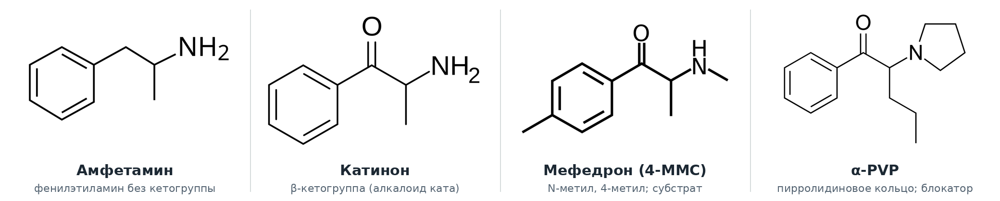
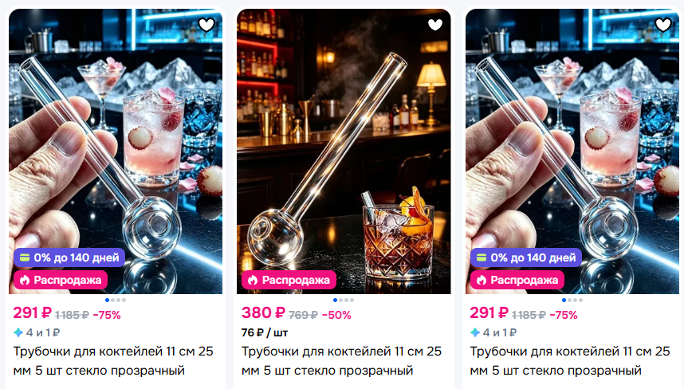
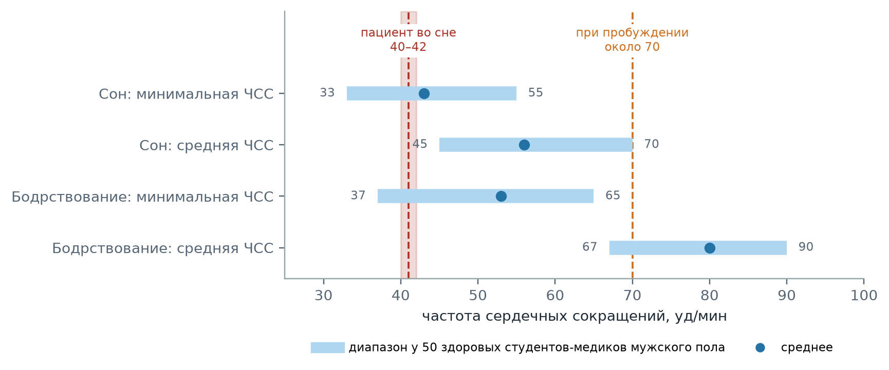

  
Клинический разбор

  
Соли, сон и брадикардия

  
Синтетические катиноны, фаза «срыва» после психостимуляторов и физиологическая ночная брадикардия в дифференциальном ряду угнетения сознания у молодого потребителя психоактивных веществ

  

  
Вызов с поводом «без сознания» к мужчине 19 лет на лестничной площадке: сонливость с кратковременными пробуждениями, частота сердечных сокращений 40–42 в минуту во сне и около 70 при пробуждении, стеклянная курительная трубка с нагаром. Рассмотрены химия, механизм действия и способы употребления синтетических катинонов, цикл «марафон — срыв» и синдром отмены психостимуляторов, нормативы частоты сердечных сокращений во сне, дифференциальный ряд с оксибутиратом, синтетическими каннабиноидами, опиоидами и седативными средствами, поражение зубов у потребителей психостимуляторов и выбор раздела приказа ДЗМ Москвы № 535.

  
Серия «Крещение поворотом» · версия 1.0 · 11 октября 2026 · CC BY-NC-SA 4.0

# Клинический случай

## Слово бригаде

«Около 7 утра. На лестничной площадке молодой человек, в поводе к вызову значится как „без сознания“, но пробуждаем. Просыпается, что-то может сказать, потом опять отключается. Зрачки не узкие, реакция на свет сохранена, может быть чуть снижена, но незначительно. Запаха алкоголя нет. Сахар 5,7. В кармане стеклянная трубочка, которая фигурирует на маркетплейсах как трубочка для коктейля, но… все знают, для чего она. Употребление солей не отрицает, но по поведению он сонлив, тремора нет, пару раз выгнулся дугой, но непонятно, специально, при попытке перевернуть его на спину для записи ЭКГ, или всё-таки какое-то действие солей. На ЭКГ в спокойном состоянии синусовый ритм, пульс 40–42, признаки ранней реполяризации желудочков, ЧДД снижена, 13–14. В моменты пробуждений (с помощью волшебной салфетки с нашатырём) пульс около 70, ЧДД нормальная. Мы подумали, что наш товарищ просто засыпает и мгновенно проваливается в глубокий сон, поэтому так замедляется пульс. Верхние зубы гнилые, дёсны чёрные. Нижний ряд — ровные белые. Давление 130/80. Отзвонились токсикологам, состояние не сочтено жизнеугрожающим. Передан наряду полиции.» — *Ю.Н.*

Разбор случая приведён в конце материала.

## Данные, известные из наблюдения

**Повод и обстоятельства.** Вызов около 7 часов утра на лестничную площадку жилого дома, повод — «без сознания».

**Пациент.** Мужчина 19 лет, худощавого телосложения, истощён.

**Сознание и неврологический статус.** Пробуждаем: при стимуляции раствором аммиака просыпается, отвечает на вопросы, затем вновь засыпает. Между пробуждениями мышечный тонус снижен, пациент расслаблен. Зрачки не сужены, реакция на свет сохранена, возможно незначительно снижена. Нистагма нет. В период бодрствования при попытке перевернуть на спину дважды отмечено разгибание туловища длительностью не более 2 секунд без изменения сознания; судорог не было. Тремора нет. Рвоты и признаков непроизвольного мочеиспускания нет. В вопросе о времени суток не ориентирован: утро назвал вечером.

**Анамнез со слов пациента.** Употребление «солей» не отрицает; сообщил, что употреблял около часа назад. Приём других веществ отрицает.

**Объективный статус.** Кожные покровы бледные. Запаха алкоголя нет. Во сне частота дыхания 13–14 в минуту, при пробуждении нормальная. SpO₂ 99 %. Артериальное давление 130/80 мм рт. ст. Глюкоза крови 5,7 ммоль/л. Эпизодов апноэ не было.

**Электрокардиограмма.** Синусовый ритм; во сне частота 40–42 в минуту на протяжении всего периода сна, при каждом пробуждении — около 70 в минуту. Признаки ранней реполяризации желудочков; иных изменений нет.

**Осмотр полости рта.** Верхние зубы поражены кариесом, дёсны тёмного цвета; зубы нижней челюсти без видимых поражений.

**Находка.** В кармане — стеклянная трубка с шаровидным расширением на конце, внутри — нагар.

**Тактика.** Проведён дистанционный консилиум бригады с токсикологом; состояние не расценено как жизнеугрожающее. Диагноз в карте вызова — Z72.2 «Использование наркотиков». Пациент передан наряду полиции. Исход неизвестен.

# Вопросы для размышления

Ответы — в конце материала.

1. Что такое «соли», к какому химическому классу они относятся и чем механизм действия α-PVP отличается от механизма действия мефедрона и амфетамина?
2. Какими путями употребляются синтетические катиноны и для чего предназначена стеклянная трубка с шаровидным расширением?
3. Существует ли синдром отмены синтетических катинонов и как проявляется фаза «срыва» после многочасового употребления?
4. Может ли частота сердечных сокращений 40–42 в минуту во сне у мужчины 19 лет быть физиологической и что меняется при пробуждении?
5. Какие вещества и состояния входят в дифференциальный ряд угнетения сознания с быстрыми пробуждениями и по каким признакам они различаются?
6. Что такое спайс и снюс и могут ли они объяснить наблюдаемую картину?
7. Чем объясняется поражение верхних зубов при сохранности нижних и тёмный цвет дёсен?
8. Какие разделы приказа № 535 применимы к этому пациенту?

# Синтетические катиноны

## Происхождение и химическая структура

Катинон — алкалоид листьев кустарника кат (*Catha edulis*), жевание которых распространено в странах Африканского Рога и Аравийского полуострова. Химически катинон представляет собой β-кетоамфетамин: от амфетамина он отличается кетогруппой в β-положении боковой цепи (рис. 1). Синтетическими катинонами называют производные этой структуры с замещениями в ароматическом кольце, при атоме азота и в боковой цепи.

<figure>

<figcaption>Рис. 1. Структурные формулы амфетамина, катинона, мефедрона (4-метилметкатинона) и α-PVP (α-пирролидинопентиофенона). Общий фенилэтиламиновый скелет определяет психостимулирующее действие; β-кетогруппа отличает катиноны от амфетаминов; пирролидиновое кольцо при атоме азота у α-PVP превращает молекулу из субстрата моноаминовых транспортёров в их блокатор и повышает её липофильность.</figcaption>
</figure>

Многие синтетические катиноны описаны в химической и фармакологической литературе задолго до появления на нелегальном рынке. Мефедрон синтезирован в 1929 году; пировалерон и родственные ему пирролидинофеноны, в том числе α-PVP и МДПВ (3,4-метилендиоксипировалерон), разработаны в 1960-х годах как потенциальные лекарственные средства. Массовое распространение синтетических катинонов началось в конце 2000-х годов: в Европе и США они продавались через интернет под видом «солей для ванн», «удобрений» и «реактивов для исследований» с маркировкой «не для употребления человеком». Отсюда происходит жаргонное название «соли». В Российской Федерации N-метилэфедрон и его производные, к которым относятся α-PVP и родственные пирролидинофеноны, включены в Список I наркотических средств, оборот которых запрещён (постановление Правительства РФ № 681 от 30.06.1998).

## Механизм действия: субстраты и блокаторы транспортёров

Все синтетические катиноны повышают концентрацию моноаминов — дофамина, норадреналина и в разной степени серотонина — в синаптической щели. По механизму они делятся на две группы, различающиеся клинически.

| Группа | Представители | Механизм | Клиническая характеристика |
|---|---|---|---|
| Субстраты транспортёров (рилизеры) | Мефедрон, метилон, 3-MMC, 4-CMC | Транспортируются внутрь нейрона и вызывают обратный выброс моноаминов через транспортёр, аналогично амфетамину; выраженное действие на транспортёр серотонина | Эмпатогенный компонент, сходство с МДМА; гипонатриемия, серотониновая токсичность |
| Блокаторы транспортёров | МДПВ, α-PVP, α-PHP, α-PiHP | Блокируют обратный захват дофамина и норадреналина, аналогично кокаину; действие на транспортёр серотонина слабое | Выраженная психомоторная стимуляция, компульсивное повторное употребление, психозы, возбуждение |

Baumann et al. (*Neuropsychopharmacology*, 2013) показали, что МДПВ блокирует обратный захват дофамина в 50 раз, а норадреналина — в 10 раз сильнее кокаина, при этом, в отличие от мефедрона, не является субстратом транспортёров; в эксперименте он в 10 раз сильнее кокаина вызывал двигательную активацию, тахикардию и артериальную гипертензию. α-PVP — структурный предшественник МДПВ без метилендиоксигруппы — действует по тому же механизму с сопоставимой активностью в отношении транспортёров дофамина и норадреналина. Пирролидиновое кольцо повышает липофильность молекулы и облегчает её проникновение через гематоэнцефалический барьер, а также позволяет употреблять вещество курением в форме свободного основания.

## Способы употребления

Синтетические катиноны употребляются интраназально, курением (испарением), внутрь, сублингвально, внутривенно и ректально (WHO Expert Committee on Drug Dependence, 2015). Способ определяется химической формой: производные мефедронового ряда преимущественно вдыхаются интраназально, тогда как пирролидинофеноны (α-PVP и его аналоги, МДПВ) преимущественно курятся. В немецком опросе потребителей курительных катинонов (Bendau et al., *Harm Reduction Journal*, 2026) курение или испарение назвали 32 из 36 респондентов.

Для курения используется стеклянная трубка с шаровидным расширением на конце (англ. *oil burner pipe*). Вещество помещается в шар, который нагревается снизу пламенем зажигалки; образующийся пар вдыхается через трубку. После испарения на внутренней поверхности шара остаётся нагар. Такие же трубки применяются для курения метамфетамина. В розничной торговле, в том числе на маркетплейсах, они предлагаются под наименованием «трубочки для коктейлей» (рис. 2).

<figure class="fragment">

<figcaption>Рис. 2. Стеклянные трубки с шаровидным расширением в карточках товара на маркетплейсе под наименованием «Трубочки для коктейлей 11 см 25 мм стекло прозрачный». Конструкция с замкнутым шаром на одном конце непригодна для питья и соответствует курительной трубке для испарения психоактивных веществ. Снимок экрана публичных карточек товара приведён в учебных целях.</figcaption>
</figure>

При курении эффект развивается в течение нескольких секунд или минут и продолжается относительно недолго, что поддерживает многократное повторное употребление. В опросе Bendau et al. треть потребителей курительных катинонов сообщала о сильном влечении к повторной дозе, возникающем уже через 10 минут после употребления; средняя продолжительность сессии употребления составила 20,6 часа (медиана 18, диапазон до 72 часов).

## Клинические проявления интоксикации

Острая интоксикация синтетическими катинонами проявляется симпатомиметическим токсидромом: тахикардия, артериальная гипертензия, мидриаз, гипертермия, потливость, тремор, психомоторное возбуждение, тревога, бессонница, бруксизм. Тяжёлое течение включает психоз с галлюцинациями и параноидным бредом, агрессивное поведение, судороги, гипертермию с рабдомиолизом, острое почечное повреждение, острый коронарный синдром. В шведской серии STRIDA (Beck et al., *Clinical Toxicology*, 2016; 42 аналитически подтверждённых случая интоксикации α-PVP без других стимуляторов) тахикардия отмечена у 80 % пациентов, возбуждение — у 70 %, артериальная гипертензия — у 33 %; лишь в трети случаев α-PVP был единственным обнаруженным психоактивным веществом, в остальных выявлялись опиоиды, бензодиазепины и этанол.

Отсутствие признаков симпатомиметического токсидрома — тахикардии, гипертензии, мидриаза, тремора, возбуждения — указывает на то, что период активного действия психостимулятора завершился.

## Цикл «марафон — срыв» и синдром отмены

Многочасовое или многосуточное употребление психостимулятора без сна сменяется фазой, которую в англоязычной литературе называют *crash* («срыв»). Её проявления — непреодолимая сонливость, продолжительный сон, слабость, дисфория, повышенный аппетит. Модель течения отмены кокаина, описанная Gawin и Kleber (*Archives of General Psychiatry*, 1986), выделяет три фазы: срыв в первые часы и дни после прекращения употребления, собственно отмену с ангедонией и влечением в течение последующих недель и фазу угасания.

Синдром отмены психостимуляторов включён в классификацию DSM-5 (American Psychiatric Association, 2013): дисфорическое настроение в сочетании не менее чем с двумя признаками из следующих — утомляемость, яркие неприятные сновидения, бессонница или гиперсомния, повышение аппетита, психомоторная заторможенность или возбуждение; признаки развиваются в течение от нескольких часов до нескольких суток после прекращения или уменьшения длительного употребления. В МКБ-10 этому состоянию соответствует рубрика F15.3 «Абстинентное состояние, вызванное употреблением других стимуляторов».

Динамика отмены описана для метамфетамина. В исследовании McGregor et al. (*Addiction*, 2005) выраженность симптомов была максимальной в первые 24 часа после последнего употребления и снижалась до уровня контрольной группы к концу первой недели; острая фаза длительностью 7–10 суток характеризовалась увеличением продолжительности сна и аппетита и депрессивными симптомами, подострая — продолжалась не менее двух недель. Для синтетических катинонов систематические данные ограничены сведениями опросов и наблюдений, однако общность механизма — истощение дофаминергической и норадренергической передачи после её длительной стимуляции — позволяет ожидать сходной картины.

# Сон после психостимуляторов и частота сердечных сокращений

## Вегетативная регуляция во сне

Переход от бодрствования к медленноволновому сну сопровождается снижением симпатической и преобладанием парасимпатической активности. При прямой регистрации у здоровых добровольцев симпатическая активность в мышечных нервах в IV стадии сна снижалась более чем вдвое по сравнению с бодрствованием, и параллельно снижались частота сердечных сокращений и артериальное давление (Somers et al., *New England Journal of Medicine*, 1993). Пробуждение, в том числе вызванное внешним раздражителем, сопровождается кратковременным симпатическим выбросом и приростом частоты сердечных сокращений.

После депривации сна латентность засыпания сокращается: при ограничении сна она прогрессивно уменьшается от ночи к ночи (Carskadon, Dement, *Psychophysiology*, 1981), а средняя латентность засыпания 8 минут и менее в тесте множественной латентности сна рассматривается как объективный признак патологической сонливости (Littner et al., *Sleep*, 2005). Восстановительный сон после депривации отличается увеличенной долей медленноволнового сна (Borbély, *Human Neurobiology*, 1982) — той фазы, в которой парасимпатическое влияние на сердце максимально.

## Частота сердечных сокращений во сне у здоровых молодых мужчин

Brodsky et al. (*American Journal of Cardiology*, 1977) провели суточное мониторирование электрокардиограммы у 50 студентов-медиков мужского пола без заболеваний сердца. Минимальная частота во сне составила от 33 до 55 в минуту (в среднем 43 ± 5), у всех обследованных частота во сне хотя бы однажды была ниже 60 в минуту, у 12 человек (24 %) — ниже 40 в минуту. У 14 человек (28 %) регистрировались синусовые паузы более 1,75 секунды, у трёх (6 %) — преходящая ночная атриовентрикулярная блокада II степени I типа. Авторы пришли к заключению, что брадиаритмии, в том числе выраженная синусовая аритмия с паузами, синусовая брадикардия и ночная атриовентрикулярная блокада, у молодых мужчин распространены.

<figure>

<figcaption>Рис. 3. Частота сердечных сокращений во сне и бодрствовании по данным суточного мониторирования у 50 здоровых студентов-медиков мужского пола (Brodsky et al., 1977): полосы — диапазон, точки — среднее значение. Частота 40–42 в минуту, зарегистрированная у пациента во сне, находится в пределах диапазона минимальной частоты во сне и близка к её среднему значению; частота около 70 в минуту при пробуждении соответствует диапазону бодрствования.</figcaption>
</figure>

## Дополнительные факторы

**Недостаточность питания.** Синусовая брадикардия — частое проявление белково-энергетической недостаточности: в систематическом обзоре сердечно-сосудистых осложнений нервной анорексии её распространённость составила от 35 до 95 % (Sachs et al., *International Journal of Eating Disorders*, 2016). Механизм связывают с преобладанием вагусных влияний и адаптивным снижением энергозатрат. Подавление аппетита относится к типичным эффектам психостимуляторов, и истощение у их потребителей распространено.

**Ранняя реполяризация.** Электрокардиографический феномен ранней реполяризации выявлен у 5,8 % обследованных в популяционной когорте из 10 864 человек (Tikkanen et al., *New England Journal of Medicine*, 2009); он чаще встречается у молодых мужчин и спортсменов, ассоциирован с высоким вагусным тонусом и более выражен при низкой частоте сердечных сокращений. Сочетание ранней реполяризации и синусовой брадикардии во сне у молодого мужчины относится к вариантам нормы, если отсутствуют синкопе, отягощённый семейный анамнез внезапной смерти и подъём точки J в нижних отведениях более 0,2 мВ.

# Дифференциальный ряд угнетения сознания с быстрыми пробуждениями

| Причина | Сознание | Зрачки | Частота сердечных сокращений и дыхания | Дополнительные признаки |
|---|---|---|---|---|
| Срыв после психостимулятора | Глубокий сон, пробуждаемость сохранена, после пробуждения ориентировка частично восстанавливается | Нормальные | Брадикардия во сне в пределах физиологической, при пробуждении — нормализация; дыхание сохранено | Анамнез многочасового употребления, истощение, отсутствие признаков симпатомиметического токсидрома |
| Оксибутират (ГОМК) и γ-бутиролактон | Быстрое развитие комы с внезапными пробуждениями, нередко с возбуждением | Нормальные или суженные | Брадикардия; гиповентиляция | Рвота, гипотермия, миоклонии; длительность обычно до 5 часов |
| Синтетические каннабиноиды | Заторможенность, ступор, возбуждение, психоз | Нормальные или расширенные | Чаще тахикардия, описана брадикардия | Тошнота, судороги, острое почечное повреждение |
| Опиоиды | Угнетение сознания, пробуждаемость снижена | Узкие | Брадипноэ, гиповентиляция, гипоксемия | Ответ на налоксон |
| Бензодиазепины, прегабалин | Сонливость, атаксия, дизартрия | Нормальные | Дыхание угнетается в основном при сочетании с другими депрессантами | Нистагм, атаксия |
| Этанол | Угнетение сознания | Нормальные | Возможна гиповентиляция | Запах алкоголя, гипогликемия |

## Оксибутират и его предшественники

γ-Гидроксимасляная кислота (ГОМК, натрия оксибутират) — эндогенный метаболит γ-аминомасляной кислоты и агонист ГАМК-B-рецепторов. Её предшественники — промышленные растворители γ-бутиролактон (ГБЛ) и 1,4-бутандиол — в организме быстро превращаются в ГОМК. Максимальная концентрация в плазме достигается через 20–45 минут после приёма внутрь, период полувыведения составляет 20–30 минут.

Характерной считается картина глубокой комы с внезапными пробуждениями, брадикардией и гиповентиляцией. В серии Chin et al. (*Annals of Emergency Medicine*, 1998; 88 пациентов) бессимптомная брадикардия наблюдалась у 36 %, температура тела 35 °C и ниже — у 31 %, рвота — у 30 %, у 28 % пациентов употребление сочеталось с другими психоактивными веществами, чаще всего с амфетаминами; сознание восстанавливалось самостоятельно в среднем через 146 минут. В серии Liakoni et al. (*Scandinavian Journal of Trauma, Resuscitation and Emergency Medicine*, 2016; 78 случаев) внезапное восстановление сознания отмечено в 32 % случаев, клонус — в 21 %, возбуждение — в 40 %, медиана времени до восстановления сознания составила 90 минут.

Брадикардия при отравлении ГОМК связана с глубиной угнетения сознания (в серии Chin et al. у 29 из 32 пациентов с брадикардией балл по шкале комы Глазго не превышал 8) и потому по механизму сходна с физиологической брадикардией глубокого сна. Отличительными признаками служат глубина комы между пробуждениями, гипотермия, рвота и миоклонии.

## Синтетические каннабиноиды

Синтетические каннабиноиды («спайс», «миксы») — полные агонисты каннабиноидных рецепторов CB1 и CB2, в отличие от частичного агониста Δ⁹-тетрагидроканнабинола. Первые соединения, в том числе JWH-018, синтезированы в исследовательских целях в 1990-х годах; с середины 2000-х годов они распространяются в составе курительных смесей, где вещество нанесено на растительную основу. Структура соединений на рынке постоянно меняется, и стандартные иммунохроматографические тесты на каннабиноиды их, как правило, не выявляют.

В систематическом обзоре Tait et al. (*Clinical Toxicology*, 2016; 106 исследований, около 4000 случаев) наиболее частыми проявлениями были тахикардия (37–77 %), возбуждение (16–41 %) и тошнота (13–94 %); тяжёлые осложнения включали генерализованные тонико-клонические судороги, острое почечное повреждение, инфаркт миокарда и ишемический инсульт, психоз. Для новых поколений синтетических каннабиноидов описана выраженная заторможенность: при вспышке отравлений AMB-FUBINACA в Нью-Йорке в 2016 году пострадавшие находились в состоянии ступора с замедленными стереотипными движениями (Adams et al., *New England Journal of Medicine*, 2017).

## Снюс и никотиновые паучи

Снюс — увлажнённый измельчённый табак для сосания, который помещается под верхнюю губу, обычно в порционных пакетиках; никотиновые паучи — бестабачные пакетики с никотином на растительном наполнителе, применяемые тем же способом. В Российской Федерации оптовая и розничная продажа сосательного табака (снюса) запрещена с 10 января 2016 года (Федеральный закон № 456-ФЗ от 30.12.2015, изменения в статью 19 Федерального закона № 15-ФЗ от 23.02.2013). Содержание никотина в паучах достигает 10 мг и более на пакетик, тогда как сигарета доставляет порядка 1 мг.

Отравление никотином протекает двухфазно: в первые минуты — слюнотечение, рвота, тахикардия, артериальная гипертензия, тремор, возможны судороги; при больших дозах через 1–4 часа — брадикардия, артериальная гипотензия, мышечная слабость, угнетение дыхания и сознания (Royal Children's Hospital Melbourne, Clinical Practice Guidelines: Nicotine Poisoning). Описаны случаи отравления подростков и молодых взрослых при многократном применении паучей. Ведущими признаками остаются рвота и гиперсаливация, которые в настоящем наблюдении отсутствуют.

# Состояние зубов и дёсен

Поражение зубов у потребителей психостимуляторов наиболее подробно изучено для метамфетамина. В исследовании Shetty et al. (*Journal of the American Dental Association*, 2015; 571 потребитель метамфетамина) кариес передних зубов верхней челюсти встречался чаще, чем нижней, а в иерархии восприимчивости к кариесу резцы и клыки нижней челюсти заняли последнее место. Механизм связывают с ксеростомией вследствие симпатомиметического действия, бруксизмом, частым употреблением сладких напитков и отсутствием гигиены полости рта на фоне многосуточного употребления. Передние зубы нижней челюсти защищены близостью протоков поднижнечелюстных и подъязычных слюнных желёз и языком; тот же принцип объясняет относительную сохранность нижних резцов при раннем детском кариесе.

Тёмная окраска дёсен допускает несколько объяснений. Меланоз курильщика выявляется у 25,5–31,0 % курящих, в 95,2 % случаев — на прикреплённой десне нижней челюсти с губной стороны клыков и резцов (Hedin, *Archives of Dermatology*, 1977). Серо-чёрный налёт на межзубных сосочках с их изъязвлением характерен для некротизирующего гингивита, факторами риска которого являются курение, недостаточность питания, психоэмоциональный стресс и депривация сна (Herrera et al., *Journal of Clinical Periodontology*, 2018). Разграничение требует осмотра в стоматологических условиях.

# Тактика по приказу № 535

Приказ ДЗМ Москвы № 535 содержит два раздела, применимых к последствиям употребления психоактивных веществ, и различие между ними определяет тактику.

| Раздел приказа | Объём помощи | Медицинская эвакуация |
|---|---|---|
| F10–F19 — острая интоксикация психоактивными веществами без осложнений (внутр. стр. 150) | Глюкометрия, пульсоксиметрия; при психомоторном возбуждении — оценка по RASS, галоперидол или диазепам; при тахикардии ≥ 100 — метопролол | При интоксикации средней степени тяжести и/или с делирием, при опасности для себя и окружающих; в иных случаях — рекомендация обратиться в наркологический диспансер |
| F10.3–F19.3 — абстинентное состояние (внутр. стр. 151) | Глюкометрия, пульсоксиметрия, ЭКГ; симптоматическая терапия | При тяжёлом абстинентном синдроме и осложнённом течении |
| T40.4–T40.9 — отравление синтетическими наркотиками, амфетаминами, курительными смесями (внутр. стр. 128–129) | ЭКГ, ЭКГ-мониторинг; инфузия; при возбуждении — диазепам; при судорогах — диазепам; при коме — раздел «Кома» | Медицинская эвакуация в больницу; при отказе — рекомендация обратиться в поликлинику |

## Диагностические критерии рубрик

Выбор рубрики определяется не фактом употребления, а тем, какое состояние у пациента удаётся установить в момент осмотра. Каждая из рубрик имеет собственные критерии.

**Z72.2 «Использование наркотиков».** Рубрика класса XXI МКБ-10 «Факторы, влияющие на состояние здоровья населения и обращения в учреждения здравоохранения» (Z00–Z99) применяется, когда установлен факт употребления, но у пациента не диагностировано обусловленное им болезненное состояние — интоксикация, абстинентное состояние, отравление, синдром зависимости. Синдром зависимости (F1x.2) и пагубное употребление (F1x.1) этой рубрикой исключаются и на догоспитальном этапе не устанавливаются.

**F15.0 «Острая интоксикация, вызванная употреблением других стимуляторов».** Синтетические катиноны в МКБ-10 относятся к рубрике F15 («другие стимуляторы, включая кофеин»); при неустановленном или сочетанном употреблении применяется F19. По клиническим описаниям и указаниям по диагностике МКБ-10 (ВОЗ, 1992) острая интоксикация диагностируется при соблюдении трёх условий: имеются ясные указания на недавний приём вещества в дозах, достаточных для интоксикации; симптомы соответствуют известному действию данного вещества; состояние не объясняется иным заболеванием или расстройством. Для стимуляторов известное действие — симпатомиметический токсидром: эйфория или тревога, гипербдительность, психомоторное возбуждение, тахикардия, артериальная гипертензия, мидриаз, потливость, тремор. Критерии DSM-5 допускают при интоксикации стимуляторами также брадикардию, гипотензию и психомоторную заторможенность, однако во всех случаях требуют клинически значимых поведенческих или психологических изменений, развившихся во время употребления или вскоре после него.

**F15.3 «Абстинентное состояние».** Диагностируется при прекращении или уменьшении длительного интенсивного употребления: дисфорическое настроение и не менее двух признаков из следующих — утомляемость, яркие неприятные сновидения, бессонница или гиперсомния, повышение аппетита, психомоторная заторможенность или возбуждение (DSM-5; аналогичные критерии F1x.3 МКБ-10). Обязательными элементами являются факт прекращения употребления, длительное употребление до него и дисфория.

**T40.4–T40.9 (раздел приказа) и T43.6 (МКБ-10).** Отравление предполагает токсическое действие вещества, требующее лечения. Раздел приказа о синтетических наркотиках, амфетаминах и курительных смесях перечисляет состояния, при которых предусмотрена терапия: гипертермия выше 39 °C; ЧСС более 110 в минуту в сочетании с систолическим давлением выше 160 мм рт. ст. и/или ангинозной болью; судороги; психомоторное возбуждение; кома. Медицинская эвакуация по этому разделу безусловна.

## Сопоставление с данными наблюдения

| Рубрика | Обязательные критерии | Данные наблюдения | Соответствие |
|---|---|---|---|
| T40.4–T40.9 / T43.6 | Токсическое действие: гипертермия, гипертензия с тахикардией, ангинозная боль, судороги, возбуждение или кома | SpO₂ 99 %, АД 130/80 мм рт. ст., ЧСС 40–42 во сне и около 70 при пробуждении, судорог нет, возбуждения нет; пациент пробуждается и вступает в речевой контакт, то есть комы нет | Ни одного из состояний, требующих терапии по разделу, нет; токсиколог не расценил состояние как жизнеугрожающее |
| F15.0 | Недавний приём в достаточной дозе; симптомы, соответствующие действию стимулятора; поведенческие изменения | Приём «час назад» сообщён пациентом, дезориентированным во времени; признаков симпатомиметического токсидрома нет; ведущее проявление — сон с сохранённой пробуждаемостью | Соответствие действию стимулятора не установлено; время употребления недостоверно |
| F15.3 | Прекращение длительного употребления; дисфория; гиперсомния и другие признаки | Пациент сообщает о недавнем употреблении, а не о прекращении; длительное употребление вероятно по состоянию зубов, но не установлено; дисфория у спящего пациента не оценивается | Картина совместима с фазой срыва, но обязательные элементы диагноза не установлены |
| Z72.2 | Установленный факт употребления без диагностированного болезненного состояния | Пациент употребление не отрицает; курительная трубка с нагаром; витальные функции сохранены | Соответствует |

Таким образом, рубрика Z72.2 выбирается не потому, что состояние пациента признано нормальным, а потому, что ни для одной из рубрик F15.0, F15.3 и T40.4–T40.9 не выполняется полный набор обязательных критериев. Сон с сохранённой пробуждаемостью и брадикардией, укладывающейся в физиологический диапазон, объясняется продолжительным бодрствованием и не требует для своего объяснения токсического действия вещества.

## Тактические следствия выбора рубрики

Выбор между Z72.2 и F15.0 лёгкой степени на тактику не влияет: раздел F10–F19 при интоксикации без делирия, без средней степени тяжести и без опасности для себя и окружающих предусматривает рекомендацию обратиться в наркологический диспансер, а не медицинскую эвакуацию. Тактику меняет отнесение состояния к разделу T40.4–T40.9, по которому эвакуация безусловна. Именно это разграничение — отравление или нет — составляет предмет консилиума с токсикологом: дифференциальная диагностика при отравлении малоизвестными веществами и коррекция объёма помощи входят в перечень поводов для консилиума со старшим врачом-токсикологом.

Рубрика остаётся предварительной. Нарастание угнетения сознания до неразбудимости, урежение дыхания, снижение SpO₂, появление судорог, возбуждения или гипертермии переводят состояние в рамки раздела T40.4–T40.9 или раздела «Кома» и делают эвакуацию обязательной.

# Возвращение к клиническому случаю

**Ведущий синдром.** У пациента угнетение сознания до уровня сна с сохранённой пробуждаемостью: при раздражении он просыпается, вступает в речевой контакт и вновь засыпает. Признаки симпатомиметического токсидрома — тахикардия, гипертензия, мидриаз, тремор, возбуждение — отсутствуют. Сохранность дыхания (SpO₂ 99 %, частота дыхания 13–14 в минуту во сне и нормальная при пробуждении), нормогликемия, отсутствие запаха алкоголя и узких зрачков сужают дифференциальный ряд.

**Вещество.** Стеклянная трубка с шаровидным расширением и нагаром внутри предназначена для курения испаряемых веществ и соответствует употреблению пирролидинофенонов (α-PVP и аналогов) или метамфетамина. Пациент употребление «солей» не отрицает. Аналитического подтверждения на догоспитальном этапе нет, и состав уличного вещества с названием «соль» заранее неизвестен.

**Время употребления и фаза.** Пациент указал, что употреблял около часа назад, однако утро назвал вечером. При ошибке в оценке времени суток указание на час назад не может рассматриваться как надёжное. Картина в момент осмотра — сон без признаков стимуляции, истощение — соответствует фазе срыва после многочасового употребления психостимулятора, а не фазе его активного действия. Многочасовое бодрствование в цикле «марафона» объясняет и короткую латентность засыпания, и дезориентировку во времени.

**Брадикардия во сне.** Частота 40–42 в минуту, устойчиво регистрировавшаяся во сне и возраставшая до 70 в минуту при каждом пробуждении, находится в пределах минимальной частоты во сне у здоровых молодых мужчин (33–55 в минуту, в среднем 43; Brodsky et al., 1977) (рис. 3). Воспроизводимость прироста частоты при каждом пробуждении указывает на сохранность синусового узла и проводящей системы и на вегетативную природу брадикардии. Её усиливают преобладание медленноволнового сна при восстановлении после депривации, истощение и высокий вагусный тонус, маркёром которого служит ранняя реполяризация. Предположение бригады о том, что пациент засыпает и мгновенно переходит в глубокий сон, а частота сердечных сокращений снижается вследствие этого, согласуется с данными физиологии сна. Брадикардия, сопровождающая отравление ГОМК, по механизму сходна, поэтому сама по себе в разграничении не помогает.

**Движения с разгибанием туловища.** Эпизоды длительностью не более 2 секунд, возникшие в бодрствовании при попытке перевернуть пациента, без изменения сознания и без клонических судорог, не соответствуют эпилептическому приступу. В дифференциальный ряд входят произвольное сопротивление перемене положения, дискинезии и стереотипии, описанные при употреблении психостимуляторов, и миоклонии, характерные для ГОМК. По доступным данным разграничить эти варианты нельзя.

**Сочетанное употребление.** Отрицание пациентом других веществ не исключает их употребления: в серии STRIDA α-PVP был единственным психоактивным веществом лишь у трети пациентов. Внезапные пробуждения и брадикардия описаны при отравлении ГОМК, которую нередко сочетают со стимуляторами. Против выраженного отравления ГОМК в этом наблюдении свидетельствуют сохранность речевого контакта при пробуждении, отсутствие рвоты и угнетения дыхания.

**Полость рта.** Кариес верхних зубов при сохранности нижних соответствует картине, описанной у потребителей метамфетамина (Shetty et al., 2015), и указывает на длительное употребление психостимуляторов, а не на однократный эпизод. Тёмный цвет дёсен совместим с меланозом курильщика и с некротизирующим гингивитом.

**Обоснование рубрики Z72.2.** Для рубрик T40.4–T40.9, F15.0 и F15.3 в наблюдении не выполняется полный набор обязательных критериев (раздел «Сопоставление с данными наблюдения»). Признаков токсического действия, при которых раздел об отравлении синтетическими наркотиками предусматривает терапию, нет: витальные функции сохранены, комы, судорог, возбуждения, гипертермии и гипертензии с тахикардией нет. Для острой интоксикации стимулятором нет симптомов, соответствующих его действию, а время употребления сообщено дезориентированным пациентом. Для абстинентного состояния не установлены прекращение длительного употребления и дисфория, хотя картина совместима с фазой срыва. Установлен лишь факт употребления — со слов пациента и по находке курительной трубки с нагаром, — что и составляет содержание рубрики Z72.2.

**Консилиум.** Тактическое значение имеет разграничение отравления и неотравления: только раздел T40.4–T40.9 делает эвакуацию безусловной, тогда как при Z72.2 и при F15.0 лёгкой степени тактика совпадает. Это разграничение и составило предмет консилиума с токсикологом, по итогам которого состояние не было расценено как жизнеугрожающее. Пациент передан наряду полиции.

**Исход.** Неизвестен.

# Ответы на вопросы для размышления

**1.** «Соли» — синтетические катиноны, производные β-кетоамфетамина, структурно родственные алкалоиду ката катинону. Мефедрон, как и амфетамин, является субстратом моноаминовых транспортёров и вызывает обратный выброс дофамина, норадреналина и серотонина. α-PVP, как и МДПВ и кокаин, блокирует транспортёры дофамина и норадреналина, не проникая в нейрон; МДПВ блокирует транспортёр дофамина в 50 раз сильнее кокаина.

**2.** Интраназально, курением (испарением), внутрь, сублингвально, внутривенно, ректально. Стеклянная трубка с шаровидным расширением — курительное приспособление: вещество в шаре нагревается пламенем, пар вдыхается через трубку, на стенках остаётся нагар. Такие трубки продаются на маркетплейсах как «трубочки для коктейлей».

**3.** Синдром отмены психостимуляторов включён в DSM-5 и МКБ-10 (F15.3): дисфория, утомляемость, гиперсомния, повышенный аппетит, психомоторная заторможенность. Фаза срыва развивается в первые часы после многочасового употребления и проявляется непреодолимой сонливостью и продолжительным сном; острая фаза отмены метамфетамина длится 7–10 суток. Для синтетических катинонов систематические данные ограничены, но механизм общий.

**4.** Да. У здоровых студентов-медиков мужского пола минимальная частота во сне составляет 33–55 в минуту, в среднем 43, у 24 % — ниже 40. Медленноволновый сон сопровождается преобладанием парасимпатической активности; пробуждение вызывает симпатический выброс и прирост частоты. Воспроизводимый прирост до 70 в минуту при каждом пробуждении указывает на вегетативную природу брадикардии.

**5.** Фаза срыва после психостимулятора, отравление ГОМК или γ-бутиролактоном, синтетическими каннабиноидами, опиоидами, бензодиазепинами и прегабалином, этанолом. Различаются глубиной угнетения сознания между пробуждениями, шириной зрачков, состоянием дыхания, наличием рвоты, гипотермии и миоклоний, ответом на налоксон, запахом алкоголя.

**6.** Спайс — курительные смеси с синтетическими каннабиноидами, полными агонистами рецепторов CB1; чаще вызывают тахикардию, возбуждение и тошноту, тяжёлые формы — судороги, ступор, острое почечное повреждение. Снюс — сосательный табак, никотиновые паучи — бестабачные пакетики с никотином. Отравление никотином протекает с рвотой и слюнотечением, брадикардия появляется лишь во второй фазе тяжёлого отравления. Картину наблюдения ни одно из них не объясняет лучше, чем срыв после психостимулятора.

**7.** Кариес верхних зубов при сохранности нижних резцов и клыков описан у потребителей метамфетамина и связан с ксеростомией, бруксизмом, сладкими напитками и отсутствием гигиены; нижние передние зубы защищены слюной поднижнечелюстных и подъязычных желёз. Тёмные дёсны — меланоз курильщика или некротизирующий гингивит.

**8.** F10–F19 — острая интоксикация психоактивными веществами без осложнений (эвакуация при средней степени тяжести, делирии, опасности для себя и окружающих); F10.3–F19.3 — абстинентное состояние; T40.4–T40.9 — отравление синтетическими наркотиками и амфетаминами (эвакуация безусловна). У пациента нет признаков токсического действия, при которых раздел об отравлении предусматривает терапию; симптомы не соответствуют действию стимулятора, и время употребления недостоверно; прекращение длительного употребления и дисфория не установлены. Поэтому выставлена рубрика Z72.2, фиксирующая установленный факт употребления без диагностированного болезненного состояния. Разграничение с отравлением, от которого зависит обязательность эвакуации, проведено на консилиуме с токсикологом.

# Источники

- Приказ Департамента здравоохранения города Москвы № 535 от 18.05.2023 «Об утверждении Алгоритмов оказания скорой и неотложной медицинской помощи» — T40.4–T40.9 (внутр. стр. 128–129), F10–F19 и F10.3–F19.3 (внутр. стр. 150–151).
- Приказ ДЗМ Москвы № 830 от 08.04.2024 в редакции приказа № 1566 — перечень поводов для дистанционного консилиума со старшим врачом-токсикологом.
- Baumann M.H., Partilla J.S., Lehner K.R. et al. Powerful cocaine-like actions of 3,4-methylenedioxypyrovalerone (MDPV), a principal constituent of psychoactive «bath salts» products. *Neuropsychopharmacology*, 2013; 38(4): 552–562 — МДПВ в 50 раз сильнее кокаина блокирует транспортёр дофамина.
- Glennon R.A., Young R. Neurobiology of 3,4-methylenedioxypyrovalerone (MDPV) and α-pyrrolidinovalerophenone (α-PVP). *Brain Research Bulletin*, 2016; 126: 111–126 — механизм действия α-PVP.
- WHO Expert Committee on Drug Dependence. α-Pyrrolidinovalerophenone (α-PVP): critical review report. Geneva: World Health Organization, 2015 — пути употребления, токсичность.
- Beck O., Franzén L., Bäckberg M. et al. Toxicity evaluation of α-pyrrolidinovalerophenone (α-PVP): results from intoxication cases within the STRIDA project. *Clinical Toxicology*, 2016; 54(7): 568–575 — 42 случая; тахикардия 80 %, возбуждение 70 %, гипертензия 33 %.
- Bendau A., Bournot P., Betzler F. et al. From dust till dawn: patterns, motives, and risks of using smokable synthetic cathinones. *Harm Reduction Journal*, 2026; 23: 44 — курение у 32 из 36 респондентов, сессии в среднем 20,6 часа.
- Gawin F.H., Kleber H.D. Abstinence symptomatology and psychiatric diagnosis in cocaine abusers. *Archives of General Psychiatry*, 1986; 43(2): 107–113 — трёхфазная модель отмены.
- World Health Organization. *The ICD-10 Classification of Mental and Behavioural Disorders: Clinical Descriptions and Diagnostic Guidelines*. Geneva: WHO, 1992 — указания по диагностике острой интоксикации (F1x.0) и абстинентного состояния (F1x.3).
- Международная статистическая классификация болезней и проблем, связанных со здоровьем, 10-го пересмотра (МКБ-10), класс XXI — рубрика Z72.2.
- American Psychiatric Association. *Diagnostic and Statistical Manual of Mental Disorders*, 5th ed. (DSM-5), 2013 — критерии интоксикации психостимуляторами и синдрома их отмены.
- McGregor C., Srisurapanont M., Jittiwutikarn J. et al. The nature, time course and severity of methamphetamine withdrawal. *Addiction*, 2005; 100(9): 1320–1329.
- Somers V.K., Dyken M.E., Mark A.L., Abboud F.M. Sympathetic-nerve activity during sleep in normal subjects. *New England Journal of Medicine*, 1993; 328(5): 303–307.
- Carskadon M.A., Dement W.C. Cumulative effects of sleep restriction on daytime sleepiness. *Psychophysiology*, 1981; 18(2): 107–113.
- Littner M.R., Kushida C., Wise M. et al. Practice parameters for clinical use of the multiple sleep latency test and the maintenance of wakefulness test. *Sleep*, 2005; 28(1): 113–121.
- Borbély A.A. A two process model of sleep regulation. *Human Neurobiology*, 1982; 1(3): 195–204.
- Brodsky M., Wu D., Denes P. et al. Arrhythmias documented by 24 hour continuous electrocardiographic monitoring in 50 male medical students without apparent heart disease. *American Journal of Cardiology*, 1977; 39(3): 390–395.
- Sachs K.V., Harnke B., Mehler P.S., Krantz M.J. Cardiovascular complications of anorexia nervosa: a systematic review. *International Journal of Eating Disorders*, 2016; 49(3): 238–248.
- Tikkanen J.T., Anttonen O., Junttila M.J. et al. Long-term outcome associated with early repolarization on electrocardiography. *New England Journal of Medicine*, 2009; 361(26): 2529–2537.
- Chin R.L., Sporer K.A., Cullison B. et al. Clinical course of γ-hydroxybutyrate overdose. *Annals of Emergency Medicine*, 1998; 31(6): 716–722 — 88 пациентов; брадикардия 36 %, гипотермия 31 %, рвота 30 %.
- Liakoni E., Walther F., Nickel C.H., Liechti M.E. Presentations to an urban emergency department in Switzerland due to acute γ-hydroxybutyrate toxicity. *Scandinavian Journal of Trauma, Resuscitation and Emergency Medicine*, 2016; 24: 107 — 78 случаев; внезапное пробуждение 32 %, клонус 21 %.
- Tait R.J., Caldicott D., Mountain D. et al. A systematic review of adverse events arising from the use of synthetic cannabinoids and their associated treatment. *Clinical Toxicology*, 2016; 54(1): 1–13.
- Adams A.J., Banister S.D., Irizarry L. et al. «Zombie» outbreak caused by the synthetic cannabinoid AMB-FUBINACA in New York. *New England Journal of Medicine*, 2017; 376(3): 235–242.
- Федеральный закон № 456-ФЗ от 30.12.2015 «О внесении изменений в статью 19 Федерального закона „Об охране здоровья граждан от воздействия окружающего табачного дыма и последствий потребления табака“ и статью 14.53 Кодекса Российской Федерации об административных правонарушениях» — запрет продажи сосательного табака (снюса).
- Royal Children's Hospital Melbourne. Clinical Practice Guidelines: Nicotine poisoning — двухфазное течение отравления никотином.
- Shetty V., Harrell L., Murphy D.A. et al. Dental disease patterns in methamphetamine users: findings in a large urban sample. *Journal of the American Dental Association*, 2015; 146(12): 875–885 — 571 потребитель; иерархия восприимчивости зубов к кариесу.
- Hedin C.A. Smokers' melanosis. Occurrence and localization in the attached gingiva. *Archives of Dermatology*, 1977; 113(11): 1533–1538.
- Herrera D., Retamal-Valdes B., Alonso B., Feres M. Acute periodontal lesions (periodontal abscesses and necrotizing periodontal diseases) and endo-periodontal lesions. *Journal of Clinical Periodontology*, 2018; 45(Suppl 20): S78–S94.

# Источники иллюстраций

| Файл | Что изображено | Источник и лицензия |
|---|---|---|
| `formuly.png` | Структурные формулы амфетамина, катинона, мефедрона и α-PVP | Собственная компоновка; исходные изображения — Wikimedia Commons: Amphetamine.svg (автор Vaccinationist, PD-chem), Cathinone.svg (автор Harbin, PD-self), Mephedrone.svg (автор Benrr101, PD-chem), Alpha-Pyrrolidinopentiophenone.svg (автор Arrowsmaster, CC BY-SA 3.0) |
| `marketpleys.png` | Карточки товара на маркетплейсе: стеклянные трубки с шаровидным расширением, продаваемые как «трубочки для коктейлей» | Снимок экрана публичных карточек товара, предоставлен автором наблюдения; приводится в учебных целях в объёме, оправданном целью цитирования (ст. 1274 ГК РФ) |
| `chss_son.png` | Частота сердечных сокращений во сне и бодрствовании у здоровых молодых мужчин и у пациента | Собственная схема по данным Brodsky et al., 1977 |

Схемы `formuly.png` и `chss_son.png` построены скриптом `images/postroit.py`.

# Выходные данные

**Материал:** «Соли, сон и брадикардия». Версия 1.0 от 11 октября 2026.

**Серия:** «Крещение поворотом» — клинические разборы догоспитальной практики.

**Лицензия:** текст — Creative Commons «С указанием авторства — Некоммерческая — С сохранением условий» 4.0 (CC BY-NC-SA 4.0). Копировать, печатать и раздавать коллегам можно свободно; продавать — нельзя. Иллюстрация `formuly.png` содержит изображение под лицензией CC BY-SA 3.0.

**Оговорка.** Материал носит учебный характер. Он не является нормативным документом, не заменяет действующие протоколы, клинические рекомендации и распоряжения службы и не может использоваться как единственное основание для клинического решения. Дозы, показания и маршрутизацию необходимо проверять по действующим первоисточникам. Ответственность за клинические решения несёт медицинский работник, а не автор материала.

**О клинических случаях.** Случаи обезличены: нет имён, дат вызовов, адресов, номеров карт вызова, названий стационаров, бытовые детали изменены. Совпадения с чужой практикой возможны и неизбежны.

**Нашли ошибку?** Сообщить можно через раздел Issues репозитория проекта; исправление выходит новой версией, а изменение фиксируется в журнале изменений.
