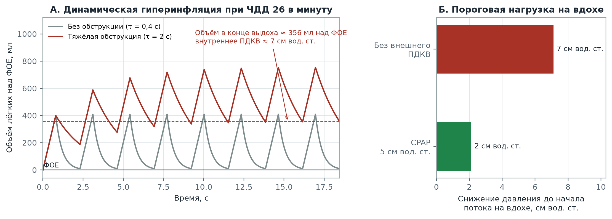
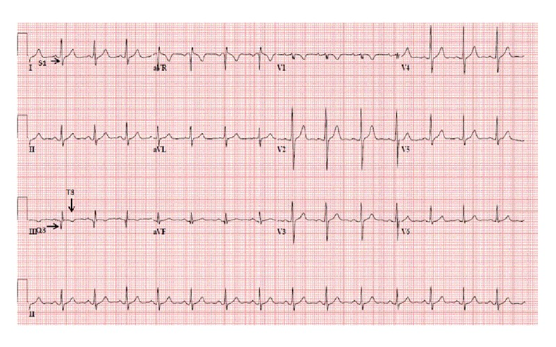
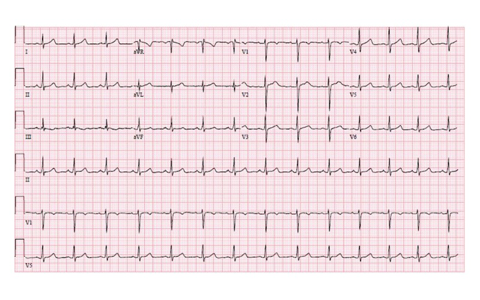

  
Клинический разбор

  
Жизнеугрожающая астма

  
Повторное обращение, гипоксемия, неинвазивная вентиляция и то, чего не видно при бронхоскопии

  

  
Повторный вызов к женщине 32 лет со смешанной бронхиальной астмой через семь часов после отказа от медицинской эвакуации: частота дыхания 26 в минуту, частота сердечных сокращений 140 в минуту, SpO₂ 80 % на атмосферном воздухе, электрокардиографические признаки перегрузки правых отделов сердца. Рассмотрены критерии тяжести обострения и факторы риска смерти от астмы, физиология динамической гиперинфляции и её влияние на кровообращение, догоспитальная терапия по приказу ДЗМ Москвы № 535 в сопоставлении с руководствами GINA и BTS/SIGN, обоснование и доказательная база масочной вентиляции, особенности интубации и искусственной вентиляции лёгких при тяжёлой обструкции, а также интерпретация госпитальных данных: эхокардиографии, электрокардиограмм в динамике и двух бронхоскопий.

  
Серия «Крещение поворотом» · версия 1.1 · 25 ноября 2026 · CC BY-NC-SA 4.0

# Клинический случай

## Слово бригаде

«Последний вызов смены (вот почему так всегда бывает?!). Ехали на астму, повторно. Ну думали, честно говоря, что сейчас уколем ГКС, скорее всего дома оставим, и через час вернемся, смену сдадим. Приезжаем — на кровати сидит девушка с небулайзером, руки дрожат, глаза испуганные. „Помогите, сделайте что-нибудь“. Говорит отдельными словами. Накидываем пульсоксиметр — 80%. Доливаем ей в ее пульмикорт наш беродуал. Кидаем от КРИ шланг прямо через небулайзерную камеру с лекарством. Ну, 84% на кислом. Ставим катетер, дексаметазон по вене, сразу 12 мг. Не растет сатурация. Девушка хватает меня за руку во время введения препарата, смотрит страшно, задыхается. Видно, что дело-то не очень. Звоним на ЦКС, просим бригаду АиР на себя, тащим монитор, подключаем. Все равно плохо. Решаем попробовать НИВЛ. Еще одна пробежка до машины и обратно на 3 этаж с этим Дреггером, будь он неладен, хотя аппарат хороший вообще, тяжелый просто, ужас… Немного возни со шлангами и баллонами, в итоге надеваем маску с ПДКВ 7 мм вод. ст. Пациентка паникует, маску отпихивает, срывает эти резинки. Убрали ПДКВ до 5, что делать… И еле-еле, уже сама не помню как, уговорили руками ее самой прижимать, задышала, даже утечки особо не было, судя по аппарату, прекратившему наконец орать как резаный 🤣. И постепенно сатурация начала подниматься. 87. 90. 91. 93. 94. Каждый шаг — маленькая победа. Магнезию параллельно вводили, не очень веря в ее действие, дробно, по 2–3 кубика, чтобы давление не рушить. Кислород в аппарате ИВЛ закончился у нас, перекидывали на КРИ, а там тоже на исходе. Под ноль все использовали к приезду бригады. Передали. Они ее вывезли. Комната — как поле битвы, везде наше оборудование, ампулы, бумажки, шприцы, кровь из катетера на кровати. Ну вот как-то так… Через два дня посмотрела карту, пациентка все еще на трубе, пишут ей бронхит. А ведь спрашивал ее ответственный по бригаде, не болеет ли. Отрицала.» — *Ю.Н.*

## Данные, известные из наблюдения

Женщина 32 лет, смешанная форма бронхиальной астмы (по данным ЕМИАС). Рост 160 см, масса тела около 55 кг.

**Анамнез.** Приступ удушья с вечера накануне вызова. Около 00:30 вызвана бригада скорой медицинской помощи; после терапии по алгоритмам пациентка отметила незначительное улучшение и от медицинской эвакуации отказалась. Около 07:30 — резкое ухудшение с тошнотой, кашлем и ощущением удушья; приступ подобной тяжести, со слов пациентки, развился впервые. До вызова самостоятельно использовала небулайзер с ипратропия бромидом + фенотеролом в разведении натрия хлоридом 0,9 %; к прибытию бригады проводила ингаляцию будесонида через собственный небулайзер. Признаки текущего респираторного заболевания при опросе отрицала. Аллергологический анамнез, в том числе лекарственный, со слов пациентки, не отягощён.

**Жалобы.** Чувство нехватки воздуха, одышка с затруднённым выдохом, ощущение неполного вдоха.

**Объективный статус.** Состояние тяжёлое. Сознание ясное, 15 баллов по шкале комы Глазго; пациентка возбуждена, контактна, ориентирована, речь внятная, отдельными словами. Вынужденное положение — сидя с упором руками. Кожные покровы бледные, влажные. Частота дыхательных движений 26 в минуту, одышка экспираторная. Дыхание жёсткое, сухие свистящие хрипы над всеми лёгочными полями с обеих сторон; влажных хрипов нет; перкуторно лёгочный звук. Пульс 140 в минуту, ритмичный; артериальное давление 130/80 мм рт. ст., привычное — 120/80 мм рт. ст. SpO₂ 80 % на атмосферном воздухе, 84 % на фоне ингаляции кислорода. Температура тела 36,6 °C.

**Электрокардиограмма.** Синусовая тахикардия с частотой 150 в минуту, вертикальное положение электрической оси, неполная блокада правой ножки пучка Гиса, признаки перегрузки правых отделов сердца. Запись передана на дистанционную консультацию; заключение: астматический статус, рекомендованы консультация реаниматолога консультативного центра и медицинская эвакуация. Тактика ведения согласована с врачом консультативного центра.

**Помощь и динамика.**

| Этап | Вмешательство | АД, мм рт. ст. | ЧСС, мин⁻¹ | ЧДД, мин⁻¹ | SpO₂, % |
|------|------------------------------|--------|-------|-------|-------|
| Исходно | — | 130/80 | 140 | 26 | 80 |
| 1 | К ингаляции будесонида, начатой пациенткой через собственный небулайзер, добавлены ипратропия бромид + фенотерол 2 мл; кислород через КРИ-1, 6 л/мин (поток рассчитан по массе тела по формуле Дарбиняна), подан через небулайзерную камеру | 120/80 | 142 | 26 | 84 |
| 2 | Катетеризация периферической вены (18G); дексаметазон 12 мг (3 мл) внутривенно в разведении натрия хлоридом 0,9 % до 10 мл, доза согласована с врачом консультативного центра; раствор калия хлорида + кальция хлорида + магния хлорида + натрия ацетата + натрия хлорида + яблочной кислоты 500 мл внутривенно капельно; магния сульфат 2 г (25 % — 8 мл) в разведении натрия хлоридом 0,9 % до 20 мл внутривенно дробно по 2–3 мл в течение 20 минут | 120/80 | 138 | 24 | 87 |
| 3 | Неинвазивная вентиляция в режиме CPAP, ПДКВ 7 см вод. ст., снижено до 5 см вод. ст., транспортный аппарат искусственной вентиляции лёгких; фиксацию маски пациентка не переносила, маска удерживалась её руками | 125/80 | 145 | 24 | 92 |

Свистящие хрипы над всеми полями сохранялись на всех этапах. Время на месте вызова — 68 минут.

**Диагноз бригады.** J46 — смешанная астма; астматический статус; острая дыхательная недостаточность III степени. Пациентка передана реанимационной бригаде скорой медицинской помощи.

## Медицинская документация

Данные получены ретроспективно из медицинской документации пациентки. Время указано от вызова бригады (сутки 0 — день вызова).

::: lomka
| Срок | Исследование | Находки |
|--------|--------|----------------------------|
| Сутки 0, отделение реанимации | УЗИ органов брюшной полости | Выполнено в положении сидя: ортопноэ, выраженная одышка. Патологии не выявлено, свободной жидкости нет |
| Сутки 0, отделение реанимации | Дуплексное сканирование вен нижних конечностей | Признаков тромбоза глубоких и поверхностных вен не выявлено |
| Сутки 0, отделение реанимации | УЗИ почек | Патологии не выявлено |
| Сутки 0 | Эхокардиография, фокусное исследование для расчёта фракции выброса по Симпсону | Рост 165 см, масса тела 57 кг, площадь поверхности тела 1,62 м². КДО левого желудочка 49 мл (индекс 30,2 мл/м²), КСО 17 мл, ударный объём 32 мл, фракция выброса 65 %. Правые отделы не описаны |
| Сутки 0, первый стационар | ЭКГ | Синусовая тахикардия 137 в минуту, электрическая ось 67°. Автоматическое измерение: QRS 144 мс, QT 288 мс, QTc 423 мс; в заключении нарушения внутрижелудочковой проводимости не указаны |
| Сутки 0 | Бронхоскопия | ИВЛ через интубационную трубку, дистальный конец трубки в 2 см от карины. Трахея и бронхи до сегментарных осмотрены, просвет свободен; слизистая бронхов умеренно диффузно гиперемирована; умеренное количество вязкого слизистого секрета с обеих сторон. Санация 20 мл изотонического раствора. Заключение: двусторонний диффузный бронхит I степени интенсивности воспаления по Lemoine |
| Сутки 0–1 | Межбольничный перевод бригадой скорой медицинской помощи | Время у первого стационара до начала транспортировки — 2 ч 37 мин, транспортировка — 36 мин; диагноз при переводе J46 |
| Сутки 1, второй стационар | ЭКГ | Синусовая тахикардия 100 в минуту, электрическая ось вертикальная (79°), PQ 0,10 с, QRS 94 мс, QTc 429 мс; заключение: укорочение PQ, нарушение внутрижелудочковой проводимости |
| Сутки 1 | Бронхоскопия | Через интубационную трубку, осмотр до бронхов 3–4-го порядка с обеих сторон. Слизистая бронхов умеренно диффузно гиперемирована, слегка отёчна; в сегментарных бронхах с обеих сторон небольшое количество жидкого мутного слизисто-гнойного секрета. Санация, бронхоальвеолярный лаваж. Заключение: двусторонний диффузный бронхит I степени интенсивности воспаления |
:::

Разбор случая приведён в конце материала.

# Вопросы для размышления

Ответы — в конце материала.

1. По каким признакам обострение бронхиальной астмы относят к тяжёлому и к жизнеугрожающему в руководствах BTS/SIGN и GINA и как с ними соотносится деление строки «Бронхиальная астма» приказа № 535 по уровню SpO₂ 90 %?
2. Какие факторы риска смерти от астмы и какие критерии ответа на терапию учитываются при решении об отказе от медицинской эвакуации? Какие из них присутствуют в наблюдении?
3. Почему SpO₂ ниже 92 % при обострении астмы рассматривается как признак угрозы жизни и почему кислород при астме титруют, а не подают максимальным потоком без ограничения?
4. Что такое динамическая гиперинфляция и внутреннее ПДКВ, каким образом внешнее ПДКВ уменьшает работу дыхания и почему доказательная база неинвазивной вентиляции при астме остаётся слабой?
5. Чем объясняются электрокардиографические признаки перегрузки правых отделов при тяжёлом приступе, с каким состоянием их разграничивают и как этот вопрос решался в наблюдении?
6. Как сочетаются фракция выброса левого желудочка 65 % и ударный индекс около 20 мл/м²?
7. Почему у пациентки, которой потребовалась искусственная вентиляция лёгких, при бронхоскопии описан лишь бронхит I степени и чем различаются находки двух исследований?
8. Какие особенности интубации и искусственной вентиляции лёгких при тяжёлой бронхиальной обструкции имеют значение для бригады, передающей или транспортирующей такого пациента?

# Тяжесть обострения бронхиальной астмы

## Классификация тяжести

Руководство Британского торакального общества и Шотландской межуниверситетской сети (BTS/SIGN 158) выделяет у взрослых четыре степени тяжести обострения. Отнесение к степени проводится по наиболее тяжёлому из имеющихся признаков.

| Степень | Признаки (достаточно одного) |
|-------|-------------------|
| Среднетяжёлое обострение | Нарастание симптомов; пиковая скорость выдоха (ПСВ) более 50–75 % от лучшей или должной; признаки тяжёлого обострения отсутствуют |
| Тяжёлое обострение | ПСВ 33–50 % от лучшей или должной; частота дыхания ≥ 25 в минуту; частота сердечных сокращений ≥ 110 в минуту; невозможность закончить фразу на одном выдохе |
| Жизнеугрожающее обострение (у пациента с тяжёлым обострением) | ПСВ < 33 %; SpO₂ < 92 %; PaO₂ < 8 кПа; нормальное PaCO₂ (4,6–6,0 кПа); нарушение сознания; истощение; аритмия; артериальная гипотензия; цианоз; «немое лёгкое»; слабое дыхательное усилие |
| Почти фатальное обострение | Повышение PaCO₂ и (или) потребность в искусственной вентиляции лёгких с повышенным давлением раздувания |

Руководство GINA использует близкие критерии: тяжёлое обострение характеризуется речью отдельными словами, положением сидя с наклоном вперёд, возбуждением, частотой дыхания более 30 в минуту, участием вспомогательной мускулатуры, частотой сердечных сокращений более 120 в минуту, SpO₂ на воздухе менее 90 % и ПСВ не более 50 %; сонливость, спутанность сознания и «немое лёгкое» указывают на непосредственную угрозу жизни.

Нормальное PaCO₂ в перечне признаков угрозы жизни отражает физиологию обострения: в начале приступа гипервентиляция снижает PaCO₂, и возвращение его к норме у пациента с продолжающейся одышкой указывает на утомление дыхательной мускулатуры и приближение гиперкапнии.

> **Расхождение РФ ↔ международная практика.** В строке «Бронхиальная астма» (J45) приказа № 535 объём помощи разделён по уровню SpO₂: более 90 % (дыхательная недостаточность I–II степени) и менее 90 % (III степень). Строка J46 «Жизнеугрожающая астма (астматический статус) или ДН III–IV ст.» отсылает к строке «Дыхательная недостаточность». Порог угрозы жизни в BTS/SIGN составляет 92 %. Пиковая скорость выдоха, на которой построена международная классификация, в приказе не используется.

## Гипоксемия и гиперкапния

Гипоксемия при обострении астмы обусловлена прежде всего неравномерностью вентиляционно-перфузионного отношения: участки лёгкого за обтурированными бронхами сохраняют перфузию при сниженной вентиляции. Истинный шунт при неосложнённом обострении невелик, поэтому гипоксемия, как правило, корригируется умеренной концентрацией кислорода. Стойкая гипоксемия на фоне кислорода указывает на выраженную обструкцию, ателектазы за слизистыми пробками или осложнения.

Порог 92 % обоснован связью сатурации с газовым составом крови. По данным Carruthers и Harrison (*Thorax*, 1995), при SpO₂ 92 % и выше дыхательная недостаточность с гиперкапнией у пациентов с острой астмой встречалась редко; на этом основании BTS рекомендует исследование газов артериальной крови при SpO₂ ниже 92 %. Сатурация ниже порога, таким образом, указывает на вероятность гиперкапнии, которую пульсоксиметрия не регистрирует.

Подача кислорода высокой концентрации без ограничения повышает PaCO₂ и при астме. В рандомизированном исследовании Perrin et al. (*Thorax*, 2011; 106 пациентов с тяжёлым обострением) при подаче кислорода 8 л/мин через лицевую маску в течение 60 минут повышение транскутанного PCO₂ на 4 мм рт. ст. и более наблюдалось у 44 % пациентов, при титровании до SpO₂ 93–95 % — у 19 %. Механизмы — устранение гипоксической вазоконстрикции в плохо вентилируемых участках с увеличением физиологического мёртвого пространства и эффект Холдейна.

> **Расхождение РФ ↔ международная практика.** GINA рекомендует титровать кислород до SpO₂ 93–95 %, BTS — до 94–98 %. В приказе № 535 ингаляция кислорода предусмотрена при SpO₂ ≤ 90 % без целевого диапазона, а переход к масочной вентиляции — при сохранении SpO₂ ≤ 90 % на фоне ингаляции кислорода максимальным потоком.

## Факторы риска смерти от астмы

GINA относит к факторам риска смерти, связанной с астмой: почти фатальное обострение с интубацией и искусственной вентиляцией лёгких в анамнезе; госпитализацию или неотложное обращение по поводу астмы в течение последнего года; текущий или недавно прекращённый приём системных глюкокортикостероидов; отсутствие базисной терапии ингаляционными глюкокортикостероидами; избыточное использование короткодействующих β₂-агонистов (более одного ингалятора в месяц); психические заболевания и неблагоприятные психосоциальные условия; низкую приверженность лечению; пищевую аллергию; отсутствие письменного плана действий.

Решение о госпитализации в BTS/SIGN основано на ответе на терапию и на обстоятельствах обращения. Госпитализации подлежат пациенты с любым признаком жизнеугрожающего или почти фатального обострения, а также с признаками тяжёлого обострения, сохраняющимися после начальной терапии. Выписка из отделения неотложной помощи допускается при ПСВ более 75 % от лучшей или должной через час после начальной терапии. Порог госпитализации снижается при обращении во второй половине дня и в ночное время, при ночных симптомах и недавних госпитализациях, тяжёлых обострениях в анамнезе, сомнениях в возможности самостоятельной оценки состояния, проживании в одиночестве, неблагоприятных психосоциальных условиях и беременности.

> **Расхождение РФ ↔ международная практика.** В строке J45 медицинская эвакуация предусмотрена при отсутствии эффекта от проведённой терапии и на фоне отмены системных глюкокортикостероидов при их длительном приёме, а при SpO₂ < 90 % — безусловно. Количественный критерий эффекта при SpO₂ > 90 % строкой не определён; факторы риска смерти от астмы и повторное обращение в течение суток критериями эвакуации не названы. При отказе взрослого пациента от медицинской эвакуации проводится активный аудиоконтроль.

# Патофизиология тяжёлого обострения

## Обструкция мелких дыхательных путей

Обструкция при обострении астмы складывается из трёх компонентов: сокращения гладкой мускулатуры бронхов, отёка и воспалительной инфильтрации стенки и закупорки просвета слизью. Бронхолитики устраняют первый компонент за минуты, глюкокортикостероиды уменьшают второй за часы; третий компонент фармакологически устраняется медленнее всего.

Основная зона обструкции — мелкие дыхательные пути диаметром менее 2 мм. При морфометрическом исследовании лёгких умерших от астмы Kuyper et al. (*American Journal of Medicine*, 2003) выявили закупорку просвета слизью в значительно большей доле дыхательных путей, чем у пациентов с астмой, умерших от других причин, и у лиц без астмы; слизистые пробки преобладали в мелких бронхах. Гибкий бронхоскоп позволяет осмотреть трахею, главные, долевые, сегментарные и частично субсегментарные бронхи (3–5-я генерации ветвления), то есть зона основной обструкции при обострении астмы находится дистальнее зоны эндоскопического осмотра.

Вирусные респираторные инфекции — наиболее частый пусковой фактор обострений; в проспективном наблюдении Nicholson et al. (*BMJ*, 1993) у взрослых они сопровождали до 44 % эпизодов ухудшения.

## Динамическая гиперинфляция и внутреннее ПДКВ

При тяжёлой обструкции постоянная времени опорожнения альвеол возрастает, и выдох не успевает завершиться до начала следующего вдоха. Лёгкие опорожняются не до функциональной остаточной ёмкости, а до большего объёма; к концу выдоха в альвеолах сохраняется положительное давление — внутреннее, или скрытое, ПДКВ (auto-PEEP), описанное Pepe и Marini (*American Review of Respiratory Disease*, 1982). Тахипноэ укорачивает выдох и усугубляет гиперинфляцию.

Гиперинфляция имеет три следствия. Дыхание происходит в верхней, пологой части кривой давление — объём, где податливость лёгких ниже и каждый вдох требует большего изменения давления. Диафрагма уплощается и укорачивается, её способность генерировать давление снижается. Внутреннее ПДКВ создаёт пороговую нагрузку: прежде чем начнётся поток воздуха на вдохе, дыхательные мышцы должны снизить давление в альвеолах от уровня внутреннего ПДКВ до атмосферного. Эта нагрузка вместе с сопротивлением бронхов определяет утомление дыхательной мускулатуры.

Внешнее ПДКВ, или CPAP, уравновешивает часть внутреннего ПДКВ: давление на входе в дыхательные пути приближается к давлению в альвеолах в конце выдоха, и пороговая нагрузка уменьшается. При экспериментально индуцированном бронхоспазме Martin et al. (*American Review of Respiratory Disease*, 1982) показали снижение работы дыхания на CPAP. Эффект сохраняется, пока внешнее давление не превышает внутреннее; превышение увеличивает объём лёгких и гиперинфляцию.

Зависимость гиперинфляции от постоянной времени и частоты дыхания показана на однокамерной модели (рис. 1). При частоте дыхания 26 в минуту и длительности вдоха 0,8 с на выдох остаётся 1,5 с. Без обструкции (постоянная времени 0,4 с) этого достаточно, чтобы лёгкие вернулись к функциональной остаточной ёмкости. При постоянной времени 2 с каждый следующий вдох начинается с большего объёма, пока прирост объёма за вдох не уравновесится его убылью за выдох; в установившемся режиме в конце выдоха в лёгких остаётся около 360 мл, что при податливости 50 мл/см вод. ст. соответствует внутреннему ПДКВ около 7 см вод. ст. CPAP 5 см вод. ст. уменьшает пороговую нагрузку до 2 см вод. ст.

<figure>
  
  <figcaption>Рис. 1. Динамическая гиперинфляция на однокамерной модели лёгкого. А — объём лёгких над функциональной остаточной ёмкостью (ФОЕ) при частоте дыхания 26 в минуту, дыхательном объёме 400 мл и длительности вдоха 0,8 с; серая кривая — постоянная времени 0,4 с, красная — 2 с; пунктир — объём в конце выдоха в установившемся режиме. Б — снижение альвеолярного давления, которое дыхательные мышцы создают до начала потока на вдохе, без внешнего ПДКВ и на CPAP 5 см вод. ст. при податливости 50 мл/см вод. ст. Учебная модель с условными значениями параметров, а не измерения у пациентки.</figcaption>
</figure>

## Кровообращение при гиперинфляции

Гиперинфляция и большие колебания внутригрудного давления изменяют работу обоих желудочков. На вдохе резко отрицательное внутригрудное давление увеличивает венозный возврат к правому желудочку; растянутый правый желудочек смещает межжелудочковую перегородку влево и уменьшает наполнение левого (межжелудочковое взаимодействие), а отрицательное давление вокруг левого желудочка увеличивает его постнагрузку. Систолическое давление на вдохе снижается — парадоксальный пульс. Rebuck и Pengelly (*New England Journal of Medicine*, 1973) показали связь величины парадоксального пульса с выраженностью обструкции; значения более 10–12 мм рт. ст. традиционно относят к признакам тяжёлого обострения.

Перерастянутые альвеолы сдавливают внутриальвеолярные капилляры, а гипоксическая вазоконстрикция повышает лёгочное сосудистое сопротивление; постнагрузка правого желудочка возрастает. Положительное давление в грудной клетке в конце выдоха снижает венозный возврат. Сочетание этих механизмов уменьшает наполнение левого желудочка и ударный объём при сохранённой сократимости; минутный объём поддерживается тахикардией. Те же механизмы определяют артериальную гипотензию после интубации (раздел «Интубация и искусственная вентиляция лёгких»).

## Электрокардиографические изменения

При тяжёлом приступе астмы описаны синусовая тахикардия, вертикализация электрических осей зубца P и комплекса QRS, высокий заострённый зубец P во II, III, aVF (P pulmonale), блокада правой ножки пучка Гиса, депрессия сегмента ST и инверсия зубца T в отведениях правого желудочка и нижних отведениях, смещение переходной зоны влево. В систематическом исследовании Siegler (*Thorax*, 1977; 63 пациента с тяжёлым обострением) синусовая тахикардия более 100 в минуту была у всех, аномально вертикальная ось зубца P — у 78 %, P pulmonale — у 22 %, признаки гипертрофии правого желудочка — у одного пациента; отклонение оси вправо и блокада правой ножки не встретились ни разу. Все изменения исчезли после клинического улучшения, ось зубца P нормализовалась в течение 3–4 суток. Gelb et al. (*Journal of Allergy and Clinical Immunology*, 1979; 129 пациентов) выявили P pulmonale у 49 % пациентов с PaCO₂ ≥ 45 мм рт. ст. и pH ≤ 7,37 и у 2,5 % — без гиперкапнии и ацидоза; оси зубца P и комплекса QRS при P pulmonale составили 79 ± 8° и 80 ± 20°. Давление в лёгочной артерии относительно атмосферного при катетеризации было нормальным, а трансмуральное давление на вдохе повышалось за счёт резко отрицательного плеврального давления. Изменения, следовательно, отражают не лёгочную гипертензию в обычном смысле, а растяжение правых камер при больших колебаниях внутригрудного давления и изменение положения сердца при гиперинфляции.

Сочетание тахикардии, гипоксемии и признаков перегрузки правых отделов у молодой женщины требует разграничения с тромбоэмболией лёгочной артерии. В пользу обострения астмы свидетельствуют анамнез, экспираторная одышка, диффузные свистящие хрипы и связь ухудшения с течением приступа; бронхоспазм при тромбоэмболии описан, но диффузная обструкция для неё нехарактерна. Окончательное разграничение проводится в стационаре: компрессионное ультразвуковое исследование вен нижних конечностей, оценка правого желудочка при эхокардиографии, при сохранении подозрения — компьютерная томографическая ангиография или вентиляционно-перфузионная сцинтиграфия.

Arshad et al. (*American Journal of Case Reports*, 2017) описали пациентку 33 лет с тяжёлым обострением астмы во время беременности, у которой на фоне бронхоспазма с тахикардией и гипоксемией, потребовавшей неинвазивной вентиляции, была зарегистрирована картина S1Q3T3 (рис. 2). Картина послужила поводом к исключению тромбоэмболии: вентиляционно-перфузионная сцинтиграфия показала низкую вероятность, допплерография вен нижних конечностей тромбоза не выявила, при эхокардиографии фракция выброса была нормальной, давление в лёгочной артерии — умеренно повышенным. После разрешения бронхоспазма картина исчезла (рис. 3).

<figure class="ekg">
  
  <figcaption>Рис. 2. Электрокардиограмма пациентки 33 лет на фоне тяжёлого бронхоспазма. Стрелками отмечены зубец S в отведении I, зубец Q и инвертированный зубец T в отведении III (картина S1Q3T3). Arshad H. et al., 2017, CC BY-NC-ND 4.0.</figcaption>
</figure>

<figure class="ekg">
  
  <figcaption>Рис. 3. Электрокардиограмма той же пациентки после разрешения бронхоспазма: в отведении III глубокого зубца Q нет, зубец T сглажен, но не инвертирован; небольшой зубец S в отведении I сохраняется. Arshad H. et al., 2017, CC BY-NC-ND 4.0.</figcaption>
</figure>

# Догоспитальная терапия

## Строки приказа № 535

Объём помощи при обострении бронхиальной астмы у взрослых определяют строка «Бронхиальная астма» (J45), строка J46, отсылающая к строке «Дыхательная недостаточность», и сама строка «Дыхательная недостаточность». Положения этих строк сопоставлены с руководствами GINA и BTS/SIGN 158 по компонентам терапии; механизм каждого компонента рассмотрен в следующих подразделах.

::: lomka
| Компонент | Приказ № 535, строки J45 и «Дыхательная недостаточность» | GINA, BTS/SIGN 158 |
|-----|-----------|-----------|
| Кислород | При SpO₂ < 90 %; при сохранении SpO₂ ≤ 90 % — максимальный поток | Титрование до SpO₂ 93–95 % (GINA) или 94–98 % (BTS) |
| Короткодействующий β₂-агонист | Сальбутамол 2,5 мг и (или) ипратропия бромид + фенотерол 2 мл через небулайзер; максимальная суммарная доза ипратропия бромида + фенотерола при дробном введении — 4 мл, сальбутамола — 10 мг | Сальбутамол 2,5–5 мг через небулайзер повторно каждые 15–30 минут; при жизнеугрожающем обострении — ингаляции подряд или непрерывно; небулайзер приводится кислородом |
| М-холинолитик | В составе ипратропия бромида + фенотерола | Ипратропия бромид 0,5 мг каждые 4–6 часов при тяжёлом и жизнеугрожающем обострении |
| Ингаляционный глюкокортикостероид | Будесонид 0,5–1 мг через небулайзер через 5 минут после бронхолитика | Не входит в стандарт ведения тяжёлого обострения в отделении неотложной помощи; GINA допускает добавление в первый час |
| Системный глюкокортикостероид | При недостаточном эффекте ингаляции: преднизолон 90 мг или дексаметазон 8 мг внутривенно | Преднизолон 40–50 мг внутрь или гидрокортизон 100 мг внутривенно каждые 6 часов; в течение первого часа |
| Магния сульфат | При SpO₂ < 90 %: 25 % — 8 мл (2 г) в разведении натрия хлоридом 0,9 % до 20 мл в течение 20 минут | 1,2–2 г внутривенно в течение 20 минут однократно при тяжёлом обострении без ответа на бронхолитики и при жизнеугрожающем обострении |
| Инфузия | Сбалансированный кристаллоидный раствор или натрия хлорид 0,9 % 500 мл | По клинической потребности |
| Масочная вентиляция | НИВЛ/CPAP с ПДКВ 5–10 см вод. ст. при SpO₂ ≤ 90 % на кислороде максимальным потоком | Доказательная база недостаточна для рекомендации (GINA, ERS/ATS 2017) |
| Интубация | При SpO₂ ≤ 80 % на фоне масочной вентиляции или при противопоказаниях к ней | При почти фатальном обострении, утомлении, нарушении сознания, остановке дыхания |
| Аминофиллин, адреналин | Не предусмотрены при астме | Аминофиллин не рекомендуется; адреналин — при анафилаксии и ангиоотёке |
:::

## Расчёт потока кислорода

Формула Т. М. Дарбиняна и соавт. (1976) — минутный объём вентиляции (л/мин) = масса тела (кг) / 10 + 1 — предложена для начальной установки минутного объёма при искусственной вентиляции лёгких в анестезиологии; в отечественной догоспитальной практике по ней задают и газоток аппаратов искусственной вентиляции, работающих по полуоткрытому контуру. Для массы тела 55 кг расчёт даёт 6,5 л/мин.

Формула отражает потребность в вентиляции у пациента с нормальной механикой дыхания. При тяжёлом обострении собственная минутная вентиляция и пиковый инспираторный поток пациента значительно выше: при выраженной одышке пиковый поток вдоха превышает 30–60 л/мин. При подаче кислорода через устройство низкого потока вдыхаемая смесь разбавляется атмосферным воздухом, и фракция кислорода тем ниже, чем выше инспираторный поток пациента. Поток, обеспечивающий целевую сатурацию, у конкретного пациента устанавливается титрованием по SpO₂; приказ № 535 перед переходом к масочной вентиляции предусматривает подачу кислорода максимальным потоком.

## Бронхолитики

Короткодействующий β₂-агонист — основа лечения обострения; при тяжёлом обострении эффективность определяется дозой и частотой ингаляций. Добавление ипратропия бромида к β₂-агонисту при тяжёлом обострении уменьшает частоту госпитализаций и улучшает функцию лёгких. Ингаляция подряд или непрерывная небулизация предусмотрены международными руководствами для пациентов, не ответивших на первую ингаляцию.

> **Расхождение РФ ↔ международная практика.** Приказ № 535 ограничивает суммарную дозу ипратропия бромида + фенотерола 4 мл (80 капель) при дробном введении. BTS/SIGN при жизнеугрожающем обострении предусматривает повторные и непрерывные ингаляции β₂-агониста без фиксированного верхнего предела на догоспитальном этапе.

## Глюкокортикостероиды

Системные глюкокортикостероиды ускоряют разрешение обострения и уменьшают частоту госпитализаций; по метаанализу Cochrane (Rowe et al., 2001) введение в течение первого часа в отделении неотложной помощи снижало частоту госпитализаций (отношение шансов 0,40). Эффект развивается через 4–6 часов, поэтому эффект глюкокортикостероида, введённого на догоспитальном этапе, приходится на первые часы пребывания в стационаре, а не на время вызова. Пероральный путь при сохранённом глотании и отсутствии рвоты по эффективности сопоставим с внутривенным. Однократный приём дексаметазона 12 мг у взрослых сопоставлен с пятидневным курсом преднизолона 50 мг в исследовании не меньшей эффективности (Rehrer et al., *Annals of Emergency Medicine*, 2016).

## Магния сульфат

Магний блокирует потенциалзависимые кальциевые каналы гладкомышечных клеток бронхов, уменьшает высвобождение ацетилхолина в нервно-мышечных синапсах и стабилизирует тучные клетки. По метаанализу Cochrane (Kew et al., 2014; 14 исследований, 2313 пациентов) однократная внутривенная инфузия у взрослых в отделении неотложной помощи снижала частоту госпитализации (отношение шансов 0,75; 95 % ДИ 0,60–0,92) и улучшала функцию лёгких. В крупнейшем исследовании 3Mg (Goodacre et al., *Lancet Respiratory Medicine*, 2013; 1109 пациентов) снижение частоты госпитализации статистической значимости не достигло. Доза приказа — 2 г за 20 минут — совпадает с верхней границей диапазона BTS/SIGN. Побочные эффекты при этой скорости — ощущение жара, артериальная гипотензия, брадикардия.

## Масочная вентиляция

Обоснование CPAP при астме изложено выше: внешнее ПДКВ уменьшает пороговую нагрузку внутреннего ПДКВ. Неинвазивная вентиляция с поддержкой давлением дополнительно разгружает дыхательную мускулатуру на вдохе.

Доказательная база ограничена. Систематический обзор Cochrane (Lim et al., 2012; 5 исследований, 206 участников) не позволил сделать заключение о влиянии неинвазивной вентиляции на частоту интубации и летальность при тяжёлом обострении астмы. Руководство ERS/ATS по неинвазивной вентиляции (Rochwerg et al., *European Respiratory Journal*, 2017) рекомендаций при астме не сформулировало из-за неопределённости данных. GINA расценивает данные о роли неинвазивной вентиляции при астме как слабые; если она применяется, пациент находится под постоянным наблюдением и не получает седации.

Приказ № 535 в строке «Дыхательная недостаточность» называет противопоказаниями к НИВЛ/CPAP пневмоторакс, инородное тело дыхательных путей, слабость дыхательных мышц, поражения дыхательного центра и периферических нервов, частоту дыхания более 35 или менее 10 в минуту, артериальную гипотензию с систолическим давлением менее 90 мм рт. ст. и нарушение сознания. Для пациента с астмой практическое значение имеют три условия: способность переносить маску при возбуждении, герметичность прилегания и наблюдение за признаками утомления. Утечка через неплотно прилегающую маску снижает фактическое давление в дыхательных путях и увеличивает поток, который аппарат подаёт для его поддержания.

> **Расхождение РФ ↔ международная практика.** Приказ № 535 включает НИВЛ/CPAP в последовательность помощи при дыхательной недостаточности, в том числе вентиляционной при бронхиальной астме. Международные руководства рекомендации по неинвазивной вентиляции при астме не дают.

## Положение при транспортировке

Строка «Дыхательная недостаточность» предусматривает транспортировку в пронационной позиции или латеропозиции. Строка объединяет гипоксемическую и вентиляционную недостаточность; данные о пользе пронационной позиции получены при гипоксемической недостаточности (исследование PROSEVA, Guérin et al., *New England Journal of Medicine*, 2013). При обструкции пациент занимает положение сидя с упором на руки, при котором вспомогательная дыхательная мускулатура работает с фиксированной точкой опоры.

# Интубация и искусственная вентиляция лёгких

Интубация при тяжёлой обструкции относится к процедурам высокого риска. Показаниями служат остановка дыхания или кровообращения, нарушение сознания, утомление дыхательной мускулатуры и прогрессирующая гиперкапния с ацидозом несмотря на терапию.

**Артериальная гипотензия после интубации.** Переход к вентиляции с положительным давлением на фоне гиперинфляции снижает венозный возврат; к этому добавляются вазодилатирующее действие препаратов индукции и относительная гиповолемия после многочасового тахипноэ и уменьшения приёма жидкости. Частая ручная вентиляция мешком после интубации быстро наращивает гиперинфляцию. При артериальной гипотензии или остановке кровообращения у вентилируемого пациента с астмой ERC (Lott et al., *Resuscitation*, 2021) рекомендует отсоединить дыхательный контур и дать лёгким опорожниться, а также исключить напряжённый пневмоторакс.

**Параметры вентиляции.** Цель — дать время для выдоха: дыхательный объём 6–8 мл/кг идеальной массы тела, частота 10–12 в минуту, отношение вдоха к выдоху 1:4–1:5 за счёт высокого инспираторного потока, внешнее ПДКВ не выше уровня внутреннего. Tuxen и Lane (*American Review of Respiratory Disease*, 1987) показали, что гиперинфляция и давление в дыхательных путях определяются прежде всего минутным объёмом вентиляции; объём лёгких в конце вдоха выше функциональной остаточной ёмкости более 20 мл/кг ассоциирован с артериальной гипотензией и баротравмой (Tuxen et al., 1992). Гиперкапния при этой стратегии допускается (пермиссивная гиперкапния, Darioli и Perret, 1984) при pH не ниже 7,15–7,20. Для женщины ростом 160 см идеальная масса тела составляет около 52 кг, дыхательный объём 6–8 мл/кг — 315–420 мл.

> **Расхождение РФ ↔ международная практика.** Строка «Дыхательная недостаточность» задаёт для искусственной вентиляции целевое значение EtCO₂ 35–45 мм рт. ст. При тяжёлой обструкции международная практика допускает гиперкапнию ради уменьшения гиперинфляции; кроме того, при неравномерной вентиляции EtCO₂ существенно ниже PaCO₂, и нормализация EtCO₂ требует минутного объёма, усугубляющего гиперинфляцию.

**Резервные методы.** При гиперкапнии, некорригируемой искусственной вентиляцией, применяются ингаляционные анестетики и экстракорпоральная поддержка. По данным регистра ELSO (Mikkelsen et al., *ASAIO Journal*, 2009; 24 пациента с астматическим статусом) выживаемость до выписки при экстракорпоральной поддержке составила 83 %.

**Бронхоскопия у вентилируемого пациента.** Лечебная бронхоскопия с санацией удаляет секрет из доступных бронхов; бронхоальвеолярный лаваж используется для микробиологической диагностики. Влияние санационной бронхоскопии на течение астматического статуса изучено только в описаниях серий случаев.

# Возвращение к клиническому случаю

**Хронология.** Начало приступа — вечер накануне вызова; первая бригада — около 00:30, незначительное улучшение, отказ от эвакуации; резкое ухудшение — около 07:30; повторный вызов — через полчаса; передача реанимационной бригаде — через 68 минут после прибытия. В тот же день пациентка госпитализирована в отделение реанимации; в ночь на следующие сутки переведена в другой многопрофильный стационар. В документации отделения реанимации есть исследование, выполненное в положении сидя при ортопноэ на самостоятельном дыхании, и исследования, выполненные при искусственной вентиляции лёгких через интубационную трубку.

**Тяжесть при повторном вызове.** Частота дыхания 26 в минуту и частота сердечных сокращений 140 в минуту соответствуют тяжёлому обострению по BTS/SIGN, речь отдельными словами — тяжёлому обострению по BTS/SIGN и GINA; SpO₂ 80 % на воздухе — жизнеугрожающему. Определялись участки «немого лёгкого», что также соответствует жизнеугрожающему обострению. Нарушения сознания и артериальной гипотензии не было; возбуждение при ясном сознании соответствует критериям тяжёлого обострения GINA. Пиковая скорость выдоха не измерялась.

**Повторное обращение.** Из факторов, которые BTS/SIGN связывает со снижением порога госпитализации, в наблюдении присутствуют обращение в ночное время и повторное обращение в течение суток. Самостоятельное использование небулайзера до вызова указывает на интенсивное применение короткодействующего β₂-агониста дома; наличие у пациентки будесонида для небулайзера — на назначенную терапию ингаляционным глюкокортикостероидом. Течение наблюдения иллюстрирует ограничение качественного критерия «эффект от терапии»: незначительное улучшение через семь часов сменилось жизнеугрожающим обострением.

**Последовательность терапии.** Объём помощи соответствует ветви SpO₂ < 90 % строки J45 с переходом к строке «Дыхательная недостаточность»: кислород, ипратропия бромид + фенотерол, добавленный к ингаляции будесонида, венозный доступ, сбалансированный кристаллоидный раствор, системный глюкокортикостероид, магния сульфат в дозе строки, затем CPAP с ПДКВ 5 см вод. ст. Доза дексаметазона 12 мг превышает дозу строки (8 мг), согласована с врачом консультативного центра и отражена в карте вызова. Бронхолитик введён однократно в дозе 2 мл из допустимых строкой 4 мл. Поток кислорода 6 л/мин рассчитан по формуле Дарбиняна для массы тела 55 кг (6,5 л/мин); строка «Дыхательная недостаточность» предусматривает переход к масочной вентиляции при сохранении гипоксемии на фоне максимального потока, а международные руководства — титрование потока по SpO₂ (раздел «Расчёт потока кислорода»).

**Ответ на терапию.** На фоне кислорода и ингаляции бронхолитика SpO₂ повысилась с 80 до 84 %, после магния сульфата и глюкокортикостероида — до 87 %, на CPAP — до 92 % по карте вызова, по описанию бригады к передаче — до 94 %; частота дыхания снизилась с 26 до 24 в минуту, частота сердечных сокращений сохранялась на уровне 138–145 в минуту. SpO₂ 92 % на CPAP с кислородом находится на пороге жизнеугрожающего обострения, а минимальный ответ на кислород и β₂-агонист относится к признакам, при которых BTS/SIGN предусматривает повторные ингаляции и раннее привлечение реаниматолога. Решение о консультации реаниматолога и передаче реанимационной бригаде принято по рекомендации дистанционной консультации.

**Переносимость масочной вентиляции.** Перевод на CPAP проходил тяжело. CPAP начат с ПДКВ 7 см вод. ст.; фиксированную маску пациентка не переносила, отталкивала её и срывала ремни, ПДКВ снижено до 5 см вод. ст. Затем пациентка согласилась удерживать маску собственными руками; по показаниям аппарата значимой утечки не было, и сатурация постепенно повышалась. Ощущение нехватки воздуха при наложении маски характерно для пациентов с выраженной одышкой и возбуждением; удержание маски рукой снижает герметичность прилегания, а при утечке давление 5 см вод. ст. в дыхательных путях может не достигаться. Переносимость маски у возбуждённой пациентки в вынужденном положении сидя ограничивает применимость метода независимо от его доказательной базы; седация, облегчающая адаптацию к маске, при астме вне отделения реанимации GINA не рекомендуется.

**Электрокардиограмма в динамике.** На догоспитальной записи — синусовая тахикардия 150 в минуту, вертикальная ось, неполная блокада правой ножки пучка Гиса и признаки перегрузки правых отделов. В первом стационаре — ЧСС 137 в минуту, ось 67°; автоматически измеренная длительность QRS 144 мс в заключении не интерпретирована, и без записи установить, отражает ли она блокаду ножки или ошибку измерения, невозможно. На следующие сутки — ЧСС 100 в минуту, QRS 94 мс. Сужение комплекса и уменьшение тахикардии по мере лечения соответствуют обратимому характеру изменений при обострении астмы. Ось зубца P 90° и ось QRS 79° на следующие сутки совпадают со значениями, которые Gelb et al. описали у пациентов с P pulmonale при тяжёлом обострении, и с аномально вертикальной осью P — наиболее частой находкой в серии Siegler. Блокада правой ножки, зарегистрированная бригадой, в серии Siegler не встретилась, но описана в более ранних наблюдениях.

**Разграничение с тромбоэмболией лёгочной артерии.** Анамнез астмы, экспираторная одышка и свистящие хрипы над всеми полями указывали на обострение астмы. В отделении реанимации выполнено дуплексное сканирование вен нижних конечностей — тромбоза не выявлено. Правый желудочек при эхокардиографии не оценивался.

**Эхокардиография.** Фракция выброса 65 % при конечно-диастолическом объёме 49 мл (индекс 30,2 мл/м², нижняя граница референсного диапазона для женщин — 29 мл/м²; Lang et al., 2015) и ударном объёме 32 мл (ударный индекс около 20 мл/м² при нижней границе нормы около 35 мл/м²). Сократимость сохранена, наполнение левого желудочка снижено. Картина соответствует механизмам, изложенным в разделе «Кровообращение при гиперинфляции», и согласуется с относительной гиповолемией после многочасового тахипноэ. Время исследования относительно интубации не указано, поэтому разграничить вклад спонтанного дыхания с большими колебаниями внутригрудного давления и вентиляции с положительным давлением нельзя.

**Бронхоскопия.** Оба исследования выполнены через интубационную трубку. В первом описан вязкий слизистый секрет в умеренном количестве и гиперемия слизистой, во втором — отёк слизистой и жидкий мутный слизисто-гнойный секрет с бронхоальвеолярным лаважем. Бронхит I степени по Lemoine при тяжести, потребовавшей искусственной вентиляции лёгких, не противоречит диагнозу: основная обструкция и слизистые пробки при астме располагаются в мелких дыхательных путях, дистальнее зоны осмотра. Бронхоскопия исключила центральные причины обструкции — инородное тело, стеноз трахеи и бронхов, опухоль, — которые входят в дифференциальный ряд первого тяжёлого приступа у взрослого. Изменение характера секрета от вязкого слизистого к слизисто-гнойному и выполнение лаважа указывают на исследование инфекционного компонента; источник — инфекция как пусковой фактор обострения или инфекция, связанная с искусственной вентиляцией лёгких, — по имеющимся данным не устанавливается.

**Межбольничный перевод.** Пациентка переведена в другой многопрофильный стационар в течение первых суток после поступления. Причина перевода в доступной документации не указана; находилась ли пациентка во время транспортировки на искусственной вентиляции лёгких, неизвестно.

**Данные, оставшиеся несобранными.** Пиковая скорость выдоха; показатели первой бригады; газы артериальной крови; время и показания к интубации; параметры искусственной вентиляции лёгких; оценка правого желудочка при эхокардиографии; результаты исследования лаважной жидкости. Отсутствие этих сведений ограничивает ретроспективную интерпретацию.

**Исход.** Пациентка госпитализирована в отделение реанимации; в ходе лечения проводилась искусственная вентиляция лёгких через интубационную трубку; в течение первых суток переведена в другой многопрофильный стационар. По классификации BTS/SIGN обострение, потребовавшее искусственной вентиляции, относится к почти фатальному. На момент подготовки материала сведения о дальнейшем течении отсутствуют.

# Ответы на вопросы для размышления

**1.** По BTS/SIGN тяжёлое обострение определяется ПСВ 33–50 %, частотой дыхания ≥ 25 в минуту, частотой сердечных сокращений ≥ 110 в минуту или невозможностью закончить фразу; жизнеугрожающее — ПСВ < 33 %, SpO₂ < 92 %, нормальным или повышенным PaCO₂, нарушением сознания, истощением, аритмией, гипотензией, цианозом, «немым лёгким», слабым дыхательным усилием. GINA относит к тяжёлому обострению речь словами, возбуждение, частоту дыхания > 30, ЧСС > 120, SpO₂ < 90 %, ПСВ ≤ 50 %. Строка J45 делит помощь по SpO₂ 90 % без использования ПСВ; порог угрозы жизни BTS (92 %) выше порога строки.

**2.** Факторы риска GINA: почти фатальная астма с интубацией в анамнезе, госпитализации и неотложные обращения за последний год, текущий или недавно прекращённый приём системных глюкокортикостероидов, отсутствие ингаляционных глюкокортикостероидов, избыточное использование короткодействующих β₂-агонистов, неблагоприятные психосоциальные условия, низкая приверженность, пищевая аллергия, отсутствие плана действий. Критерий ответа BTS/SIGN — ПСВ > 75 % через час после терапии при отсутствии признаков тяжёлого обострения; порог госпитализации снижается при обращении в вечернее и ночное время, недавних госпитализациях, тяжёлых обострениях в анамнезе, проживании в одиночестве. В наблюдении присутствуют ночное обращение, повторное обращение в течение суток и интенсивное использование бронхолитика дома; остальные факторы не документированы.

**3.** SpO₂ < 92 % указывает на вероятность гиперкапнии, которую пульсоксиметрия не регистрирует (Carruthers и Harrison, 1995), и служит показанием к исследованию газов крови. Кислород высокой концентрации повышает PaCO₂ за счёт устранения гипоксической вазоконстрикции с ростом мёртвого пространства и эффекта Холдейна: в исследовании Perrin et al. (2011) повышение PCO₂ на 4 мм рт. ст. и более — у 44 % при 8 л/мин через маску против 19 % при титровании до 93–95 %.

**4.** При обструкции выдох не завершается до следующего вдоха, лёгкие опорожняются не до функциональной остаточной ёмкости, и в конце выдоха в альвеолах сохраняется положительное давление — внутреннее ПДКВ. Оно создаёт пороговую нагрузку на вдохе, гиперинфляция снижает податливость и уплощает диафрагму. Внешнее ПДКВ уравновешивает часть внутреннего и уменьшает пороговую нагрузку, пока не превышает его. Доказательная база слабая: обзор Cochrane (5 исследований, 206 участников) не позволил сделать заключение о влиянии на интубацию и летальность, ERS/ATS (2017) рекомендаций не дало.

**5.** Наиболее частые находки — синусовая тахикардия и аномально вертикальная ось зубца P (78 % в серии Siegler), реже P pulmonale (22 %), которая ассоциирована с гиперкапнией и ацидозом (49 % против 2,5 %; Gelb et al., 1979). Механизмы — растяжение правых камер при резко отрицательном плевральном давлении на вдохе, повышение сопротивления лёгочных сосудов при гиперинфляции и гипоксемии, изменение положения сердца при уплощении диафрагмы, действие β₂-агонистов; изменения обратимы. Разграничение проводится с тромбоэмболией лёгочной артерии. В наблюдении за астму свидетельствовали анамнез, экспираторная одышка и диффузные свистящие хрипы; в стационаре тромбоз вен нижних конечностей исключён дуплексным сканированием, а на следующие сутки ЭКГ показала сужение QRS и урежение ритма.

**6.** Сократимость левого желудочка сохранена, но его наполнение снижено: индекс КДО 30,2 мл/м² на нижней границе нормы, ударный индекс около 20 мл/м² при норме от 35 мл/м². Механизмы — снижение венозного возврата при гиперинфляции, межжелудочковое взаимодействие при перегрузке правого желудочка, повышение постнагрузки левого желудочка при резко отрицательном внутригрудном давлении на вдохе, относительная гиповолемия после многочасового тахипноэ. Минутный объём поддерживается тахикардией.

**7.** Бронхоскоп позволяет осмотреть бронхи до сегментарных и частично субсегментарных, тогда как основная обструкция и слизистые пробки при астме располагаются в мелких дыхательных путях диаметром менее 2 мм (Kuyper et al., 2003). Значение бронхоскопии — исключение центральной обструкции (инородное тело, стеноз, опухоль) и санация доступных бронхов. В первом исследовании описан вязкий слизистый секрет, во втором — отёк слизистой и слизисто-гнойный секрет с выполнением бронхоальвеолярного лаважа, что указывает на исследование инфекционного компонента.

**8.** После интубации высок риск артериальной гипотензии из-за снижения венозного возврата при гиперинфляции, действия препаратов индукции и гиповолемии; частая ручная вентиляция мешком усугубляет гиперинфляцию. Вентиляция строится на удлинении выдоха: дыхательный объём 6–8 мл/кг идеальной массы тела, частота 10–12 в минуту, отношение вдоха к выдоху 1:4–1:5, допустимая гиперкапния. При внезапной гипотензии или остановке кровообращения у вентилируемого пациента дыхательный контур отсоединяется для опорожнения лёгких и исключается напряжённый пневмоторакс (ERC, 2021). Целевой EtCO₂ 35–45 мм рт. ст. по строке «Дыхательная недостаточность» при тяжёлой обструкции может требовать минутного объёма, увеличивающего гиперинфляцию.

# Источники

- Global Initiative for Asthma. *Global Strategy for Asthma Management and Prevention*, 2024 update — классификация тяжести обострения, факторы риска смерти от астмы, целевая SpO₂ 93–95 %, неинвазивная вентиляция, аминофиллин и адреналин.
- British Thoracic Society, Scottish Intercollegiate Guidelines Network. *British guideline on the management of asthma* (SIGN 158), 2019 — степени тяжести обострения у взрослых, критерии госпитализации и выписки, дозы бронхолитиков, магния сульфата, глюкокортикостероидов, целевая SpO₂ 94–98 %.
- Carruthers D.M., Harrison B.D.W. Arterial blood gas analysis or oxygen saturation in the assessment of acute asthma? *Thorax*, 1995; 50(2): 186–188 — порог SpO₂ 92 %.
- Perrin K., Wijesinghe M., Healy B. et al. Randomised controlled trial of high concentration versus titrated oxygen therapy in severe exacerbations of asthma. *Thorax*, 2011; 66(11): 937–941 — повышение PCO₂ у 44 % против 19 %.
- Kuyper L.M., Paré P.D., Hogg J.C. et al. Characterization of airway plugging in fatal asthma. *American Journal of Medicine*, 2003; 115(1): 6–11.
- Nicholson K.G., Kent J., Ireland D.C. Respiratory viruses and exacerbations of asthma in adults. *BMJ*, 1993; 307(6910): 982–986.
- Pepe P.E., Marini J.J. Occult positive end-expiratory pressure in mechanically ventilated patients with airflow obstruction: the auto-PEEP effect. *American Review of Respiratory Disease*, 1982; 126(1): 166–170.
- Martin J.G., Shore S., Engel L.A. Effect of continuous positive airway pressure on respiratory mechanics and pattern of breathing in induced asthma. *American Review of Respiratory Disease*, 1982; 126(5): 812–817.
- Rebuck A.S., Pengelly L.D. Development of pulsus paradoxus in the presence of airways obstruction. *New England Journal of Medicine*, 1973; 288(2): 66–69.
- Siegler D. Reversible electrocardiographic changes in severe acute asthma. *Thorax*, 1977; 32(3): 328–332 — 63 пациента; вертикальная ось зубца P у 78 %, P pulmonale у 22 %, отклонения оси вправо и блокады правой ножки нет; обратимость изменений.
- Gelb A.F. et al. P pulmonale in status asthmaticus. *Journal of Allergy and Clinical Immunology*, 1979; 64(1): 18–22 — 129 пациентов; P pulmonale у 49 % при гиперкапнии и ацидозе и у 2,5 % без них; трансмуральное давление в лёгочной артерии.
- Arshad H., Khan R.R., Khaja M. Case report of S1Q3T3 electrocardiographic abnormality in a pregnant asthmatic patient during acute bronchospasm. *American Journal of Case Reports*, 2017; 18: 110–113.
- Дарбинян Т.М. и соавт., 1976 — формула минутного объёма вентиляции: масса тела / 10 + 1 (л/мин).
- Rowe B.H., Spooner C., Ducharme F.M. et al. Early emergency department treatment of acute asthma with systemic corticosteroids. *Cochrane Database of Systematic Reviews*, 2001; (1): CD002178 — отношение шансов госпитализации 0,40.
- Rehrer M.W., Liu B., Rodriguez M. et al. A randomized controlled noninferiority trial of single dose of oral dexamethasone versus 5 days of oral prednisone in acute adult asthma. *Annals of Emergency Medicine*, 2016; 68(5): 608–613.
- Kew K.M., Kirtchuk L., Michell C.I. Intravenous magnesium sulfate for treating adults with acute asthma in the emergency department. *Cochrane Database of Systematic Reviews*, 2014; (5): CD010909 — 14 исследований, 2313 пациентов, отношение шансов госпитализации 0,75.
- Goodacre S., Cohen J., Bradburn M. et al. Intravenous or nebulised magnesium sulphate versus standard therapy for severe acute asthma (3Mg trial). *Lancet Respiratory Medicine*, 2013; 1(4): 293–300.
- Lim W.J., Mohammed Akram R., Carson K.V. et al. Non-invasive positive pressure ventilation for treatment of respiratory failure due to severe acute exacerbations of asthma. *Cochrane Database of Systematic Reviews*, 2012; (12): CD004360.
- Rochwerg B., Brochard L., Elliott M.W. et al. Official ERS/ATS clinical practice guidelines: noninvasive ventilation for acute respiratory failure. *European Respiratory Journal*, 2017; 50(2): 1602426.
- Guérin C., Reignier J., Richard J.C. et al. Prone positioning in severe acute respiratory distress syndrome (PROSEVA). *New England Journal of Medicine*, 2013; 368(23): 2159–2168.
- Tuxen D.V., Lane S. The effects of ventilatory pattern on hyperinflation, airway pressures, and circulation in mechanical ventilation of patients with severe air-flow obstruction. *American Review of Respiratory Disease*, 1987; 136(4): 872–879.
- Tuxen D.V., Williams T.J., Scheinkestel C.D. et al. Use of a measurement of pulmonary hyperinflation to control the level of mechanical ventilation in patients with acute severe asthma. *American Review of Respiratory Disease*, 1992; 146(5): 1136–1142.
- Darioli R., Perret C. Mechanical controlled hypoventilation in status asthmaticus. *American Review of Respiratory Disease*, 1984; 129(3): 385–387.
- Lott C., Truhlář A., Alfonzo A. et al. European Resuscitation Council Guidelines 2021: cardiac arrest in special circumstances. *Resuscitation*, 2021; 161: 152–219.
- Mikkelsen M.E., Woo Y.J., Sager J.S. et al. Outcomes using extracorporeal life support for adult respiratory failure due to status asthmaticus. *ASAIO Journal*, 2009; 55(1): 47–52.
- Lang R.M., Badano L.P., Mor-Avi V. et al. Recommendations for cardiac chamber quantification by echocardiography in adults. *Journal of the American Society of Echocardiography*, 2015; 28(1): 1–39 — референсные значения индекса КДО левого желудочка.
- Приказ Департамента здравоохранения города Москвы № 535 от 18.05.2023 «Об утверждении Алгоритмов оказания скорой и неотложной медицинской помощи» — строки «Бронхиальная астма» (J45), «Жизнеугрожающая астма (астматический статус) или ДН III–IV ст.» (J46), «Дыхательная недостаточность» (J96, J81, J80).

# Источники иллюстраций

| Файл | Что изображено | Источник |
|------|------------|------------|
| `ekg_bronhospazm.jpg` | ЭКГ на фоне тяжёлого бронхоспазма, картина S1Q3T3 | Arshad H., Khan R.R., Khaja M. *American Journal of Case Reports*, 2017; 18: 110–113, рис. 1; CC BY-NC-ND 4.0; воспроизведено без изменений |
| `ekg_razreshenie.jpg` | ЭКГ той же пациентки после разрешения бронхоспазма | Там же, рис. 2; CC BY-NC-ND 4.0; воспроизведено без изменений |
| `auto_pdkv.png` | Динамическая гиперинфляция и пороговая нагрузка на однокамерной модели | Построено для настоящего материала (`images/postroit.py`) |

# Выходные данные

**Материал:** «Жизнеугрожающая астма». Версия 1.1 от 25 ноября 2026.

**Серия:** «Крещение поворотом» — клинические разборы догоспитальной практики.

**Лицензия:** текст — Creative Commons «С указанием авторства — Некоммерческая — С сохранением условий» 4.0 (CC BY-NC-SA 4.0).

**Оговорка.** Материал носит учебный характер, не является нормативным документом, не заменяет действующие протоколы и клинические рекомендации и не может использоваться как единственное основание для клинического решения. Дозы, показания и маршрутизацию необходимо проверять по действующим первоисточникам. Ответственность за клинические решения несёт медицинский работник, а не автор материала.

**О клинических случаях.** Случаи обезличены: нет имён, дат вызовов, адресов, номеров карт вызова, названий стационаров; сроки указаны относительно дня вызова. Совпадения с чужой практикой возможны и неизбежны.

**Нашли ошибку?** Сообщить можно через раздел Issues репозитория проекта; исправление выходит новой версией, а изменение фиксируется в журнале изменений.
