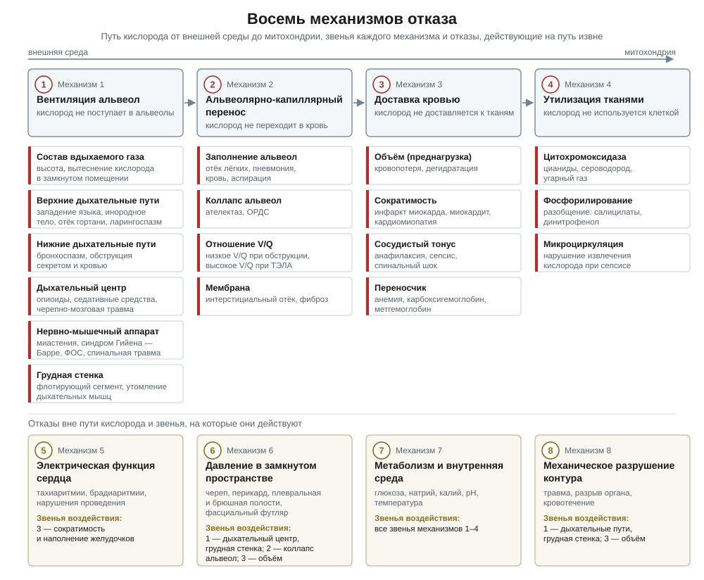

# Предел прочности. Восемь механизмов отказа человеческого организма

Редакция 1.4 от 14.11.2026.

---

## 1. Назначение

Курс предназначен для фельдшеров и врачей выездных бригад. Цель —
устойчивые навыки распознавания жизнеугрожающих состояний у постели больного
и действия по Алгоритмам оказания скорой и неотложной медицинской помощи
(приказ ДЗМ г. Москвы № 535 от 18.05.2023). Акцент — на практике:
физикальное обследование, интерпретация показателей мониторинга и ЭКГ,
выбор тактики и маршрутизации. Патофизиология излагается в объёме,
необходимом для понимания действия.

Рамка курса — восемь механизмов отказа, к которым сводится любое
жизнеугрожающее состояние: (1) воздух не попадает в лёгкие; (2) кислород не
диффундирует через альвеолу; (3) кислород не доставляется кровью; (4)
кислород не извлекается тканями; (5) нарушена электрическая функция сердца;
(6) давление в закрытой полости; (7) метаболизм и среда; (8) механическое
разрушение и потеря целостности контура. Каждая тема относится к одному или
нескольким механизмам; механизм определяет действие в первые минуты, до
уточнения нозологического диагноза.

<figure>

<figcaption>Рис. 1. Классификация курса. Горизонтальная ось изображает путь кислорода от внешней среды до митохондрии; механизмы 1–4 расположены на этом пути, механизмы 5–8 нарушают работу системы вне него. Прерывание на любом уровне даёт у постели больного сходную клиническую картину.</figcaption>
</figure>

К каждой теме готовится лекция для самостоятельного чтения. Для
узкоспециальных тем планируется привлечение экспертов.

## 2. Формат занятия

| Параметр | Значение |
|---|---|
| Продолжительность | 90 минут (академическая пара) |
| Периодичность | Одно занятие в неделю |
| Объём | Вводное занятие и 48 тем в четырёх циклах, около одного учебного года |
| Аудитория | Фельдшеры и врачи выездных бригад |
| Оснащение | Компьютер с проектором или телевизором; для практики — фонендоскопы, электрокардиограф, манекен для СЛР, укладка |

| Часть | Время | Содержание |
|---|---|---|
| Клинический случай | 10 мин | Ситуация с вызова; вопросы к слушателям до изложения материала |
| Материал | 35 мин | Распознавание, пороговые значения, действие по приказу № 535 со ссылкой на строку |
| Практика | 30 мин | Навык руками: обследование, ЭКГ, манекен, задачи по картам вызова |
| Ловушки и вопросы | 15 мин | Типичные ошибки, недопустимые действия, вопросы слушателей |

Слайды показываются на экране; поверх слайда и на чистой доске можно
рисовать. К каждому занятию прилагается раздаточная карточка на одну
страницу и ссылка на полную лекцию для самостоятельного чтения.

## 3. Тематический план

### Вводное занятие. Восемь механизмов отказа

Рамка курса, границы её применимости, разбор трёх примеров (болезнь
Паркинсона, перфорация язвы, шизофрения) по механизмам отказа. Практика:
отнесение вызовов последней смены к механизмам.

### Цикл 1. Кислород и перфузия (темы 1–11)

| № | Тема | Механизмы | Практическая часть |
|---|---|---|---|
| 1 | Основы дыхательной недостаточности | 1, 2 | Три вопроса у постели больного; осмотр работы дыхания; проба с кислородом; капнограмма |
| 2 | Острый коронарный синдром | 3, 5 | ИМпST по артериям на плёнках; Wellens, de Winter, Сгарбосса |
| 3 | Острая сердечная недостаточность и кардиогенный отёк лёгких | 2, 3 | Гемодинамические профили; расчёт инфузии по приложениям приказа |
| 4 | Проходимость дыхательных путей и её потеря | 1 | Приёмы, воздуховоды, надгортанные устройства, вентиляция мешком на манекене |
| 5 | Обструкция нижних дыхательных путей: астма и ХОБЛ | 1 | Оценка тяжести, небулайзерная терапия, «немое лёгкое» |
| 6 | Пневмония, плевральный выпот, пневмоторакс | 2, 6 | Топография лёгких, сравнительная перкуссия и аускультация в парах; физикальные синдромы; декомпрессия на манекене |
| 7 | Тромбоэмболия лёгочной артерии | 2, 3 | Претестовая вероятность, ЭКГ-признаки, стабильная и нестабильная форма |
| 8 | Шок: общая механика и четыре типа | 3, 4 | Разделение по коже, венам, лёгким, сердцу |
| 9 | Кровопотеря и инфузионная тактика | 3, 8 | Остановка кровотечения, жгут, транексамовая кислота |
| 10 | Анафилаксия и дистрибутивный шок | 1, 3 | Эпинефрин: доза, путь, место введения |
| 11 | Реанимация взрослого: качество и ритмы | 3, 5 | Компрессии, паузы, ритмы, обратимые причины на манекене |

Кислородотерапия, НИВЛ и ИВЛ (пороги, противопоказания, настройки по
приказу) входят в тему 1; практика работы с аппаратом — в практическую
часть тем 1 и 5.

### Цикл 2. Электрическая функция сердца и боль в груди (темы 12–22)

Морфология ишемии и эквиваленты ИМпST входят в тему 2.

| № | Тема | Механизмы | Практическая часть |
|---|---|---|---|
| 12 | ЭКГ как измерительный прибор | 5 | Наложение электродов, ошибки наложения, артефакты, отведения V4R и V7–V9 |
| 13 | Систематическое чтение ЭКГ: ритм, ось, интервалы | 5 | Полный порядок анализа на плёнках |
| 14 | Тахикардии с узким QRS | 5 | Вагусные приёмы, выбор препарата, фибрилляция и трепетание предсердий |
| 15 | Тахикардии с широким QRS | 5 | Желудочковая тахикардия и наджелудочковая с аберрацией |
| 16 | Кардиоверсия и электроимпульсная терапия | 5 | Синхронизация, энергии, седация; работа на дефибрилляторе |
| 17 | Брадикардии и блокады | 5 | Уровень блокады, атропин, наружная стимуляция |
| 18 | Электрокардиостимулятор и дефибриллятор на ЭКГ | 5 | Захват, восприятие, шторм ИКД |
| 19 | Каналопатии и внезапная смерть | 5 | QT, Бругада, вопросы к родственникам |
| 20 | Гипертрофия, перегрузки, лёгочное сердце | 5, 3 | Критерии и их границы на плёнках |
| 21 | Электролиты и отравления на ЭКГ | 5, 7 | Калий, кальций, блокаторы натриевых каналов, дигоксин |
| 22 | Расслоение аорты и некоронарная боль в груди | 8, 3, 6 | Асимметрия давления и пульса; недопустимость антикоагулянтов при подозрении |

### Цикл 3. Мозг, сознание, среда (темы 23–35)

| № | Тема | Механизмы | Практическая часть |
|---|---|---|---|
| 23 | Нарушение сознания: порядок действий на месте | 6, 7 | Глюкоза первой, ШКГ, зрачки, дыхательные паттерны, неврологический осмотр |
| 24 | Ишемический инсульт в каротидном бассейне | 3 | Шкалы, время начала, маршрутизация, давление |
| 25 | Вертебробазилярный бассейн и головокружение | 3 | Периферическое и центральное головокружение, HINTS и его ограничения |
| 26 | Внутричерепное кровоизлияние | 6, 8 | Субарахноидальное и внутримозговое, антикоагулянт в анамнезе, признаки дислокации |
| 27 | Черепно-мозговая травма и внутричерепное давление | 6, 8 | Вторичное повреждение мозга, гипотензия и гипоксия, положение |
| 28 | Судорожный синдром и эпилептический статус | 7, 6 | Время как критерий, бензодиазепины, причины помимо эпилепсии |
| 29 | Гипо- и гипергликемия, кетоацидоз, гиперосмолярное состояние | 7 | Разграничение, темп коррекции, калий |
| 30 | Натрий, калий, кальций | 7, 5 | Клиника, экстренная коррекция гиперкалиемии |
| 31 | Сепсис и лихорадка | 3, 4, 7 | Распознавание без лабораторных данных, особенности у пожилых |
| 32 | Токсидромы | 4, 7, 1 | Пять токсидромов, антидоты |
| 33 | Тепловой удар и гипотермия | 7 | Разграничение с лихорадкой, ошибки согревания |
| 34 | Делирий, психоз, возбуждение | 7 | Соматические причины, седация, безопасность бригады |
| 35 | Обморок | 3, 5 | Стратификация риска, кардиальные признаки |

### Цикл 4. Механика, полости, ультразвук, особые группы (темы 36–48)

| № | Тема | Механизмы | Практическая часть |
|---|---|---|---|
| 36 | Механизм травмы и первичный осмотр | 8 | Кинематика, порядок осмотра, остановка кровотечения первой |
| 37 | Травма головы, шеи, груди | 8, 6, 1 | Правила NEXUS, Канадское, PECARN; флотирующая грудная клетка, тампонада |
| 38 | Травма живота, таза, конечностей | 8, 3, 6 | Тазовый пояс, иммобилизация, синдром длительного сдавления |
| 39 | Ультразвук: физика и настройка датчика | — | Выбор датчика, глубина, усиление, артефакты |
| 40 | Протокол eFAST | 8, 6 | Четыре окна, свободная жидкость, скольжение плевры |
| 41 | Лёгкие под ультразвуком | 2, 6 | Профили A и B, консолидация, выпот |
| 42 | Сердце под ультразвуком | 3, 6 | Четыре доступа, сократимость, правые отделы, выпот |
| 43 | Аорта, вены, объём | 3, 8 | Аневризма, тромбоз глубоких вен, нижняя полая вена |
| 44 | Острый живот | 8, 3, 6 | Обследование живота, перитонеальные признаки, ущемлённая грыжа, мезентериальная ишемия |
| 45 | Ургентная гинекология и беременность | 8, 3, 6 | Внематочная беременность, преэклампсия и эклампсия, кровотечения |
| 46 | Роды вне стационара и новорождённый | 1, 3 | Пособия, первые минуты новорождённого |
| 47 | Педиатрия: оценка тяжести | 1, 2, 3 | Педиатрический треугольник оценки, нормы по возрасту, дозы по массе |
| 48 | Пожилой пациент и полипрагмазия | 6, 7, 8 | Стёртая клиника, делирий, падения |

Тема 39 методическая и к механизмам не относится. Психомоторное возбуждение
(тема 34) относится к механизму 7 только соматическими причинами;
психиатрическое состояние как таковое рамкой курса не описывается.

Темы 39–43 проводятся при наличии на подстанции ультразвуковых аппаратов;
при их отсутствии переносятся или заменяются по решению заведующего.

## 4. Стандарт содержания

1. Дозы и догоспитальная тактика — только по приказу ДЗМ № 535 от
   18.05.2023 с изменениями, внесёнными распоряжениями, со ссылкой на
   строку или приложение приказа.
2. Международные руководства (ERC, AHA, ESC и др.) используются для
   обоснования механизма. Расхождения с приказом указываются явно.
3. По каждой теме готовятся: лекция для чтения, слайды для занятия,
   раздаточная карточка, вопросы к клиническому случаю, задачи.
